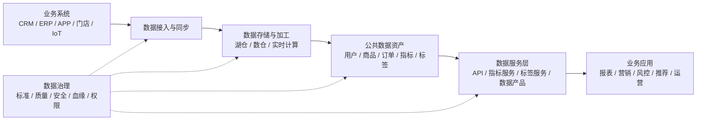

# 数据中台概述 - 不是大平台，而是可复用的数据能力

> [!abstract] 📋 本节概览
> - 🎯 **学习目标**：理解数据中台真正解决什么问题，以及什么情况下不该盲目建设数据中台
> - 📚 **前置知识**：建议先了解 [[【数据分析与数据运营】/98-专业术语词典/04-数据工程类/数据治理|数据治理]]、数据仓库、数据服务架构
> - ⏱️ **预计用时**：35分钟
> - 💡 **核心收获**：能用业务语言解释数据中台，并能判断企业是否真的需要建设数据中台

## 先说结论

数据中台不是一个“大数据平台升级版”，也不是买一套厂商产品就能得到的东西。它真正要解决的是：**企业的数据能力能不能被反复复用，而不是每来一个需求就重新拉数、重新建表、重新解释口径。**

如果一家公司的数据团队每天都在重复做三件事——接同样的数据、算同样的指标、解释同样的口径——那它需要的可能不是更多人，而是一层可复用的数据能力。

这层能力，通常就被叫作数据中台。

> [!tip] 一句话理解
> **数据中台就是把分散在各业务线、各系统、各项目里的数据能力沉淀成统一、可复用、可治理的数据资产和数据服务。**

但也要先泼一盆冷水：不是所有公司都适合做数据中台。业务还没跑通、数据需求变化剧烈、团队只有几个人的时候，过早建设中台，很容易把自己拖进“平台很大、没人愿意用”的泥潭。

## 真实工作场景：数据中台通常从“重复建设”里长出来

数据中台不是凭空设计出来的，它通常出现在企业发展到某个阶段之后。

### 场景一：每条业务线都有一套自己的数据烟囱

电商业务有自己的会员表，线下门店有自己的会员表，小程序也有自己的会员表。每个团队都说自己有用户数据，但没人能回答一个简单问题：

> “这个用户到底是不是同一个人？”

于是营销活动做不准，用户画像拼不起来，会员权益无法统一。业务越多，数据越乱。

这时候，数据中台要做的不是再建一个更大的库，而是沉淀统一的用户识别、会员标签、交易事实和数据服务能力。

### 场景二：数据开发被低价值需求淹没

业务每天提需求：

- 帮我拉一下最近 30 天复购用户。
- 帮我算一下不同渠道转化率。
- 帮我做一个会员分层标签。
- 帮我给推荐系统提供一份商品宽表。

这些需求看起来都不一样，但底层逻辑高度重复。如果每次都从 ODS 到 DWD 到 ADS 重新走一遍，数据团队会永远忙，但很难积累。

数据中台的价值在这里：把高频数据能力做成公共资产，例如统一指标、标签服务、用户画像、商品主数据、数据 API，让后续需求不再从零开始。

### 场景三：老板想要“数据驱动”，但组织里没人相信数据

经营会上，运营、财务、产品、市场各拿一套数字。报表都有，但没人信；指标很多，但没人敢拍板。

这不是看板问题，而是数据资产缺少统一口径、质量规则和责任机制。没有 [[【数据分析与数据运营】/98-专业术语词典/04-数据工程类/数据治理|数据治理]] 的中台，只是一个更大的数据仓库；没有业务参与的中台，只是数据团队自己的工程玩具。

## 什么是数据中台？

从架构角度看，数据中台是一层位于业务系统和数据应用之间的共享数据能力层。

它通常包括三类东西：

1. **共享数据资产**：统一用户、商品、订单、组织、设备等核心数据对象。
2. **共享数据服务**：通过指标、标签、画像、API、数据产品等方式向业务提供能力。
3. **共享治理机制**：统一标准、质量、安全、血缘、权限和资产运营规则。

可以用下面这个简化图理解：

这个图里最关键的不是技术组件，而是中间的“公共数据资产”和“数据服务层”。如果一个平台只有采集、存储、计算，但没有可复用的数据资产和服务，那它更像数据平台，不一定是数据中台。

## 数据中台和数据仓库、数据湖、数据平台有什么区别？

| 概念 | 更关注什么 | 典型问题 | 和数据中台的关系 |
|---|---|---|---|
| 数据仓库 | 结构化数据建模和分析 | 数据如何分层、建模、汇总 | 常常是数据中台的数据底座之一 |
| 数据湖 | 多类型数据的低成本存储 | 原始数据如何统一存放 | 可作为中台的存储底座，但本身不等于中台 |
| 数据平台 | 采集、存储、计算、调度等技术能力 | 数据如何被处理 | 提供技术底座，但未必沉淀业务能力 |
| 数据中台 | 数据能力的复用和服务化 | 业务如何更快、更一致地使用数据 | 更强调资产、服务、治理和运营 |

一个简单判断：

- 你在讨论表怎么建、任务怎么跑，多半是在谈数据仓库或数据平台。
- 你在讨论用户标签如何复用、指标口径谁负责、数据能力如何服务多个业务，多半是在谈数据中台。

## 数据中台真正解决的五类问题

### 1. 解决重复建设

同一个用户宽表、商品宽表、交易指标，不应该每个项目都建一遍。数据中台要把高频通用能力沉淀下来。

### 2. 解决口径不一致

指标口径、字段含义、业务对象定义要有统一规则。否则中台建得越大，混乱传播得越快。

### 3. 解决响应慢

业务提出一个常见数据需求，不应该每次都排期两周。如果底层资产和服务已经沉淀，很多需求应该从“开发交付”变成“配置使用”。

### 4. 解决数据不可发现

很多企业不是没有数据，而是不知道数据在哪里、能不能用、谁负责。数据目录、元数据、血缘和资产运营，是中台必须面对的问题。

### 5. 解决数据服务不可控

当数据通过报表、接口、标签、模型、下载文件等方式被大量使用时，权限、审计、质量和 SLA 都必须可控。

## 新手最容易误解的地方

### 误区一：把数据中台等同于采购平台

厂商可以提供工具，但不能替企业定义核心指标、业务对象和组织责任。没有数据标准和业务共识，再漂亮的平台也只是一个入口。

### 误区二：以为数据中台必须“大而全”

很多失败的中台项目都有一个共同特征：一上来就想覆盖全公司、全业务、全数据域。结果周期很长，价值很慢，业务等不及，最后变成内部展示系统。

更好的做法是从一个高频数据域开始，例如用户域、商品域、交易域、财务域或风控域。

### 误区三：以为中台会让业务方不用管数据

恰恰相反，真正的数据中台更需要业务参与。因为数据中台沉淀的是业务能力，不只是技术能力。用户怎么算、商品怎么分、订单状态怎么定义，这些都离不开业务共识。

### 误区四：以为数据中台已经过时，所以不用学

“数据中台”这个词的热度确实不像前几年那么高，但它背后的需求没有消失：数据复用、指标统一、语义层、数据产品、数据治理、AI-ready Data，这些问题今天仍然存在。

概念会换名字，问题不会自动消失。

### 误区五：小团队也照搬大厂中台

如果团队只有几个人，业务还在试错，最好的“中台”可能只是一套清晰的数据模型、指标口径文档、几个稳定的数据集和一套基础调度规范。不要为了叫中台而中台。

## 真正落地时怎么判断要不要做？

可以用四个问题判断。

### 问题一：有没有足够多的重复需求？

如果 70% 的数据需求都是一次性、探索性、变化很快的需求，中台化不一定划算。中台适合沉淀高频、稳定、跨业务复用的能力。

### 问题二：有没有多个业务方共享同类数据？

只有一个业务线时，做一个干净的数仓和报表体系可能就够了。当多个业务线都在使用用户、商品、订单、门店、设备等核心对象时，中台价值才会放大。

### 问题三：有没有统一口径的组织基础？

如果业务方不愿意共同定义指标和对象，中台很难成功。技术团队可以建表、建服务，但无法单方面决定业务含义。

### 问题四：有没有可见的价值闭环？

早期中台项目一定要能说清：做完后，哪个业务动作会更快、更准、更省。比如营销圈选从 3 天缩短到半天，核心指标争议减少，接口复用率提高，重复开发减少。

## 一个具体例子：从“统一会员数据服务”开始

假设一家连锁零售企业同时有线下门店、线上商城、会员小程序和社群运营。每个渠道都有自己的会员数据，业务想做精准营销，但经常遇到几个问题：

- 同一个人在线下和线上是两个账号；
- 会员等级、积分、消费次数对不上；
- 运营每次做人群圈选都要找数据团队拉数；
- 推荐系统、短信系统、企微运营都需要会员标签，但字段来源不一致。

这时候如果直接说“我们要建设企业级数据中台”，范围太大，也容易空。更稳的切口是：先做会员域的数据中台能力。

### 第一步：统一会员识别

明确会员唯一标识规则，处理手机号、设备号、会员卡号、微信 openid 等标识之间的关系。这里可以参考 [[【数据治理与数据管理】/02-深度研究/03-技术架构/数据架构/02-数据中台/OneID统一身份|OneID统一身份]] 的思路。

### 第二步：沉淀会员主数据和交易事实

把会员基础信息、注册渠道、消费记录、积分权益、互动行为整理成稳定的数据资产，而不是每个活动临时拼一份宽表。

### 第三步：定义可复用标签和指标

例如：高价值会员、沉睡会员、新客首购、近 30 天复购、优惠敏感度、品类偏好等。每个标签要有清晰口径、更新时间、负责人和适用场景。

### 第四步：提供服务化能力

不要只给业务一张表，而要提供可使用的能力：

- 运营可以在圈选工具中选择人群；
- 推荐系统可以通过接口获取标签；
- BI 看板可以复用统一会员指标；
- 营销系统可以调用会员分层结果。

### 第五步：建立治理和运营机制

会员数据必须有质量规则、权限控制、血缘追踪和效果反馈。否则标签越多，反而越难管理。

这个例子的关键不是技术多先进，而是把“会员数据”从一次次临时取数，变成了可以被持续复用的数据能力。

## 数据中台的核心架构：不要只背六层，要理解每层的责任

| 层次 | 主要责任 | 常见产物 |
|---|---|---|
| 数据接入层 | 把多源数据稳定接进来 | CDC、批量同步、实时采集、API 接入 |
| 存储计算层 | 支撑数据加工和计算 | 数仓、湖仓、实时计算、调度系统 |
| 公共数据层 | 沉淀可复用数据资产 | 主题域、明细层、汇总层、标签、指标 |
| 数据服务层 | 把数据能力交付给业务 | 数据 API、指标服务、标签服务、数据产品 |
| 应用场景层 | 支撑具体业务动作 | BI、营销、风控、推荐、经营分析 |
| 治理运营层 | 保证数据可信、可控、可持续 | 标准、质量、安全、血缘、权限、资产目录 |

真正考验能力的不是画出这张表，而是回答：哪些能力应该沉淀在公共层，哪些需求应该留在应用层？

我的建议是：**稳定、高频、跨业务复用的能力放进中台；临时、个性、快速试错的需求留在业务侧。**

## 数据中台建设路径

### 第一阶段：选一个高价值数据域做样板

不要一开始覆盖全公司。优先选择满足三个条件的数据域：

- 业务价值高；
- 复用需求多；
- 责任边界相对清楚。

常见选择是用户域、商品域、订单域、门店域、设备域、财务指标域。

### 第二阶段：把数据资产做稳

先把核心对象、核心事实、核心指标建扎实。别急着做花哨门户，也别急着堆很多组件。中台的底座如果不稳，服务层越丰富，出错越快。

### 第三阶段：用服务化方式交付

中台不能只停留在“我有表”。它应该让业务更容易用数据：指标可查、标签可选、接口可调、权限可控、质量可见。

### 第四阶段：建立数据资产运营机制

数据中台不是建完就结束。要持续看这些问题：

- 哪些数据资产被高频使用？
- 哪些接口没人调用？
- 哪些指标经常被质疑？
- 哪些标签效果不好？
- 哪些数据服务应该下线？

没有运营的数据中台，很快会变成一个堆满旧表和旧接口的仓库。

## 不适合做数据中台的情况

以下几种情况，建议先别急着上中台：

1. **业务还没稳定**：今天做社交，明天做电商，后天做 AI 工具，数据模型很难沉淀。
2. **数据规模不大**：几张核心表、几个固定报表就能解决问题，不必强行中台化。
3. **没有业务Owner**：所有口径都让数据团队拍脑袋，中台会失去业务合法性。
4. **只为汇报立项**：如果项目目标主要是“显得先进”，后期大概率没人用。
5. **基础治理太弱**：字段含义、质量规则、权限边界都没有，先补基础再谈中台。

## 可直接复用：数据中台启动检查清单

启动项目前，建议先问这 12 个问题：

- [ ] 现在最痛的问题是重复建设、口径不一、响应慢，还是数据不可控？
- [ ] 哪个业务域最适合作为第一阶段样板？
- [ ] 这个数据域有没有明确的业务Owner和数据Owner？
- [ ] 当前有哪些高频复用的数据需求？
- [ ] 哪些指标、标签、数据集值得沉淀为公共资产？
- [ ] 哪些需求不应该进中台，而应该留在业务应用侧？
- [ ] 数据质量规则是否明确？出了问题谁负责？
- [ ] 权限、脱敏、审计是否满足安全要求？
- [ ] 业务使用数据的入口是什么？BI、API、标签平台，还是数据集市？
- [ ] 中台建设完成后，如何衡量复用率和业务价值？
- [ ] 是否有资产下线机制，避免旧表、旧接口无限堆积？
- [ ] 这件事是业务真的需要，还是技术团队单方面想做？

## 面试 / 汇报时怎么讲

如果面试官问“你怎么理解数据中台”，可以这样回答：

> 我理解的数据中台不是单一工具，而是一套把数据能力资产化、服务化和治理化的机制。它的核心价值是减少重复建设，统一关键数据口径，并把高频数据能力沉淀成可以被多个业务复用的服务。真正落地时，我会先从一个高价值数据域切入，比如用户域或交易域，先沉淀核心对象、指标、标签和数据服务，再通过治理机制保证质量、权限和责任边界。数据中台不是越大越好，关键是能不能被业务持续使用。

如果给老板汇报，可以更短：

> 数据中台不是再建一个大平台，而是把公司反复使用的数据能力沉淀下来。它要解决的是同一个数据重复建设、同一个指标反复解释、同一个需求反复开发的问题。我们不建议一开始铺全公司，应该先选一个高价值数据域做样板，证明它能提升响应速度、减少重复开发，再逐步扩展。

## 掌握检查

- [ ] 能解释数据中台和数据仓库、数据平台的区别。
- [ ] 能说清数据中台真正解决的五类问题。
- [ ] 能判断什么情况下适合建设数据中台，什么情况下不适合。
- [ ] 能用一个具体数据域说明数据中台如何落地。
- [ ] 能说清中台建设为什么离不开数据治理和业务Owner。

## 学习连接与延伸阅读

### 本专题继续学习

- [[【数据开发与数据架构】/08-数据中台架构/02-数据中台架构设计|数据中台架构设计]]：学习数据中台的详细架构设计方法
- [[【数据开发与数据架构】/08-数据中台架构/03-数据中台核心组件|数据中台核心组件]]：理解中台核心组件如何组合
- [[【数据开发与数据架构】/08-数据中台架构/04-数据中台数据层|数据中台数据层]]：掌握公共数据层和主题域建设
- [[【数据开发与数据架构】/08-数据中台架构/05-数据中台服务层|数据中台服务层]]：理解数据 API、指标服务和标签服务
- [[【数据开发与数据架构】/08-数据中台架构/08-数据中台建设路径|数据中台建设路径]]：继续学习分阶段落地方法

### 相关知识

- [[【数据分析与数据运营】/98-专业术语词典/04-数据工程类/数据治理|数据治理]]：理解数据中台为什么离不开治理
- [[【数据治理与数据管理】/02-深度研究/03-技术架构/数据架构/02-数据中台/OneData方法论|OneData方法论]]：理解统一数据标准和指标口径
- [[【数据治理与数据管理】/02-深度研究/03-技术架构/数据架构/02-数据中台/OneID统一身份|OneID统一身份]]：理解用户统一识别的典型中台能力
- [[【数据治理与数据管理】/02-深度研究/03-技术架构/数据架构/02-数据中台/OneService统一服务|OneService统一服务]]：理解数据服务化交付思路
- [[【数据开发与数据架构】/09-实时数据架构/01-实时数据架构概述|实时数据架构]]：理解实时化数据能力如何接入中台
- [[【数据开发与数据架构】/10-云原生数据架构/01-云原生数据架构概述|云原生数据架构]]：理解云环境下的数据平台能力
