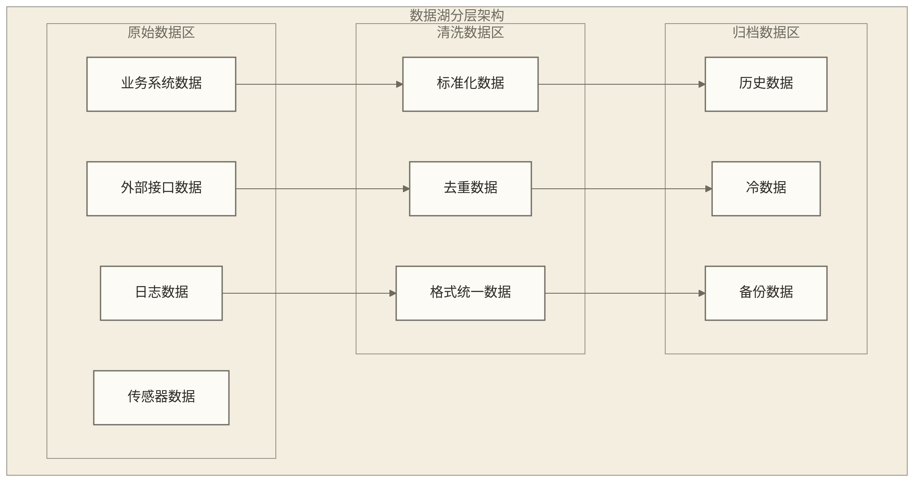
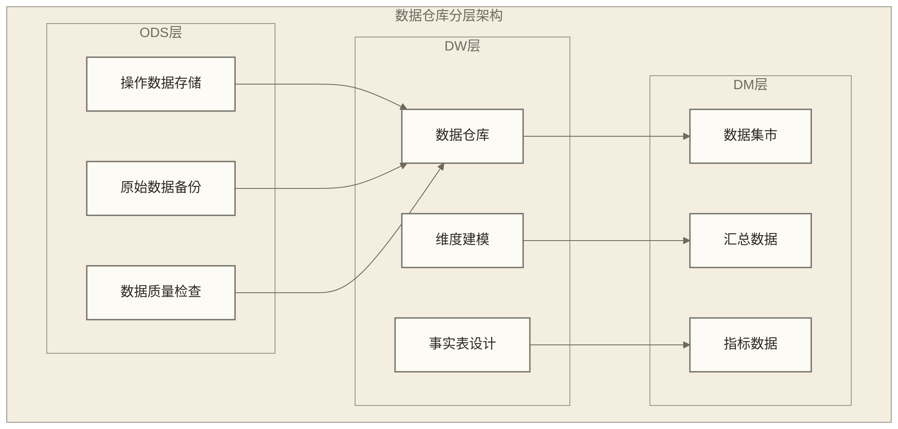
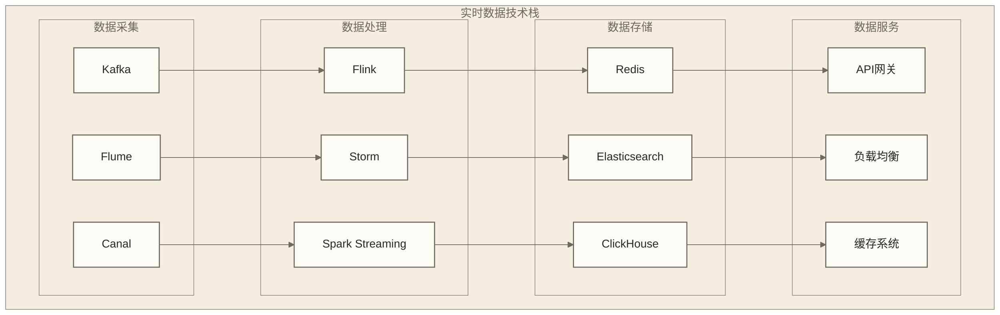
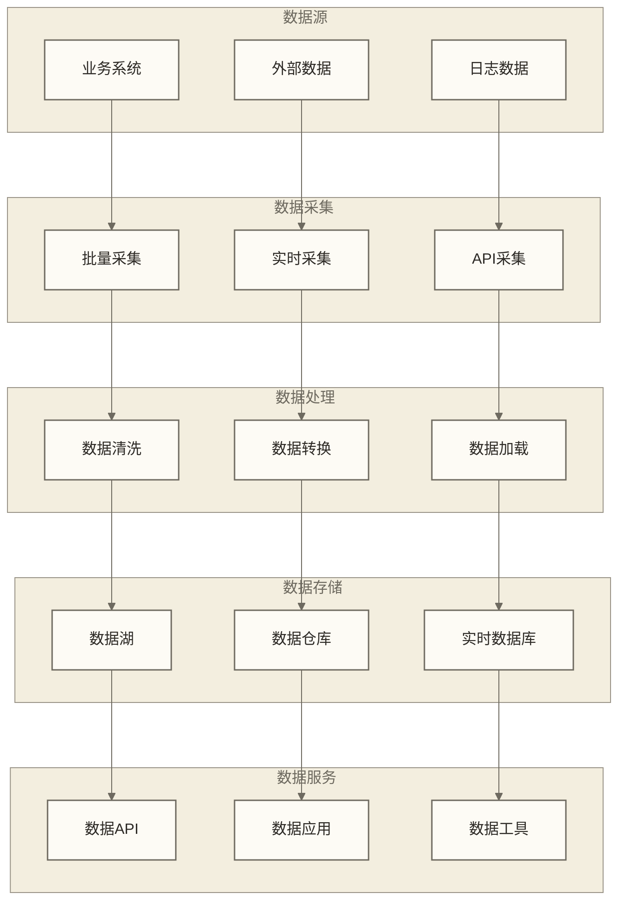

# 数据中台数据层 - 企业数据资产的核心载体

> [!abstract] 📋 本节概览
> - 🎯 学习目标：掌握数据中台数据层的架构设计和存储策略
> - 📚 前置知识：[[【数据开发与数据架构】/08-数据中台架构/01-数据中台概述|数据中台]], [[【数据开发与数据架构】/08-数据中台架构/02-数据中台架构设计|数据中台架构]], [[【数据开发与数据架构】/08-数据中台架构/03-数据中台核心组件|数据中台核心组件]]
> - ⏱️ 预计用时：25分钟

## 🏛️ 数据层：企业数据的"黄金宝库"

数据中台数据层是**现代企业数据资产的存储基石**，代表了数据存储从分散孤岛向统一治理的架构演进。

**数据层的价值**：
- 🎯 **统一存储**：构建企业级数据统一存储和管理体系
- ⚡ **分层治理**：通过数据分层实现不同场景的最优存储策略
- 🔍 **质量保障**：建立从原始到应用的数据质量管控流程
- 📊 **服务赋能**：为上层应用提供高质量的数据服务能力

从分散存储到统一数据层，正在重新定义企业数据资产的管理模式。
## 💡 数据层架构设计

> [!abstract] 🎯 数据中台三层数据架构
> 本文以"数据湖+[[【数据分析与数据运营】/98-专业术语词典/04-数据工程类/数据仓库|数据仓库]]+实时数据层"作为三层数据架构示例，满足不同场景的数据需求

```mermaid
%%{init: {"theme":"base","themeVariables":{"fontFamily":"PingFang SC, -apple-system, Source Han Serif SC, serif","fontSize":"16px","background":"#FDFBF5","primaryColor":"#FDFBF5","primaryTextColor":"#2D2A26","primaryBorderColor":"#6E6A60","secondaryColor":"#E8EFE8","secondaryBorderColor":"#8FA890","secondaryTextColor":"#2D2A26","tertiaryColor":"#FDFBF5","tertiaryBorderColor":"#9A9488","tertiaryTextColor":"#6E6A60","lineColor":"#6E6A60","textColor":"#2D2A26","mainBkg":"#FDFBF5","nodeBorder":"#2D5A3D","clusterBkg":"#F3EEDF","clusterBorder":"#9A9488","edgeLabelBackground":"#FDFBF5"},"flowchart":{"htmlLabels":true,"curve":"basis","padding":20,"nodeSpacing":60,"rankSpacing":70,"useMaxWidth":false},"themeCSS":".node rect, .node polygon, .node circle { stroke-width: 1.5px; } .edgePath .path { stroke-width: 1.5px; } .cluster-label .nodeLabel, .cluster-label foreignObject { color: #2D2A26 !important; } .edgeLabel, .edgeLabel foreignObject { color: #2D2A26 !important; background-color: #FDFBF5; } .edgeLabel rect { fill: #FDFBF5; }"}}%%
flowchart TB
    classDef default fill:#FDFBF5,stroke:#6E6A60,color:#2D2A26,stroke-width:1.5px
    classDef startend fill:#2D2A26,stroke:#2D2A26,color:#FDFBF5,font-weight:bold
    classDef decision fill:#F6EAD8,stroke:#C08A1A,color:#2D2A26,font-weight:bold
    classDef hub fill:#3B5A80,stroke:#3B5A80,color:#FDFBF5,font-weight:bold
    classDef io fill:#E5EAF0,stroke:#3B5A80,color:#2D2A26
    classDef accent fill:#A6432C,stroke:#A6432C,color:#FDFBF5,font-weight:bold
    classDef storage fill:#F3EEDF,stroke:#9A9488,color:#2D2A26
    subgraph "数据中台数据层架构"
        subgraph "数据源层"
            S1[业务系统]
            S2[外部数据]
            S3[IoT设备]
            S4[日志数据]
        end
        subgraph "数据湖层"
            L1[原始数据区]
            L2[清洗数据区]
            L3[归档数据区]
        end
        subgraph "数据仓库层"
            W1[ODS操作数据存储]
            W2[DW数据仓库]
            W3[DM数据集市]
        end
        subgraph "实时数据层"
            R1[实时数据库]
            R2[缓存系统]
            R3[消息队列]
        end
        subgraph "数据服务层"
            V1[数据API]
            V2[数据应用]
            V3[数据工具]
        end
    end
    S1 --> L1
    S2 --> L1
    S3 --> L1
    S4 --> L1
    L1 --> L2
    L2 --> W1
    W1 --> W2
    W2 --> W3
    L2 --> R1
    W3 --> R2
    R1 --> V1
    R2 --> V1
    W3 --> V2
    V1 --> V3
    class S1,S2,S3,S4,L1,L2,L3,W1,W2,W3,R1,R2,R3,V1,V2,V3 default
```

## 🌊 数据湖层设计

### 1. 数据湖概念与价值
**概念解释**：数据湖是一个集中式存储系统，可以存储任何规模、任何格式的原始数据

**生活化类比**：就像自然湖泊，可以容纳雨水、河水、地下水等各种水源，保持原始状态，需要时再进行加工利用

**核心价值**：
- **数据完整性**：保存所有原始数据，不丢失任何信息
- **灵活性**：支持多种数据格式和分析方式
- **成本效益**：低成本的存储方案
- **创新支持**：为数据探索和创新提供基础

### 2. 数据湖分层设计

**分层说明**：
- **原始数据区**：存储从各个数据源采集的原始数据，保持数据原始状态
- **清洗数据区**：对原始数据进行基础清洗和标准化处理
- **归档数据区**：存储历史数据和冷数据，用于长期保存和合规要求

### 3. 数据湖技术实现
**存储技术**：
- **分布式文件系统**：[[【技术与工具】/Hadoop/04-HDFS操作与管理|Hadoop - HDFS操作与管理]]等
- **对象存储**：S3等，支持大规模、低成本的数据存储
- **列式存储**：Parquet、ORC等高效存储格式

**计算引擎**：
- **批处理引擎**：[[【技术与工具】/Spark/10-数据读取与写入|Spark - 数据读取与写入]]、Hive等大规模数据处理
- **流处理引擎**：[[【数据分析与数据运营】/98-专业术语词典/07-基础概念类/18-Flink生产部署|Flink生产部署]]、Storm等实时数据处理
- **查询引擎**：Presto、Impala等交互式查询

## 🏢 数据仓库层设计

### 1. 数据仓库架构模式
**概念解释**：数据仓库是面向分析的结构化数据存储系统，采用星型或雪花型模型

**生活化类比**：就像大型超市的仓库，按照商品分类整齐存放，便于快速查找和统计

**架构特点**：
- **主题导向**：按照业务主题组织数据
- **集成性**：整合多个数据源的数据
- **非易失性**：数据一旦写入，不会随意修改
- **时变性**：记录数据随时间的变化

### 2. 数据仓库分层设计

**分层说明**：
- **ODS层**：操作数据存储，存储从数据湖清洗后的数据
- **DW层**：数据仓库核心层，采用维度建模方法
- **DM层**：数据集市层，面向特定业务主题的汇总数据

### 3. 维度建模设计
**建模方法**：
- **星型模型**：一个事实表连接多个维度表
- **雪花模型**：维度表进一步规范化
- **星座模型**：多个事实表共享维度表

**设计原则**：
- **业务导向**：以业务需求为导向设计模型
- **性能优先**：优化查询性能
- **可扩展性**：支持业务扩展
- **一致性**：保持数据一致性

## ⚡ 实时数据层设计

### 1. 实时数据架构
**概念解释**：实时数据层支持毫秒级的数据读写，满足实时业务需求

**生活化类比**：就像高速公路，支持车辆的高速通行，确保实时到达目的地

**架构特点**：
- **低延迟**：毫秒级的数据处理延迟
- **高并发**：支持高并发访问
- **高可用**：保证系统的高可用性
- **实时同步**：数据实时同步更新

### 2. 实时数据技术栈

### 3. 实时数据处理流程
**处理流程**：
1. **数据采集**：从数据源实时采集数据
2. **数据清洗**：对数据进行实时清洗和转换
3. **数据计算**：进行实时计算和聚合
4. **[[【数据开发与数据架构】/09-实时数据架构/04-实时数据存储|实时数据存储]]**：将结果存储到实时数据库
5. **数据服务**：通过API提供实时数据服务

## 🔄 数据流转与集成

### 1. 数据流转架构

### 2. 数据集成策略
**集成方式**：
- **ETL集成**：抽取、转换、加载的传统集成方式
- **ELT集成**：抽取、加载、转换的现代集成方式
- **实时集成**：基于消息队列的实时数据集成
- **API集成**：基于API的数据服务集成

**集成原则**：
- **数据一致性**：确保数据在不同系统间的一致性
- **[[【数据分析与数据运营】/02-数据分析专业能力/01-分析方法论/05-数据质量评估方法|数据分析专业能力 - 数据质量评估]]**：保证集成数据的质量
- **性能优化**：优化数据集成性能
- **可扩展性**：支持新的数据源集成

## 📊 数据层性能优化

### 1. 存储性能优化
**优化策略**：
- **分区策略**：按时间、地区等维度进行数据分区
- **索引优化**：建立合适的索引提高查询性能
- **压缩算法**：使用高效的压缩算法减少存储空间
- **缓存机制**：建立多级缓存提高访问性能

### 2. 查询性能优化
**优化方法**：
- **查询优化**：优化SQL查询语句
- **并行处理**：利用并行计算提高处理速度
- **预计算**：预先计算常用指标
- **数据倾斜**：处理数据倾斜问题

### 3. 成本优化策略
**成本控制**：
- **存储分层**：热数据、温数据、冷数据分层存储
- **生命周期管理**：自动管理数据生命周期
- **资源弹性**：根据需求弹性调整资源
- **成本监控**：实时监控数据存储成本

## ✅ 掌握检查

- [ ] 理解数据中台三层数据架构的设计理念
- [ ] 掌握数据湖的分层设计和应用场景
- [ ] 熟悉数据仓库的维度建模方法
- [ ] 了解实时数据层的技术架构和实现
- [ ] 掌握数据流转和集成的策略方法
- [ ] 能够进行数据层性能优化和成本控制
- [ ] 能够结合实际业务场景设计数据层架构

## 🔗 学习连接

**前置知识**: [[【数据开发与数据架构】/08-数据中台架构/01-数据中台概述|数据中台]], [[【数据开发与数据架构】/08-数据中台架构/02-数据中台架构设计|数据中台架构]], [[【数据开发与数据架构】/08-数据中台架构/03-数据中台核心组件|数据中台核心组件]]
**相关概念**: [[【数据开发与数据架构】/08-数据中台架构/05-数据中台服务层|数据中台服务层]], [[【数据开发与数据架构】/08-数据中台架构/06-数据中台应用层|数据中台应用层]], [[【数据开发与数据架构】/08-数据中台架构/07-数据中台技术栈|数据中台技术栈]]
**下一步**: [[【数据开发与数据架构】/08-数据中台架构/08-数据中台建设路径|数据中台建设路径]] 