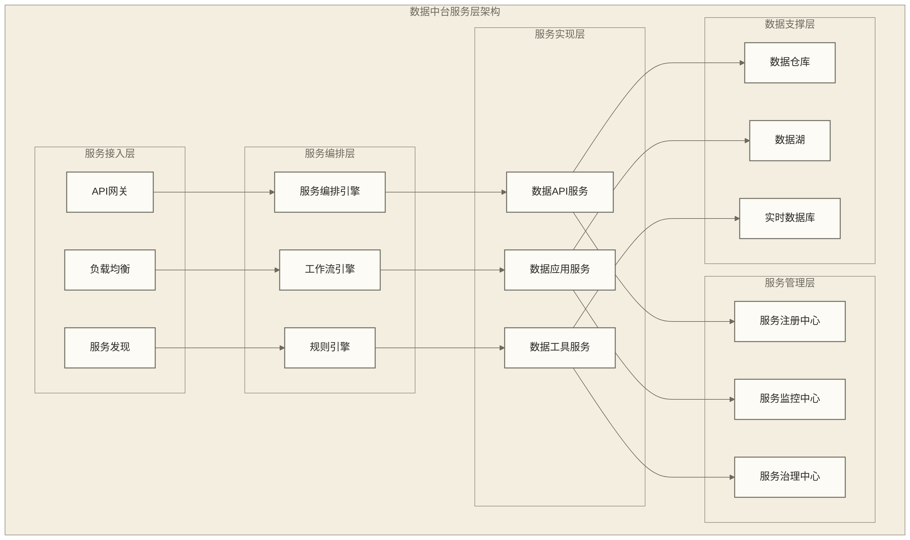
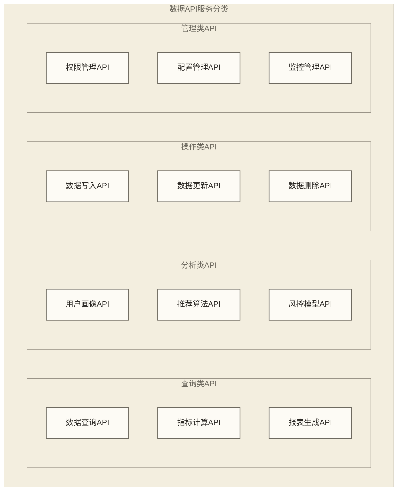
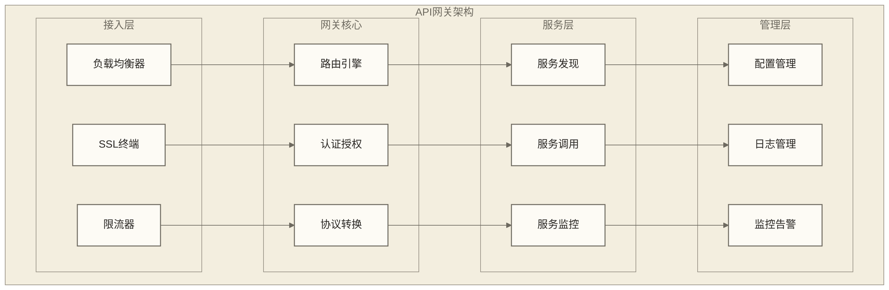
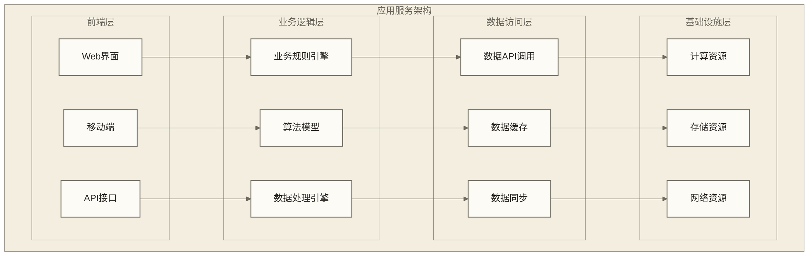
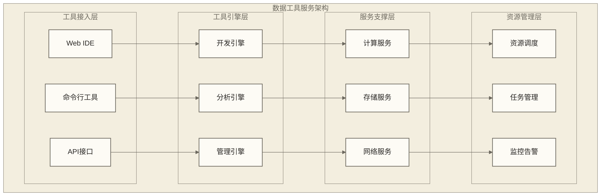
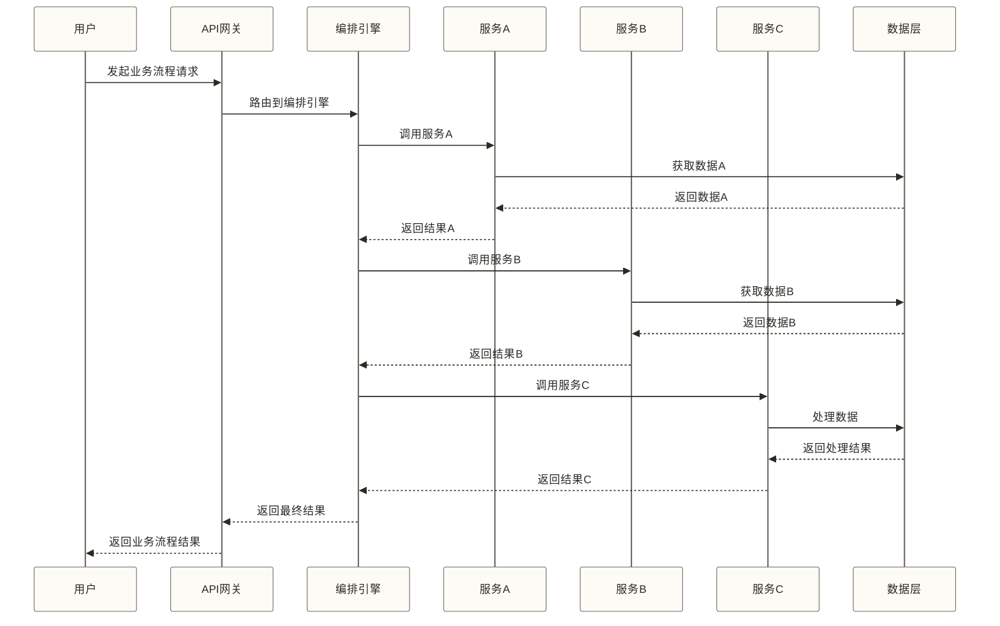
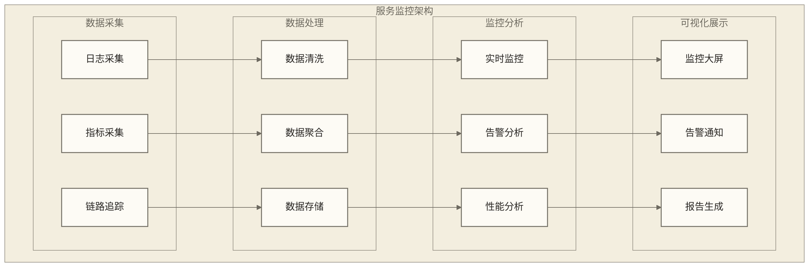

# 数据中台服务层 - 数据能力的服务化封装

> [!abstract] 📋 本节概览
> - 🎯 学习目标：掌握数据中台服务层的设计理念和服务化模式
> - 📚 前置知识：[[【数据开发与数据架构】/08-数据中台架构/01-数据中台概述|数据中台]], [[【数据开发与数据架构】/08-数据中台架构/02-数据中台架构设计|数据中台架构]], [[【数据开发与数据架构】/08-数据中台架构/03-数据中台核心组件|数据中台核心组件]], [[【数据开发与数据架构】/08-数据中台架构/04-数据中台数据层|数据中台数据层]]
> - ⏱️ 预计用时：30分钟

## ⚡ 服务层：数据价值的"输出引擎"

数据中台服务层是**数据价值变现的关键枢纽**，让数据能力从内部资产向业务服务的系统化价值输出。

**服务化的价值**：
- 🎯 **能力输出**：从数据储备向标准化API和业务服务的能力转化
- ⚡ **价值放大**：建立数据复用和能力共享的服务体系和商业模式
- 🔧 **敏捷响应**：掌握服务编排、快速开发和业务需求响应的实战技能
- 📈 **生态构建**：构建服务治理和合作伙伴接入的平台竞争力

在服务化架构时代，服务层是连接数据技术与商业价值的重要桥梁。
## 💡 服务层架构设计

> [!abstract] 🎯 数据中台服务层架构
> 本节以服务接入层、服务编排层、服务实现层、服务管理层和数据支撑层的五层划分示意数据中台服务架构，说明标准化数据服务的组成

## 🌐 数据API服务

### 1. API服务设计原则
**概念解释**：数据API服务是将数据能力封装成标准化接口，供业务系统调用

**生活化类比**：就像银行的ATM机，提供标准化的金融服务接口，用户可以通过统一的操作方式获取不同的服务

**设计原则**：
- **标准化**：统一的接口规范和调用方式
- **简单化**：降低使用门槛，提高易用性
- **高性能**：支持高并发、低延迟的访问
- **可扩展**：支持新服务的快速接入

### 2. API服务分类

**服务类型**：
- **查询类API**：提供数据查询和检索服务
- **分析类API**：提供数据分析和挖掘服务
- **操作类API**：提供数据增删改操作服务
- **管理类API**：提供系统管理和配置服务

### 3. API网关架构

## 🎯 数据应用服务

### 1. 应用服务概念
**概念解释**：数据应用服务是将多个数据能力组合封装，提供完整的业务解决方案

**生活化类比**：就像餐厅的特色套餐，将多个菜品组合在一起，提供完整的用餐体验

**服务特点**：
- **业务导向**：以解决具体业务问题为目标
- **功能完整**：提供端到端的解决方案
- **用户友好**：提供直观的用户界面
- **可定制**：支持个性化定制需求

### 2. 应用服务类型

| 服务类型 | 功能描述 | 应用场景 | 技术特点 |
|---|---|---|---|
| **用户画像服务** | 构建用户360度画像 | 精准营销、个性化推荐 | 多维度数据融合、实时更新 |
| **推荐引擎服务** | 智能推荐算法服务 | 电商推荐、内容推荐 | [[【数据分析与数据运营】/98-专业术语词典/03-技术算法类/机器学习.md\|机器学习]]、A/B测试 |
| **风控服务** | 风险识别和预警 | 金融风控、业务风控 | 规则引擎、模型预测 |
| **报表服务** | 数据报表和可视化 | 业务分析、决策支持 | 可视化组件、交互式分析 |
| **预测服务** | 趋势预测和预警 | 销售预测、库存预测 | 时间序列分析、[[【数据分析与数据运营】/98-专业术语词典/03-技术算法类/机器学习.md\|机器学习]] |

### 3. 应用服务架构

## 🔧 数据工具服务

### 1. 工具服务概念
**概念解释**：数据工具服务是提供数据开发、分析、管理的工具和平台

**生活化类比**：就像专业的工具箱，为数据工程师提供各种专业工具，提高工作效率

**工具类型**：
- **开发工具**：数据开发、ETL工具
- **分析工具**：[[【数据分析与数据运营】/00-数据分析与数据运营导览|【数据分析与运营】知识体系整合总结 - 【数据分析与运营】知识体系整合总结]]、可视化工具
- **管理工具**：[[【数据分析与数据运营】/98-专业术语词典/04-数据工程类/数据治理|数据治理]]、监控工具
- **协作工具**：团队协作、版本管理工具

### 2. 工具服务架构

## 🔄 服务编排与集成

### 1. 服务编排概念
**概念解释**：服务编排是将多个独立的服务组合编排，形成复杂的业务流程

**生活化类比**：就像乐队的指挥，协调各个乐器的演奏，形成完整的音乐作品

**编排能力**：
- **服务组合**：将多个服务组合成业务流程
- **条件分支**：根据条件执行不同的服务分支
- **异常处理**：处理服务执行过程中的异常
- **性能优化**：优化服务组合的执行性能

### 2. 服务编排流程

### 3. 服务集成模式
**集成方式**：
- **同步集成**：服务间同步调用，实时响应
- **异步集成**：通过消息队列异步处理
- **事件驱动**：基于事件的松耦合集成
- **API集成**：通过标准化API接口集成

## 📊 服务治理与监控

### 1. 服务治理体系
**治理维度**：
- **服务注册**：服务发现和注册管理
- **服务配置**：服务配置的统一管理
- **服务监控**：服务运行状态的监控
- **服务安全**：服务访问的安全控制

### 2. 服务监控架构

### 3. 服务质量保障
**质量指标**：
- **可用性**：服务可用时间和故障恢复时间
- **性能**：响应时间、吞吐量、并发能力
- **稳定性**：错误率、异常处理能力
- **安全性**：数据安全、访问控制

## 🎯 服务化实施策略

### 1. 分阶段实施
**实施阶段**：
1. **基础服务**：先建设核心的数据API服务
2. **应用服务**：基于API服务构建应用服务
3. **工具服务**：提供开发和管理工具
4. **编排服务**：实现服务编排和集成

### 2. 关键成功因素
**成功要素**：
- **标准化**：建立统一的服务标准
- **文档化**：完善的服务文档和使用指南
- **测试化**：全面的服务测试和质量保障
- **监控化**：完善的服务监控和运维体系

## ✅ 掌握检查

- [ ] 理解数据中台服务层的设计理念和架构模式
- [ ] 掌握数据API服务的设计原则和分类方法
- [ ] 熟悉数据应用服务的类型和架构特点
- [ ] 了解数据工具服务的功能和实现方式
- [ ] 掌握服务编排和集成的技术方法
- [ ] 理解服务治理和监控的体系架构
- [ ] 能够制定服务化实施策略和方案

## 🔗 学习连接

**前置知识**: [[【数据开发与数据架构】/08-数据中台架构/01-数据中台概述|数据中台]], [[【数据开发与数据架构】/08-数据中台架构/02-数据中台架构设计|数据中台架构]], [[【数据开发与数据架构】/08-数据中台架构/03-数据中台核心组件|数据中台核心组件]], [[【数据开发与数据架构】/08-数据中台架构/04-数据中台数据层|数据中台数据层]]
**相关概念**: [[【数据开发与数据架构】/08-数据中台架构/06-数据中台应用层|数据中台应用层]], [[【数据开发与数据架构】/08-数据中台架构/07-数据中台技术栈|数据中台技术栈]], [[【数据开发与数据架构】/08-数据中台架构/08-数据中台建设路径|数据中台建设路径]]
**下一步**: [[【数据开发与数据架构】/07-数据服务架构/00-数据服务架构导览|数据服务架构导览]], 数据治理方法 