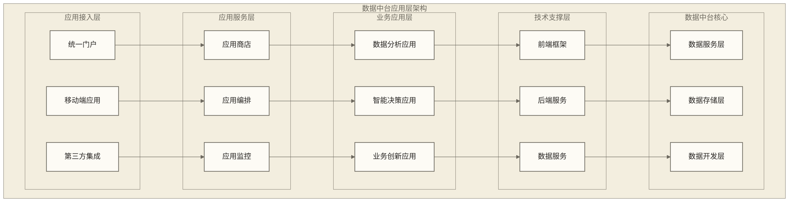
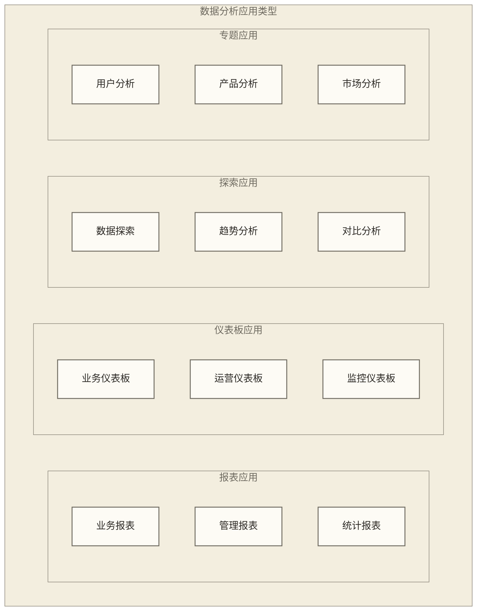
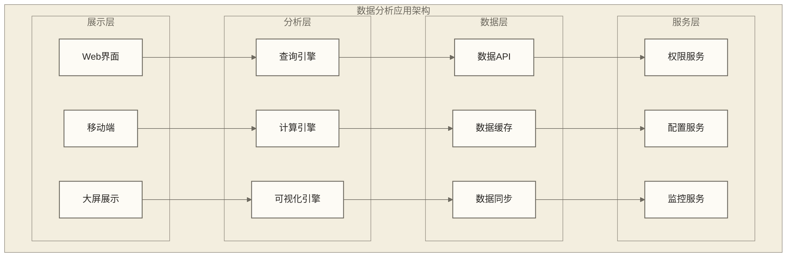
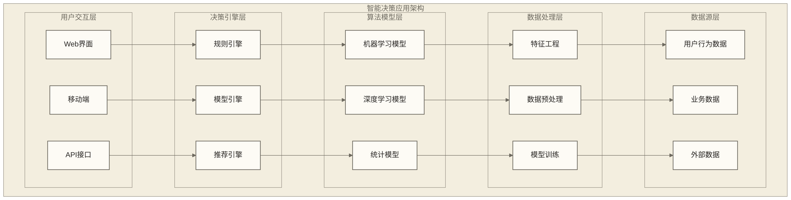
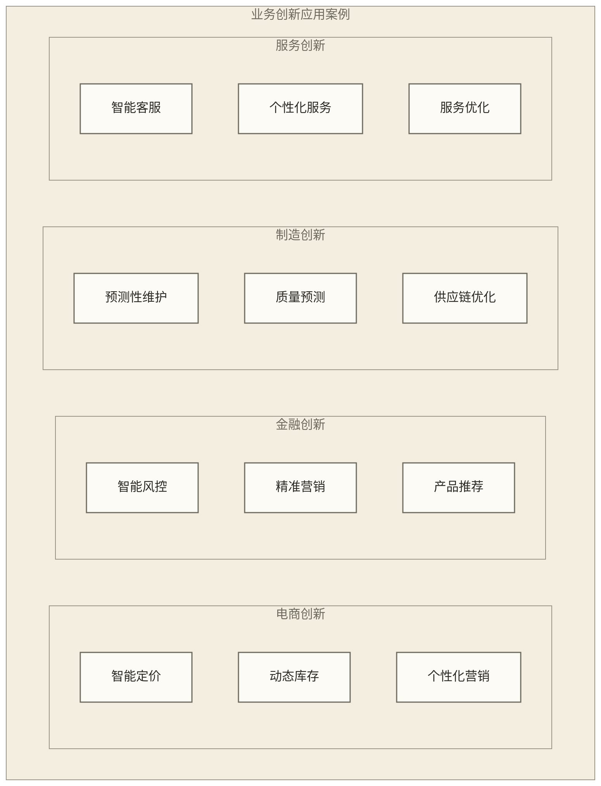
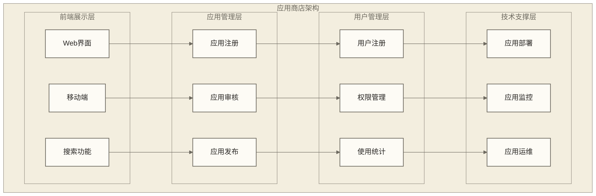
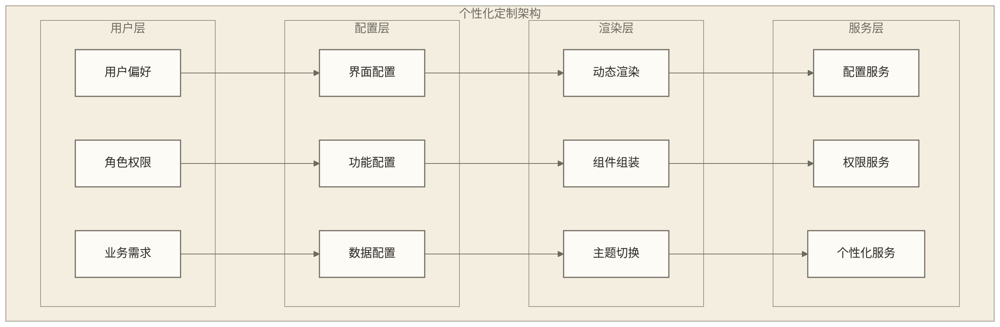

# 数据中台应用层 - 数据价值的业务化实现

> [!abstract] 📋 本节概览
> - 🎯 学习目标：掌握数据中台应用层的设计理念和业务应用模式
> - 📚 前置知识：[[【数据开发与数据架构】/08-数据中台架构/01-数据中台概述|数据中台]], [[【数据开发与数据架构】/08-数据中台架构/02-数据中台架构设计|数据中台架构]], [[【数据开发与数据架构】/08-数据中台架构/03-数据中台核心组件|数据中台核心组件]], [[【数据开发与数据架构】/08-数据中台架构/04-数据中台数据层|数据中台数据层]], [[【数据开发与数据架构】/08-数据中台架构/05-数据中台服务层|数据中台服务层]]
> - ⏱️ 预计用时：25分钟

## 🎨 应用层：业务价值的"创新工厂"

数据中台应用层是**数据驱动创新的前沿阵地**，让数据能力从技术底座向业务应用的系统化价值创造。

**应用创新的价值**：
- 🎯 **业务赋能**：从数据产品向智能决策和业务创新应用的转化
- ⚡ **用户体验**：建立直观易用的数据产品和个性化服务体验
- 🔧 **快速迭代**：了解应用开发、A/B测试和产品优化在迭代中的作用
- 📈 **商业变现**：构建数据产品和服务模式创新的商业竞争力

在产品化时代，应用层是连接数据技术与用户价值的重要桥梁。
## 💡 应用层架构设计

> [!abstract] 🎯 数据中台应用层架构
> 数据中台应用层采用"统一门户+应用商店+个性化定制"的应用架构，提供丰富的业务应用

## 📊 数据分析应用

### 1. 分析应用概念
**概念解释**：数据分析应用是基于数据中台能力构建的业务分析工具，帮助用户深入了解业务状况

**生活化类比**：就像医院的体检设备，通过各种检查帮助医生了解病人的健康状况

**应用特点**：
- **可视化展示**：直观的数据可视化界面
- **交互式分析**：支持用户交互式数据探索
- **实时更新**：数据实时更新和刷新
- **多维度分析**：支持多维度、多角度的数据分析

### 2. 分析应用类型

**应用分类**：
- **报表应用**：提供标准化的数据报表
- **仪表板应用**：提供实时监控和展示
- **探索应用**：支持灵活的数据探索
- **专题应用**：针对特定业务主题的分析

### 3. 分析应用架构

## 🧠 智能决策应用

### 1. 决策应用概念
**概念解释**：智能决策应用是基于数据分析和机器学习技术，为业务决策提供智能化支持

**生活化类比**：就像智能导航系统，根据实时路况为用户推荐最优路线

**应用特点**：
- **智能化**：基于算法模型的智能分析
- **预测性**：提供趋势预测和预警
- **个性化**：根据用户需求提供个性化建议
- **实时性**：支持实时决策支持

### 2. 决策应用类型

| 应用类型 | 功能描述 | 应用场景 | 技术特点 |
|---|---|---|---|
| **智能推荐** | 基于用户行为的个性化推荐 | 电商推荐、内容推荐 | 协同过滤、[[【数据分析与数据运营】/98-专业术语词典/03-技术算法类/深度学习技术\|深度学习技术]] |
| **风险预警** | 实时风险识别和预警 | 金融风控、业务风控 | 规则引擎、[[【数据分析与数据运营】/98-专业术语词典/03-技术算法类/机器学习\|机器学习]] |
| **预测分析** | 趋势预测和需求预测 | 销售预测、库存预测 | 时间序列、回归分析（仅术语提及，未提供教程链接） |
| **智能客服** | 基于AI的智能客服 | 客户服务、技术支持 | 自然语言处理、知识图谱 |
| **智能营销** | 精准营销和个性化营销 | 营销推广、客户运营 | 用户画像、营销自动化 |

### 3. 决策应用架构

## 🚀 业务创新应用

### 1. 创新应用概念
**概念解释**：业务创新应用是基于数据中台能力，推动业务模式创新和数字化转型

**生活化类比**：就像实验室里的创新项目，将新技术转化为实际应用

**创新方向**：
- **业务模式创新**：基于数据洞察的业务模式优化
- **产品服务创新**：基于用户需求的产品服务创新
- **运营模式创新**：基于数据驱动的运营模式创新
- **商业模式创新**：基于数据价值的商业模式创新

### 2. 创新应用案例

### 3. 创新应用开发流程

```mermaid
%%{init: {"theme":"base","themeVariables":{"fontFamily":"PingFang SC, -apple-system, Source Han Serif SC, serif","fontSize":"16px","background":"#FDFBF5","primaryColor":"#FDFBF5","primaryTextColor":"#2D2A26","primaryBorderColor":"#6E6A60","secondaryColor":"#E8EFE8","secondaryBorderColor":"#8FA890","secondaryTextColor":"#2D2A26","tertiaryColor":"#FDFBF5","tertiaryBorderColor":"#9A9488","tertiaryTextColor":"#6E6A60","lineColor":"#6E6A60","textColor":"#2D2A26","mainBkg":"#FDFBF5","nodeBorder":"#2D5A3D","clusterBkg":"#F3EEDF","clusterBorder":"#9A9488","edgeLabelBackground":"#FDFBF5"},"flowchart":{"htmlLabels":true,"curve":"basis","padding":20,"nodeSpacing":60,"rankSpacing":70,"useMaxWidth":false},"themeCSS":".node rect, .node polygon, .node circle { stroke-width: 1.5px; } .edgePath .path { stroke-width: 1.5px; } .cluster-label .nodeLabel, .cluster-label foreignObject { color: #2D2A26 !important; } .edgeLabel, .edgeLabel foreignObject { color: #2D2A26 !important; background-color: #FDFBF5; } .edgeLabel rect { fill: #FDFBF5; }"}}%%
flowchart TD
    classDef default fill:#FDFBF5,stroke:#6E6A60,color:#2D2A26,stroke-width:1.5px
    classDef startend fill:#2D2A26,stroke:#2D2A26,color:#FDFBF5,font-weight:bold
    classDef decision fill:#F6EAD8,stroke:#C08A1A,color:#2D2A26,font-weight:bold
    classDef hub fill:#3B5A80,stroke:#3B5A80,color:#FDFBF5,font-weight:bold
    classDef io fill:#E5EAF0,stroke:#3B5A80,color:#2D2A26
    classDef accent fill:#A6432C,stroke:#A6432C,color:#FDFBF5,font-weight:bold
    classDef storage fill:#F3EEDF,stroke:#9A9488,color:#2D2A26
    subgraph "创新应用开发流程"
        A[需求分析] --> B[数据探索]
        B --> C[原型设计]
        C --> D[技术验证]
        D --> E[应用开发]
        E --> F[测试验证]
        F --> G[上线部署]
        G --> H[效果评估]
        H --> I[持续优化]
    end
    class A,B,C,D,E,F,G,H,I default
```

## 🏪 应用商店模式

### 1. 应用商店概念
**概念解释**：应用商店是数据中台应用的统一管理和分发平台，提供应用的展示、下载和使用

**生活化类比**：就像手机应用商店，用户可以浏览、下载和使用各种应用

**商店功能**：
- **应用展示**：展示可用的数据应用
- **应用分类**：按功能、行业等维度分类
- **应用评价**：用户评价和反馈
- **应用推荐**：基于用户行为的智能推荐

### 2. 应用商店架构

### 3. 应用商店运营
**运营策略**：
- **应用生态**：构建丰富的应用生态
- **开发者激励**：激励内部和外部开发者
- **用户教育**：提供应用使用培训
- **效果评估**：评估应用使用效果

## 🎨 个性化定制

### 1. 定制化需求
**定制类型**：
- **界面定制**：根据用户偏好定制界面
- **功能定制**：根据业务需求定制功能
- **数据定制**：根据权限定制数据范围
- **流程定制**：根据业务流程定制工作流

### 2. 定制化架构

## 📈 应用效果评估

### 1. 评估指标体系
**业务指标**：
- **使用率**：应用的使用频率和用户数
- **满意度**：用户对应用的满意度评价
- **效率提升**：应用带来的工作效率提升
- **价值创造**：应用创造的业务价值

**技术指标**：
- **性能指标**：响应时间、吞吐量等
- **可用性指标**：系统可用性、故障率等
- **安全性指标**：数据安全、访问控制等

### 2. 评估方法
**评估方法**：
- **A/B测试**：对比不同版本的效果
- **用户调研**：收集用户反馈和意见
- **数据分析**：分析应用使用数据。相关导览：[[【数据分析与数据运营】/00-数据分析与数据运营导览|数据分析与数据运营导览]]。
- **ROI分析**：分析投资回报率

## ✅ 掌握检查

- [ ] 理解数据中台应用层的设计理念和架构模式
- [ ] 掌握数据分析应用的类型和架构特点
- [ ] 熟悉智能决策应用的功能和概念架构
- [ ] 了解业务创新应用的发展方向和应用案例
- [ ] 掌握应用商店的运营模式和管理方法
- [ ] 理解个性化定制的实现方式和技术架构
- [ ] 能够列举应用效果评估的主要指标和方法

## 🔗 学习连接

**前置知识**: [[【数据开发与数据架构】/08-数据中台架构/01-数据中台概述|数据中台]], [[【数据开发与数据架构】/08-数据中台架构/02-数据中台架构设计|数据中台架构]], [[【数据开发与数据架构】/08-数据中台架构/03-数据中台核心组件|数据中台核心组件]], [[【数据开发与数据架构】/08-数据中台架构/04-数据中台数据层|数据中台数据层]], [[【数据开发与数据架构】/08-数据中台架构/05-数据中台服务层|数据中台服务层]]
**相关概念**: [[【数据开发与数据架构】/08-数据中台架构/07-数据中台技术栈|数据中台技术栈]], [[【数据开发与数据架构】/08-数据中台架构/08-数据中台建设路径|数据中台建设路径]]
**下一步**: [[【数据分析与数据运营】/98-专业术语词典/04-数据工程类/数据可视化|数据可视化]], 智能决策系统相关技术 