# 实时数据监控 - 数据健康的守护者

> [!abstract] 📋 本节概览
> - 🎯 学习目标：理解实时数据监控的体系架构和实现方法
> - 📚 前置知识：[[【数据开发与数据架构】/09-实时数据架构/04-实时数据存储|实时数据存储]], [[【数据开发与数据架构】/09-实时数据架构/06-实时数据服务|实时数据服务]]
> - ⏱️ 预计用时：18分钟

## 👁️ 实时监控：数据健康的'守护神'

实时数据监控是**现代数据系统可靠性的核心保障**，让数据质量从被动检测向主动监控的系统化升级。

**实时监控的价值**：
- 🎯 **实时感知**：从批量检查向流式监控、实时告警和异常检测的敏捷转化
- ⚡ **质量保障**：建立数据准确性、完整性和时效性的全面体系
- 🔧 **自动化运维**：掌握指标采集、阈值设置和故障自愈的实战技能  
- 📈 **业务连续性**：构建7x24监控、快速响应和预防式维护的竞争优势

在实时计算时代，数据监控是连接系统稳定性与业务可靠性的重要桥梁。
## 💡 实时数据监控概念

> [!abstract] 🎯 什么是实时数据监控？
> 对数据系统进行持续、实时的监控，及时发现异常、告警通知，确保数据质量和系统稳定运行

### 实时监控 vs 传统监控

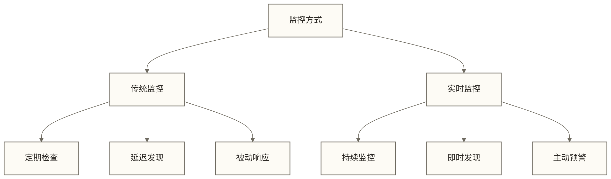

**生活化类比**：就像从定期体检到24小时健康监护的转变，问题发现更加及时。

### 实时数据监控的特点

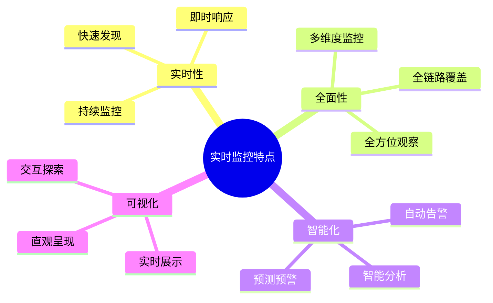

## 🔍 实时数据监控架构

### 1. 整体架构设计

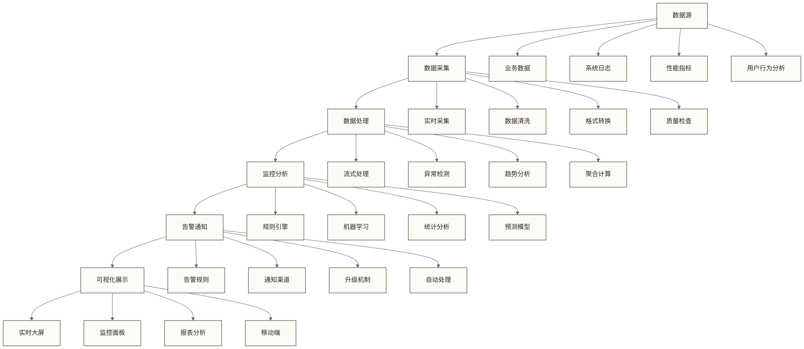

### 2. 监控层次架构

```mermaid
%%{init: {"theme":"base","themeVariables":{"fontFamily":"PingFang SC, -apple-system, Source Han Serif SC, serif","fontSize":"16px","background":"#FDFBF5","primaryColor":"#FDFBF5","primaryTextColor":"#2D2A26","primaryBorderColor":"#6E6A60","secondaryColor":"#E8EFE8","secondaryBorderColor":"#8FA890","secondaryTextColor":"#2D2A26","tertiaryColor":"#FDFBF5","tertiaryBorderColor":"#9A9488","tertiaryTextColor":"#6E6A60","lineColor":"#6E6A60","textColor":"#2D2A26","mainBkg":"#FDFBF5","nodeBorder":"#2D5A3D","clusterBkg":"#F3EEDF","clusterBorder":"#9A9488","edgeLabelBackground":"#FDFBF5"},"flowchart":{"htmlLabels":true,"curve":"basis","padding":20,"nodeSpacing":60,"rankSpacing":70,"useMaxWidth":false},"themeCSS":".node rect, .node polygon, .node circle { stroke-width: 1.5px; } .edgePath .path { stroke-width: 1.5px; } .cluster-label .nodeLabel, .cluster-label foreignObject { color: #2D2A26 !important; } .edgeLabel, .edgeLabel foreignObject { color: #2D2A26 !important; background-color: #FDFBF5; } .edgeLabel rect { fill: #FDFBF5; }"}}%%
flowchart TD
    classDef default fill:#FDFBF5,stroke:#6E6A60,color:#2D2A26,stroke-width:1.5px
    classDef startend fill:#2D2A26,stroke:#2D2A26,color:#FDFBF5,font-weight:bold
    classDef decision fill:#F6EAD8,stroke:#C08A1A,color:#2D2A26,font-weight:bold
    classDef hub fill:#3B5A80,stroke:#3B5A80,color:#FDFBF5,font-weight:bold
    classDef io fill:#E5EAF0,stroke:#3B5A80,color:#2D2A26
    classDef accent fill:#A6432C,stroke:#A6432C,color:#FDFBF5,font-weight:bold
    classDef storage fill:#F3EEDF,stroke:#9A9488,color:#2D2A26
    A[监控层次] --> B[基础设施监控]
    A --> C[应用系统监控]
    A --> D[数据质量监控]
    A --> E[业务指标监控]
    B --> B1[服务器监控]
    B --> B2[网络监控]
    B --> B3[存储监控]
    B --> B4[数据库监控]
    C --> C1[应用性能]
    C --> C2[接口监控]
    C --> C3[错误日志]
    C --> C4[用户行为分析]
    D --> D1[数据完整性]
    D --> D2[数据准确性]
    D --> D3[数据及时性]
    D --> D4[数据一致性]
    E --> E1[业务指标]
    E --> E2[用户指标]
    E --> E3[运营指标]
    E --> E4[财务指标]
    class A,B,C,D,E,B1,B2,B3,B4,C1,C2,C3,C4,D1,D2,D3,D4,E1,E2,E3,E4 default
```

### 3. 监控数据流

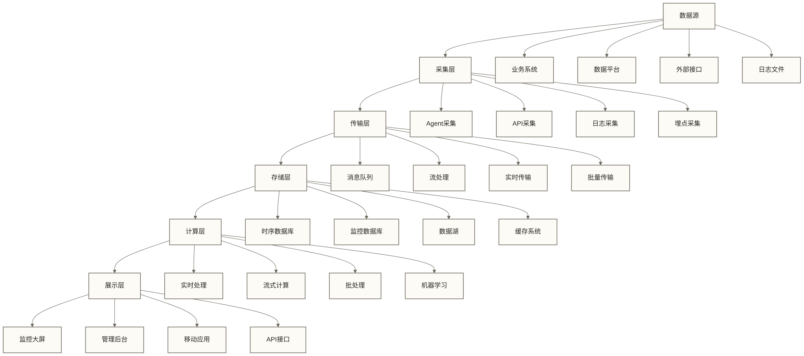

## 🔍 实时监控技术

### 1. 数据采集技术

```mermaid
%%{init: {"theme":"base","themeVariables":{"fontFamily":"PingFang SC, -apple-system, Source Han Serif SC, serif","fontSize":"16px","background":"#FDFBF5","primaryColor":"#FDFBF5","primaryTextColor":"#2D2A26","primaryBorderColor":"#6E6A60","secondaryColor":"#E8EFE8","secondaryBorderColor":"#8FA890","secondaryTextColor":"#2D2A26","tertiaryColor":"#FDFBF5","tertiaryBorderColor":"#9A9488","tertiaryTextColor":"#6E6A60","lineColor":"#6E6A60","textColor":"#2D2A26","mainBkg":"#FDFBF5","nodeBorder":"#2D5A3D","clusterBkg":"#F3EEDF","clusterBorder":"#9A9488","edgeLabelBackground":"#FDFBF5"},"flowchart":{"htmlLabels":true,"curve":"basis","padding":20,"nodeSpacing":60,"rankSpacing":70,"useMaxWidth":false},"themeCSS":".node rect, .node polygon, .node circle { stroke-width: 1.5px; } .edgePath .path { stroke-width: 1.5px; } .cluster-label .nodeLabel, .cluster-label foreignObject { color: #2D2A26 !important; } .edgeLabel, .edgeLabel foreignObject { color: #2D2A26 !important; background-color: #FDFBF5; } .edgeLabel rect { fill: #FDFBF5; }"}}%%
flowchart TD
    classDef default fill:#FDFBF5,stroke:#6E6A60,color:#2D2A26,stroke-width:1.5px
    classDef startend fill:#2D2A26,stroke:#2D2A26,color:#FDFBF5,font-weight:bold
    classDef decision fill:#F6EAD8,stroke:#C08A1A,color:#2D2A26,font-weight:bold
    classDef hub fill:#3B5A80,stroke:#3B5A80,color:#FDFBF5,font-weight:bold
    classDef io fill:#E5EAF0,stroke:#3B5A80,color:#2D2A26
    classDef accent fill:#A6432C,stroke:#A6432C,color:#FDFBF5,font-weight:bold
    classDef storage fill:#F3EEDF,stroke:#9A9488,color:#2D2A26
    A[采集技术] --> B[Agent采集]
    A --> C[API采集]
    A --> D[日志采集]
    A --> E[埋点采集]
    B --> B1[系统Agent]
    B --> B2[应用Agent]
    B --> B3[数据库Agent]
    B --> B4[网络Agent]
    C --> C1[REST API]
    C --> C2[GraphQL]
    C --> C3[WebSocket]
    C --> C4[gRPC]
    D --> D1[日志解析]
    D --> D2[日志聚合]
    D --> D3[日志分析]
    D --> D4[日志存储]
    E --> E1[前端埋点]
    E --> E2[后端埋点]
    E --> E3[业务埋点]
    E --> E4[性能埋点]
    class A,B,C,D,E,B1,B2,B3,B4,C1,C2,C3,C4,D1,D2,D3,D4,E1,E2,E3,E4 default
```

### 2. 异常检测技术

```mermaid
%%{init: {"theme":"base","themeVariables":{"fontFamily":"PingFang SC, -apple-system, Source Han Serif SC, serif","fontSize":"16px","background":"#FDFBF5","primaryColor":"#FDFBF5","primaryTextColor":"#2D2A26","primaryBorderColor":"#6E6A60","secondaryColor":"#E8EFE8","secondaryBorderColor":"#8FA890","secondaryTextColor":"#2D2A26","tertiaryColor":"#FDFBF5","tertiaryBorderColor":"#9A9488","tertiaryTextColor":"#6E6A60","lineColor":"#6E6A60","textColor":"#2D2A26","mainBkg":"#FDFBF5","nodeBorder":"#2D5A3D","clusterBkg":"#F3EEDF","clusterBorder":"#9A9488","edgeLabelBackground":"#FDFBF5"},"flowchart":{"htmlLabels":true,"curve":"basis","padding":20,"nodeSpacing":60,"rankSpacing":70,"useMaxWidth":false},"themeCSS":".node rect, .node polygon, .node circle { stroke-width: 1.5px; } .edgePath .path { stroke-width: 1.5px; } .cluster-label .nodeLabel, .cluster-label foreignObject { color: #2D2A26 !important; } .edgeLabel, .edgeLabel foreignObject { color: #2D2A26 !important; background-color: #FDFBF5; } .edgeLabel rect { fill: #FDFBF5; }"}}%%
flowchart TD
    classDef default fill:#FDFBF5,stroke:#6E6A60,color:#2D2A26,stroke-width:1.5px
    classDef startend fill:#2D2A26,stroke:#2D2A26,color:#FDFBF5,font-weight:bold
    classDef decision fill:#F6EAD8,stroke:#C08A1A,color:#2D2A26,font-weight:bold
    classDef hub fill:#3B5A80,stroke:#3B5A80,color:#FDFBF5,font-weight:bold
    classDef io fill:#E5EAF0,stroke:#3B5A80,color:#2D2A26
    classDef accent fill:#A6432C,stroke:#A6432C,color:#FDFBF5,font-weight:bold
    classDef storage fill:#F3EEDF,stroke:#9A9488,color:#2D2A26
    A[异常检测] --> B[规则检测]
    A --> C[统计检测]
    A --> D[机器学习]
    A --> E[深度学习入门]
    B --> B1[阈值规则]
    B --> B2[趋势规则]
    B --> B3[模式规则]
    B --> B4[复合规则]
    C --> C1[均值检测]
    C --> C2[方差检测]
    C --> C3[分布检测]
    C --> C4[相关性检测]
    D --> D1[分类算法]
    D --> D2[聚类算法]
    D --> D3[回归算法]
    D --> D4[时间序列]
    E --> E1[深度学习入门]
    E --> E2[LSTM]
    E --> E3[自编码器]
    E --> E4[强化学习]
    class A,B,C,D,E,B1,B2,B3,B4,C1,C2,C3,C4,D1,D2,D3,D4,E1,E2,E3,E4 default
```

### 实战代码示例

> [!example] 🛠️ 监控系统实现示例
> 以下代码展示了基础的监控系统组件实现，帮助理解监控系统的工作原理

#### Python监控数据采集示例

```python
import time
import psutil
import json
import logging
from datetime import datetime
from typing import Dict, Any, List

class SystemMonitor:
    """系统监控类 - 相当于系统的神经末梢"""
    
    def __init__(self, interval: int = 60):
        self.interval = interval
        self.logger = logging.getLogger(__name__)
    
    def collect_system_metrics(self) -> Dict[str, Any]:
        """收集系统指标 - 感知系统生命体征"""
        try:
            metrics = {
                'timestamp': datetime.now().isoformat(),
                'cpu': {
                    'usage_percent': psutil.cpu_percent(interval=1),
                    'count': psutil.cpu_count(),
                    'load_avg': psutil.getloadavg() if hasattr(psutil, 'getloadavg') else None
                },
                'memory': {
                    'total': psutil.virtual_memory().total,
                    'used': psutil.virtual_memory().used,
                    'percent': psutil.virtual_memory().percent
                },
                'disk': {
                    'usage': psutil.disk_usage('/').percent,
                    'read_bytes': psutil.disk_io_counters().read_bytes,
                    'write_bytes': psutil.disk_io_counters().write_bytes
                },
                'network': {
                    'bytes_sent': psutil.net_io_counters().bytes_sent,
                    'bytes_recv': psutil.net_io_counters().bytes_recv
                }
            }
            return metrics
        except Exception as e:
            self.logger.error(f"监控数据采集失败: {e}")
            return {}

class AlertEngine:
    """告警引擎 - 相当于神经系统的反射中枢"""
    
    def __init__(self):
        self.alert_rules = {
            'cpu_high': {'threshold': 80, 'metric': 'cpu.usage_percent'},
            'memory_high': {'threshold': 85, 'metric': 'memory.percent'},
            'disk_full': {'threshold': 90, 'metric': 'disk.usage'}
        }
        
    def check_alerts(self, metrics: Dict[str, Any]) -> List[Dict[str, Any]]:
        """检查告警条件 - 智能判断异常情况"""
        alerts = []
        
        for alert_name, rule in self.alert_rules.items():
            try:
                # 解析指标路径
                metric_path = rule['metric'].split('.')
                value = metrics
                for key in metric_path:
                    value = value[key]
                
                # 检查阈值
                if value > rule['threshold']:
                    alert = {
                        'alert_name': alert_name,
                        'metric_path': rule['metric'],
                        'current_value': value,
                        'threshold': rule['threshold'],
                        'severity': self._get_severity(value, rule['threshold']),
                        'timestamp': datetime.now().isoformat()
                    }
                    alerts.append(alert)
                    
            except (KeyError, TypeError) as e:
                logging.error(f"告警检查失败 {alert_name}: {e}")
                
        return alerts
    
    def _get_severity(self, value: float, threshold: float) -> str:
        """根据超出程度确定严重级别"""
        excess_ratio = (value - threshold) / threshold
        if excess_ratio > 0.5:
            return 'critical'
        elif excess_ratio > 0.2:
            return 'high'
        else:
            return 'medium'

# 使用示例
if __name__ == "__main__":
    monitor = SystemMonitor()
    alert_engine = AlertEngine()
    
    while True:
        # 收集监控数据
        metrics = monitor.collect_system_metrics()
        if metrics:
            # 检查告警
            alerts = alert_engine.check_alerts(metrics)
            
            # 打印监控结果
            print(f"监控时间: {metrics['timestamp']}")
            print(f"CPU使用率: {metrics['cpu']['usage_percent']}%")
            print(f"内存使用率: {metrics['memory']['percent']}%")
            
            if alerts:
                print("🚨 发现告警:")
                for alert in alerts:
                    print(f"  - {alert['alert_name']}: {alert['current_value']}% (阈值: {alert['threshold']}%)")
        
        time.sleep(60)
```

#### 实时监控指标计算

```python
from collections import deque
from datetime import datetime
from typing import Dict, Any, List
import statistics
import numpy as np

class MetricsCalculator:
    """监控指标计算器 - 相当于神经系统的数据处理中心"""
    
    def __init__(self, window_size: int = 100):
        self.window_size = window_size
        self.metric_history = {}
    
    def add_metric(self, metric_name: str, value: float):
        """添加监控指标数据"""
        if metric_name not in self.metric_history:
            self.metric_history[metric_name] = deque(maxlen=self.window_size)
        
        self.metric_history[metric_name].append({
            'value': value,
            'timestamp': datetime.now()
        })
    
    def calculate_statistics(self, metric_name: str) -> Dict[str, Any]:
        """计算统计指标 - 分析神经信号模式"""
        if metric_name not in self.metric_history:
            return {}
        
        values = [item['value'] for item in self.metric_history[metric_name]]
        
        if len(values) < 2:
            return {'current': values[-1] if values else 0}
        
        return {
            'current': values[-1],
            'mean': statistics.mean(values),
            'median': statistics.median(values),
            'std_dev': statistics.stdev(values),
            'min': min(values),
            'max': max(values),
            'trend': self._calculate_trend(values),
            'anomaly_score': self._calculate_anomaly_score(values)
        }
    
    def _calculate_trend(self, values: List[float]) -> str:
        """计算趋势 - 识别变化模式"""
        if len(values) < 5:
            return 'insufficient_data'
        
        # 简单的线性回归趋势计算
        x = np.arange(len(values))
        slope = np.polyfit(x, values, 1)[0]
        
        if slope > 0.1:
            return 'increasing'
        elif slope < -0.1:
            return 'decreasing'
        else:
            return 'stable'
    
    def _calculate_anomaly_score(self, values: List[float]) -> float:
        """计算异常分数 - 检测异常信号"""
        if len(values) < 10:
            return 0.0
        
        mean = statistics.mean(values[:-1])  # 排除最新值
        std_dev = statistics.stdev(values[:-1])
        current = values[-1]
        
        if std_dev == 0:
            return 0.0 if current == mean else 1.0
        
        # Z-score异常检测
        z_score = abs(current - mean) / std_dev
        return min(z_score / 3.0, 1.0)  # 标准化到0-1范围

# 使用示例
calculator = MetricsCalculator()

# 模拟监控数据
for i in range(50):
    cpu_usage = 20 + 10 * np.sin(i * 0.1) + np.random.normal(0, 2)
    calculator.add_metric('cpu_usage', cpu_usage)

# 获取统计结果
stats = calculator.calculate_statistics('cpu_usage')
print(f"CPU监控统计: {stats}")
```

### 3. 告警机制

```mermaid
%%{init: {"theme":"base","themeVariables":{"fontFamily":"PingFang SC, -apple-system, Source Han Serif SC, serif","fontSize":"16px","background":"#FDFBF5","primaryColor":"#FDFBF5","primaryTextColor":"#2D2A26","primaryBorderColor":"#6E6A60","secondaryColor":"#E8EFE8","secondaryBorderColor":"#8FA890","secondaryTextColor":"#2D2A26","tertiaryColor":"#FDFBF5","tertiaryBorderColor":"#9A9488","tertiaryTextColor":"#6E6A60","lineColor":"#6E6A60","textColor":"#2D2A26","mainBkg":"#FDFBF5","nodeBorder":"#2D5A3D","clusterBkg":"#F3EEDF","clusterBorder":"#9A9488","edgeLabelBackground":"#FDFBF5"},"flowchart":{"htmlLabels":true,"curve":"basis","padding":20,"nodeSpacing":60,"rankSpacing":70,"useMaxWidth":false},"themeCSS":".node rect, .node polygon, .node circle { stroke-width: 1.5px; } .edgePath .path { stroke-width: 1.5px; } .cluster-label .nodeLabel, .cluster-label foreignObject { color: #2D2A26 !important; } .edgeLabel, .edgeLabel foreignObject { color: #2D2A26 !important; background-color: #FDFBF5; } .edgeLabel rect { fill: #FDFBF5; }"}}%%
flowchart TD
    classDef default fill:#FDFBF5,stroke:#6E6A60,color:#2D2A26,stroke-width:1.5px
    classDef startend fill:#2D2A26,stroke:#2D2A26,color:#FDFBF5,font-weight:bold
    classDef decision fill:#F6EAD8,stroke:#C08A1A,color:#2D2A26,font-weight:bold
    classDef hub fill:#3B5A80,stroke:#3B5A80,color:#FDFBF5,font-weight:bold
    classDef io fill:#E5EAF0,stroke:#3B5A80,color:#2D2A26
    classDef accent fill:#A6432C,stroke:#A6432C,color:#FDFBF5,font-weight:bold
    classDef storage fill:#F3EEDF,stroke:#9A9488,color:#2D2A26
    A[告警机制] --> B[告警规则]
    A --> C[告警级别]
    A --> D[通知渠道]
    A --> E[处理流程]
    B --> B1[阈值告警]
    B --> B2[趋势告警]
    B --> B3[异常告警]
    B --> B4[预测告警]
    C --> C1[严重告警]
    C --> C2[重要告警]
    C --> C3[一般告警]
    C --> C4[提示信息]
    D --> D1[邮件通知]
    D --> D2[短信通知]
    D --> D3[微信通知]
    D --> D4[钉钉通知]
    E --> E1[告警确认]
    E --> E2[问题处理]
    E --> E3[结果反馈]
    E --> E4[经验总结]
    class A,B,C,D,E,B1,B2,B3,B4,C1,C2,C3,C4,D1,D2,D3,D4,E1,E2,E3,E4 default
```

## 🔍 监控指标体系

### 1. 系统性能指标

```mermaid
%%{init: {"theme":"base","themeVariables":{"fontFamily":"PingFang SC, -apple-system, Source Han Serif SC, serif","fontSize":"16px","background":"#FDFBF5","primaryColor":"#FDFBF5","primaryTextColor":"#2D2A26","primaryBorderColor":"#6E6A60","secondaryColor":"#E8EFE8","secondaryBorderColor":"#8FA890","secondaryTextColor":"#2D2A26","tertiaryColor":"#FDFBF5","tertiaryBorderColor":"#9A9488","tertiaryTextColor":"#6E6A60","lineColor":"#6E6A60","textColor":"#2D2A26","mainBkg":"#FDFBF5","nodeBorder":"#2D5A3D","clusterBkg":"#F3EEDF","clusterBorder":"#9A9488","edgeLabelBackground":"#FDFBF5"},"flowchart":{"htmlLabels":true,"curve":"basis","padding":20,"nodeSpacing":60,"rankSpacing":70,"useMaxWidth":false},"themeCSS":".node rect, .node polygon, .node circle { stroke-width: 1.5px; } .edgePath .path { stroke-width: 1.5px; } .cluster-label .nodeLabel, .cluster-label foreignObject { color: #2D2A26 !important; } .edgeLabel, .edgeLabel foreignObject { color: #2D2A26 !important; background-color: #FDFBF5; } .edgeLabel rect { fill: #FDFBF5; }"}}%%
flowchart TD
    classDef default fill:#FDFBF5,stroke:#6E6A60,color:#2D2A26,stroke-width:1.5px
    classDef startend fill:#2D2A26,stroke:#2D2A26,color:#FDFBF5,font-weight:bold
    classDef decision fill:#F6EAD8,stroke:#C08A1A,color:#2D2A26,font-weight:bold
    classDef hub fill:#3B5A80,stroke:#3B5A80,color:#FDFBF5,font-weight:bold
    classDef io fill:#E5EAF0,stroke:#3B5A80,color:#2D2A26
    classDef accent fill:#A6432C,stroke:#A6432C,color:#FDFBF5,font-weight:bold
    classDef storage fill:#F3EEDF,stroke:#9A9488,color:#2D2A26
    A[性能指标] --> B[响应时间]
    A --> C[吞吐量]
    A --> D[错误率]
    A --> E[资源使用]
    B --> B1[平均响应时间]
    B --> B2[最大响应时间]
    B --> B3[响应时间分布]
    B --> B4[响应时间趋势]
    C --> C1[请求数/秒]
    C --> C2[处理数/秒]
    C --> C3[并发数]
    C --> C4[队列长度]
    D --> D1[错误率]
    D --> D2[超时率]
    D --> D3[失败率]
    D --> D4[异常率]
    E --> E1[CPU使用率]
    E --> E2[内存使用率]
    E --> E3[磁盘使用率]
    E --> E4[网络使用率]
    class A,B,C,D,E,B1,B2,B3,B4,C1,C2,C3,C4,D1,D2,D3,D4,E1,E2,E3,E4 default
```

### 2. 数据质量指标

```mermaid
%%{init: {"theme":"base","themeVariables":{"fontFamily":"PingFang SC, -apple-system, Source Han Serif SC, serif","fontSize":"16px","background":"#FDFBF5","primaryColor":"#FDFBF5","primaryTextColor":"#2D2A26","primaryBorderColor":"#6E6A60","secondaryColor":"#E8EFE8","secondaryBorderColor":"#8FA890","secondaryTextColor":"#2D2A26","tertiaryColor":"#FDFBF5","tertiaryBorderColor":"#9A9488","tertiaryTextColor":"#6E6A60","lineColor":"#6E6A60","textColor":"#2D2A26","mainBkg":"#FDFBF5","nodeBorder":"#2D5A3D","clusterBkg":"#F3EEDF","clusterBorder":"#9A9488","edgeLabelBackground":"#FDFBF5"},"flowchart":{"htmlLabels":true,"curve":"basis","padding":20,"nodeSpacing":60,"rankSpacing":70,"useMaxWidth":false}}%%
flowchart TD
    classDef default fill:#FDFBF5,stroke:#6E6A60,color:#2D2A26,stroke-width:1.5px
    A[数据治理] --> B[完整性]
    A --> C[准确性]
    A --> D[及时性]
    A --> E[一致性]
    B --> B1[数据缺失率]
    B --> B2[字段完整率]
    B --> B3[记录完整率]
    B --> B4[表完整率]
    C --> C1[数据准确率]
    C --> C2[格式正确率]
    C --> C3[范围正确率]
    C --> C4[逻辑正确率]
    D --> D1[数据延迟]
    D --> D2[更新频率]
    D --> D3[处理时效]
    D --> D4[同步状态]
    E --> E1[跨表一致性]
    E --> E2[跨系统一致性]
    E --> E3[历史一致性]
    E --> E4[业务一致性]
    class A,B,C,D,E,B1,B2,B3,B4,C1,C2,C3,C4,D1,D2,D3,D4,E1,E2,E3,E4 default
```

### 3. 业务指标监控

```mermaid
%%{init: {"theme":"base","themeVariables":{"fontFamily":"PingFang SC, -apple-system, Source Han Serif SC, serif","fontSize":"16px","background":"#FDFBF5","primaryColor":"#FDFBF5","primaryTextColor":"#2D2A26","primaryBorderColor":"#6E6A60","secondaryColor":"#E8EFE8","secondaryBorderColor":"#8FA890","secondaryTextColor":"#2D2A26","tertiaryColor":"#FDFBF5","tertiaryBorderColor":"#9A9488","tertiaryTextColor":"#6E6A60","lineColor":"#6E6A60","textColor":"#2D2A26","mainBkg":"#FDFBF5","nodeBorder":"#2D5A3D","clusterBkg":"#F3EEDF","clusterBorder":"#9A9488","edgeLabelBackground":"#FDFBF5"},"flowchart":{"htmlLabels":true,"curve":"basis","padding":20,"nodeSpacing":60,"rankSpacing":70,"useMaxWidth":false},"themeCSS":".node rect, .node polygon, .node circle { stroke-width: 1.5px; } .edgePath .path { stroke-width: 1.5px; } .cluster-label .nodeLabel, .cluster-label foreignObject { color: #2D2A26 !important; } .edgeLabel, .edgeLabel foreignObject { color: #2D2A26 !important; background-color: #FDFBF5; } .edgeLabel rect { fill: #FDFBF5; }"}}%%
flowchart TD
    classDef default fill:#FDFBF5,stroke:#6E6A60,color:#2D2A26,stroke-width:1.5px
    classDef startend fill:#2D2A26,stroke:#2D2A26,color:#FDFBF5,font-weight:bold
    classDef decision fill:#F6EAD8,stroke:#C08A1A,color:#2D2A26,font-weight:bold
    classDef hub fill:#3B5A80,stroke:#3B5A80,color:#FDFBF5,font-weight:bold
    classDef io fill:#E5EAF0,stroke:#3B5A80,color:#2D2A26
    classDef accent fill:#A6432C,stroke:#A6432C,color:#FDFBF5,font-weight:bold
    classDef storage fill:#F3EEDF,stroke:#9A9488,color:#2D2A26
    A[业务指标] --> B[用户指标]
    A --> C[交易指标]
    A --> D[运营指标]
    A --> E[财务指标]
    B --> B1[活跃用户数]
    B --> B2[新增用户数]
    B --> B3[用户留存率]
    B --> B4[用户转化率]
    C --> C1[交易量]
    C --> C2[交易金额]
    C --> C3[交易成功率]
    C --> C4[平均客单价]
    D --> D1[页面访问量]
    D --> D2[功能使用率]
    D --> D3[系统可用性]
    D --> D4[用户体验]
    E --> E1[收入指标]
    E --> E2[成本指标]
    E --> E3[利润指标]
    E --> E4[ROI指标]
    class A,B,C,D,E,B1,B2,B3,B4,C1,C2,C3,C4,D1,D2,D3,D4,E1,E2,E3,E4 default
```

## 🔍 监控工具平台

### 1. 开源监控工具

```mermaid
%%{init: {"theme":"base","themeVariables":{"fontFamily":"PingFang SC, -apple-system, Source Han Serif SC, serif","fontSize":"16px","background":"#FDFBF5","primaryColor":"#FDFBF5","primaryTextColor":"#2D2A26","primaryBorderColor":"#6E6A60","secondaryColor":"#E8EFE8","secondaryBorderColor":"#8FA890","secondaryTextColor":"#2D2A26","tertiaryColor":"#FDFBF5","tertiaryBorderColor":"#9A9488","tertiaryTextColor":"#6E6A60","lineColor":"#6E6A60","textColor":"#2D2A26","mainBkg":"#FDFBF5","nodeBorder":"#2D5A3D","clusterBkg":"#F3EEDF","clusterBorder":"#9A9488","edgeLabelBackground":"#FDFBF5"},"flowchart":{"htmlLabels":true,"curve":"basis","padding":20,"nodeSpacing":60,"rankSpacing":70,"useMaxWidth":false},"themeCSS":".node rect, .node polygon, .node circle { stroke-width: 1.5px; } .edgePath .path { stroke-width: 1.5px; } .cluster-label .nodeLabel, .cluster-label foreignObject { color: #2D2A26 !important; } .edgeLabel, .edgeLabel foreignObject { color: #2D2A26 !important; background-color: #FDFBF5; } .edgeLabel rect { fill: #FDFBF5; }"}}%%
flowchart TD
    classDef default fill:#FDFBF5,stroke:#6E6A60,color:#2D2A26,stroke-width:1.5px
    classDef startend fill:#2D2A26,stroke:#2D2A26,color:#FDFBF5,font-weight:bold
    classDef decision fill:#F6EAD8,stroke:#C08A1A,color:#2D2A26,font-weight:bold
    classDef hub fill:#3B5A80,stroke:#3B5A80,color:#FDFBF5,font-weight:bold
    classDef io fill:#E5EAF0,stroke:#3B5A80,color:#2D2A26
    classDef accent fill:#A6432C,stroke:#A6432C,color:#FDFBF5,font-weight:bold
    classDef storage fill:#F3EEDF,stroke:#9A9488,color:#2D2A26
    A[监控工具] --> B[Prometheus]
    A --> C[Grafana]
    A --> D[Elasticsearch]
    A --> E[Zabbix]
    A --> F[Nagios]
    B --> B1[时序数据库]
    B --> B2[监控指标]
    B --> B3[告警规则]
    B --> B4[查询语言]
    C --> C1[数据可视化]
    C --> C2[仪表板]
    C --> C3[告警通知]
    C --> C4[插件扩展]
    D --> D1[日志分析]
    D --> D2[全文搜索]
    D --> D3[实时分析]
    D --> D4[可视化工具]
    E --> E1[网络监控]
    E --> E2[服务器监控]
    E --> E3[应用监控]
    E --> E4[告警管理]
    F --> F1[基础设施监控]
    F --> F2[服务监控]
    F --> F3[告警系统]
    F --> F4[报告生成]
    class A,B,C,D,E,F,B1,B2,B3,B4,C1,C2,C3,C4,D1,D2,D3,D4,E1,E2,E3,E4,F1,F2,F3,F4 default
```

### 2. 云原生监控

```mermaid
%%{init: {"theme":"base","themeVariables":{"fontFamily":"PingFang SC, -apple-system, Source Han Serif SC, serif","fontSize":"16px","background":"#FDFBF5","primaryColor":"#FDFBF5","primaryTextColor":"#2D2A26","primaryBorderColor":"#6E6A60","secondaryColor":"#E8EFE8","secondaryBorderColor":"#8FA890","secondaryTextColor":"#2D2A26","tertiaryColor":"#FDFBF5","tertiaryBorderColor":"#9A9488","tertiaryTextColor":"#6E6A60","lineColor":"#6E6A60","textColor":"#2D2A26","mainBkg":"#FDFBF5","nodeBorder":"#2D5A3D","clusterBkg":"#F3EEDF","clusterBorder":"#9A9488","edgeLabelBackground":"#FDFBF5"},"flowchart":{"htmlLabels":true,"curve":"basis","padding":20,"nodeSpacing":60,"rankSpacing":70,"useMaxWidth":false},"themeCSS":".node rect, .node polygon, .node circle { stroke-width: 1.5px; } .edgePath .path { stroke-width: 1.5px; } .cluster-label .nodeLabel, .cluster-label foreignObject { color: #2D2A26 !important; } .edgeLabel, .edgeLabel foreignObject { color: #2D2A26 !important; background-color: #FDFBF5; } .edgeLabel rect { fill: #FDFBF5; }"}}%%
flowchart TD
    classDef default fill:#FDFBF5,stroke:#6E6A60,color:#2D2A26,stroke-width:1.5px
    classDef startend fill:#2D2A26,stroke:#2D2A26,color:#FDFBF5,font-weight:bold
    classDef decision fill:#F6EAD8,stroke:#C08A1A,color:#2D2A26,font-weight:bold
    classDef hub fill:#3B5A80,stroke:#3B5A80,color:#FDFBF5,font-weight:bold
    classDef io fill:#E5EAF0,stroke:#3B5A80,color:#2D2A26
    classDef accent fill:#A6432C,stroke:#A6432C,color:#FDFBF5,font-weight:bold
    classDef storage fill:#F3EEDF,stroke:#9A9488,color:#2D2A26
    A[云原生监控] --> B[容器监控]
    A --> C[微服务监控]
    A --> D[服务网格监控]
    A --> E[云资源监控]
    B --> B1[Docker监控]
    B --> B2[Kubernetes监控]
    B --> B3[Kubernetes数据部署]
    B --> B4[资源调度]
    C --> C1[服务发现]
    C --> C2[负载均衡]
    C --> C3[故障转移]
    C --> C4[服务治理]
    D --> D1[Istio监控]
    D --> D2[Envoy监控]
    D --> D3[流量管理]
    D --> D4[安全策略]
    E --> E1[云服务器]
    E --> E2[云数据库]
    E --> E3[云存储]
    E --> E4[云网络]
    class A,B,C,D,E,B1,B2,B3,B4,C1,C2,C3,C4,D1,D2,D3,D4,E1,E2,E3,E4 default
```

### 3. 监控平台架构

```mermaid
%%{init: {"theme":"base","themeVariables":{"fontFamily":"PingFang SC, -apple-system, Source Han Serif SC, serif","fontSize":"16px","background":"#FDFBF5","primaryColor":"#FDFBF5","primaryTextColor":"#2D2A26","primaryBorderColor":"#6E6A60","secondaryColor":"#E8EFE8","secondaryBorderColor":"#8FA890","secondaryTextColor":"#2D2A26","tertiaryColor":"#FDFBF5","tertiaryBorderColor":"#9A9488","tertiaryTextColor":"#6E6A60","lineColor":"#6E6A60","textColor":"#2D2A26","mainBkg":"#FDFBF5","nodeBorder":"#2D5A3D","clusterBkg":"#F3EEDF","clusterBorder":"#9A9488","edgeLabelBackground":"#FDFBF5"},"flowchart":{"htmlLabels":true,"curve":"basis","padding":20,"nodeSpacing":60,"rankSpacing":70,"useMaxWidth":false},"themeCSS":".node rect, .node polygon, .node circle { stroke-width: 1.5px; } .edgePath .path { stroke-width: 1.5px; } .cluster-label .nodeLabel, .cluster-label foreignObject { color: #2D2A26 !important; } .edgeLabel, .edgeLabel foreignObject { color: #2D2A26 !important; background-color: #FDFBF5; } .edgeLabel rect { fill: #FDFBF5; }"}}%%
flowchart TD
    classDef default fill:#FDFBF5,stroke:#6E6A60,color:#2D2A26,stroke-width:1.5px
    classDef startend fill:#2D2A26,stroke:#2D2A26,color:#FDFBF5,font-weight:bold
    classDef decision fill:#F6EAD8,stroke:#C08A1A,color:#2D2A26,font-weight:bold
    classDef hub fill:#3B5A80,stroke:#3B5A80,color:#FDFBF5,font-weight:bold
    classDef io fill:#E5EAF0,stroke:#3B5A80,color:#2D2A26
    classDef accent fill:#A6432C,stroke:#A6432C,color:#FDFBF5,font-weight:bold
    classDef storage fill:#F3EEDF,stroke:#9A9488,color:#2D2A26
    A[监控平台] --> B[数据采集层]
    A --> C[数据处理层]
    A --> D[数据存储层]
    A --> E[数据展示层]
    B --> B1[Agent采集]
    B --> B2[API采集]
    B --> B3[日志采集]
    B --> B4[埋点采集]
    C --> C1[实时处理]
    C --> C2[流式计算]
    C --> C3[异常检测]
    C --> C4[数据清洗]
    D --> D1[时序数据库]
    D --> D2[监控数据库]
    D --> D3[数据湖]
    D --> D4[缓存系统]
    E --> E1[监控大屏]
    E --> E2[管理后台]
    E --> E3[移动应用]
    E --> E4[API接口]
    class A,B,C,D,E,B1,B2,B3,B4,C1,C2,C3,C4,D1,D2,D3,D4,E1,E2,E3,E4 default
```

## 🔍 实时监控应用场景

### 1. 系统运维监控

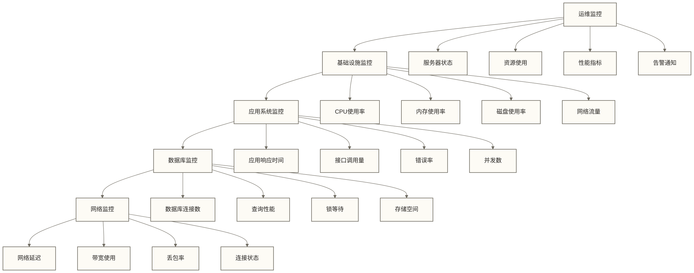

### 2. 数据质量监控

```mermaid
%%{init: {"theme":"base","themeVariables":{"fontFamily":"PingFang SC, -apple-system, Source Han Serif SC, serif","fontSize":"16px","background":"#FDFBF5","primaryColor":"#FDFBF5","primaryTextColor":"#2D2A26","primaryBorderColor":"#6E6A60","secondaryColor":"#E8EFE8","secondaryBorderColor":"#8FA890","secondaryTextColor":"#2D2A26","tertiaryColor":"#FDFBF5","tertiaryBorderColor":"#9A9488","tertiaryTextColor":"#6E6A60","lineColor":"#6E6A60","textColor":"#2D2A26","mainBkg":"#FDFBF5","nodeBorder":"#2D5A3D","clusterBkg":"#F3EEDF","clusterBorder":"#9A9488","edgeLabelBackground":"#FDFBF5"},"flowchart":{"htmlLabels":true,"curve":"basis","padding":20,"nodeSpacing":60,"rankSpacing":70,"useMaxWidth":false},"themeCSS":".node rect, .node polygon, .node circle { stroke-width: 1.5px; } .edgePath .path { stroke-width: 1.5px; } .cluster-label .nodeLabel, .cluster-label foreignObject { color: #2D2A26 !important; } .edgeLabel, .edgeLabel foreignObject { color: #2D2A26 !important; background-color: #FDFBF5; } .edgeLabel rect { fill: #FDFBF5; }"}}%%
flowchart TD
    classDef default fill:#FDFBF5,stroke:#6E6A60,color:#2D2A26,stroke-width:1.5px
    classDef startend fill:#2D2A26,stroke:#2D2A26,color:#FDFBF5,font-weight:bold
    classDef decision fill:#F6EAD8,stroke:#C08A1A,color:#2D2A26,font-weight:bold
    classDef hub fill:#3B5A80,stroke:#3B5A80,color:#FDFBF5,font-weight:bold
    classDef io fill:#E5EAF0,stroke:#3B5A80,color:#2D2A26
    classDef accent fill:#A6432C,stroke:#A6432C,color:#FDFBF5,font-weight:bold
    classDef storage fill:#F3EEDF,stroke:#9A9488,color:#2D2A26
    A[数据质量监控] --> B[数据完整性监控]
    A --> C[数据准确性监控]
    A --> D[数据及时性监控]
    A --> E[数据一致性监控]
    B --> B1[字段缺失检测]
    B --> B2[记录缺失检测]
    B --> B3[表缺失检测]
    B --> B4[数据量异常]
    C --> C1[格式验证]
    C --> C2[范围检查]
    C --> C3[逻辑验证]
    C --> C4[业务规则]
    D --> D1[数据延迟检测]
    D --> D2[更新频率监控]
    D --> D3[处理时效]
    D --> D4[同步状态]
    E --> E1[跨表一致性]
    E --> E2[跨系统一致性]
    E --> E3[历史一致性]
    E --> E4[业务一致性]
    class A,B,C,D,E,B1,B2,B3,B4,C1,C2,C3,C4,D1,D2,D3,D4,E1,E2,E3,E4 default
```

### 3. 业务指标监控

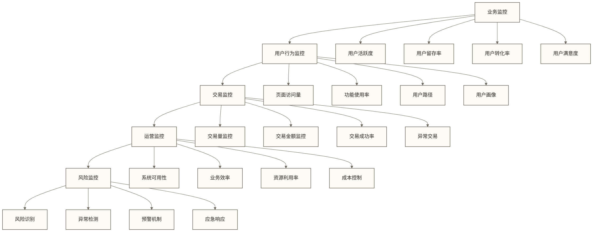

## 🔍 实时监控最佳实践

### 1. 监控设计原则

```mermaid
%%{init: {"theme":"base","themeVariables":{"fontFamily":"PingFang SC, -apple-system, Source Han Serif SC, serif","fontSize":"16px","background":"#FDFBF5","primaryColor":"#FDFBF5","primaryTextColor":"#2D2A26","primaryBorderColor":"#6E6A60","secondaryColor":"#E8EFE8","secondaryBorderColor":"#8FA890","secondaryTextColor":"#2D2A26","tertiaryColor":"#FDFBF5","tertiaryBorderColor":"#9A9488","tertiaryTextColor":"#6E6A60","lineColor":"#6E6A60","textColor":"#2D2A26","mainBkg":"#FDFBF5","nodeBorder":"#2D5A3D","clusterBkg":"#F3EEDF","clusterBorder":"#9A9488","edgeLabelBackground":"#FDFBF5"},"flowchart":{"htmlLabels":true,"curve":"basis","padding":20,"nodeSpacing":60,"rankSpacing":70,"useMaxWidth":false},"themeCSS":".node rect, .node polygon, .node circle { stroke-width: 1.5px; } .edgePath .path { stroke-width: 1.5px; } .cluster-label .nodeLabel, .cluster-label foreignObject { color: #2D2A26 !important; } .edgeLabel, .edgeLabel foreignObject { color: #2D2A26 !important; background-color: #FDFBF5; } .edgeLabel rect { fill: #FDFBF5; }"}}%%
flowchart TD
    classDef default fill:#FDFBF5,stroke:#6E6A60,color:#2D2A26,stroke-width:1.5px
    classDef startend fill:#2D2A26,stroke:#2D2A26,color:#FDFBF5,font-weight:bold
    classDef decision fill:#F6EAD8,stroke:#C08A1A,color:#2D2A26,font-weight:bold
    classDef hub fill:#3B5A80,stroke:#3B5A80,color:#FDFBF5,font-weight:bold
    classDef io fill:#E5EAF0,stroke:#3B5A80,color:#2D2A26
    classDef accent fill:#A6432C,stroke:#A6432C,color:#FDFBF5,font-weight:bold
    classDef storage fill:#F3EEDF,stroke:#9A9488,color:#2D2A26
    A[设计原则] --> B[全面性]
    A --> C[实时性]
    A --> D[准确性]
    A --> E[可操作性]
    B --> B1[全链路监控]
    B --> B2[多维度监控]
    B --> B3[全方位覆盖]
    B --> B4[无死角监控]
    C --> C1[实时采集]
    C --> C2[实时处理]
    C --> C3[实时告警]
    C --> C4[实时展示]
    D --> D1[数据准确性]
    D --> D2[告警准确性]
    D --> D3[分析准确性]
    D --> D4[预测准确性]
    E --> E1[告警可操作]
    E --> E2[问题可定位]
    E --> E3[处理可追踪]
    E --> E4[结果可验证]
    class A,B,C,D,E,B1,B2,B3,B4,C1,C2,C3,C4,D1,D2,D3,D4,E1,E2,E3,E4 default
```

### 2. 告警策略设计

```mermaid
%%{init: {"theme":"base","themeVariables":{"fontFamily":"PingFang SC, -apple-system, Source Han Serif SC, serif","fontSize":"16px","background":"#FDFBF5","primaryColor":"#FDFBF5","primaryTextColor":"#2D2A26","primaryBorderColor":"#6E6A60","secondaryColor":"#E8EFE8","secondaryBorderColor":"#8FA890","secondaryTextColor":"#2D2A26","tertiaryColor":"#FDFBF5","tertiaryBorderColor":"#9A9488","tertiaryTextColor":"#6E6A60","lineColor":"#6E6A60","textColor":"#2D2A26","mainBkg":"#FDFBF5","nodeBorder":"#2D5A3D","clusterBkg":"#F3EEDF","clusterBorder":"#9A9488","edgeLabelBackground":"#FDFBF5"},"flowchart":{"htmlLabels":true,"curve":"basis","padding":20,"nodeSpacing":60,"rankSpacing":70,"useMaxWidth":false},"themeCSS":".node rect, .node polygon, .node circle { stroke-width: 1.5px; } .edgePath .path { stroke-width: 1.5px; } .cluster-label .nodeLabel, .cluster-label foreignObject { color: #2D2A26 !important; } .edgeLabel, .edgeLabel foreignObject { color: #2D2A26 !important; background-color: #FDFBF5; } .edgeLabel rect { fill: #FDFBF5; }"}}%%
flowchart TD
    classDef default fill:#FDFBF5,stroke:#6E6A60,color:#2D2A26,stroke-width:1.5px
    classDef startend fill:#2D2A26,stroke:#2D2A26,color:#FDFBF5,font-weight:bold
    classDef decision fill:#F6EAD8,stroke:#C08A1A,color:#2D2A26,font-weight:bold
    classDef hub fill:#3B5A80,stroke:#3B5A80,color:#FDFBF5,font-weight:bold
    classDef io fill:#E5EAF0,stroke:#3B5A80,color:#2D2A26
    classDef accent fill:#A6432C,stroke:#A6432C,color:#FDFBF5,font-weight:bold
    classDef storage fill:#F3EEDF,stroke:#9A9488,color:#2D2A26
    A[告警策略] --> B[告警分级]
    A --> C[告警抑制]
    A --> D[告警聚合]
    A --> E[告警升级]
    B --> B1[严重告警]
    B --> B2[重要告警]
    B --> B3[一般告警]
    B --> B4[提示信息]
    C --> C1[时间抑制]
    C --> C2[条件抑制]
    C --> C3[依赖抑制]
    C --> C4[手动抑制]
    D --> D1[相似告警聚合]
    D --> D2[时间窗口聚合]
    D --> D3[空间聚合]
    D --> D4[智能聚合]
    E --> E1[自动升级]
    E --> E2[手动升级]
    E --> E3[升级规则]
    E --> E4[升级流程]
    class A,B,C,D,E,B1,B2,B3,B4,C1,C2,C3,C4,D1,D2,D3,D4,E1,E2,E3,E4 default
```

### 3. 监控运维管理

```mermaid
%%{init: {"theme":"base","themeVariables":{"fontFamily":"PingFang SC, -apple-system, Source Han Serif SC, serif","fontSize":"16px","background":"#FDFBF5","primaryColor":"#FDFBF5","primaryTextColor":"#2D2A26","primaryBorderColor":"#6E6A60","secondaryColor":"#E8EFE8","secondaryBorderColor":"#8FA890","secondaryTextColor":"#2D2A26","tertiaryColor":"#FDFBF5","tertiaryBorderColor":"#9A9488","tertiaryTextColor":"#6E6A60","lineColor":"#6E6A60","textColor":"#2D2A26","mainBkg":"#FDFBF5","nodeBorder":"#2D5A3D","clusterBkg":"#F3EEDF","clusterBorder":"#9A9488","edgeLabelBackground":"#FDFBF5"},"flowchart":{"htmlLabels":true,"curve":"basis","padding":20,"nodeSpacing":60,"rankSpacing":70,"useMaxWidth":false},"themeCSS":".node rect, .node polygon, .node circle { stroke-width: 1.5px; } .edgePath .path { stroke-width: 1.5px; } .cluster-label .nodeLabel, .cluster-label foreignObject { color: #2D2A26 !important; } .edgeLabel, .edgeLabel foreignObject { color: #2D2A26 !important; background-color: #FDFBF5; } .edgeLabel rect { fill: #FDFBF5; }"}}%%
flowchart TD
    classDef default fill:#FDFBF5,stroke:#6E6A60,color:#2D2A26,stroke-width:1.5px
    classDef startend fill:#2D2A26,stroke:#2D2A26,color:#FDFBF5,font-weight:bold
    classDef decision fill:#F6EAD8,stroke:#C08A1A,color:#2D2A26,font-weight:bold
    classDef hub fill:#3B5A80,stroke:#3B5A80,color:#FDFBF5,font-weight:bold
    classDef io fill:#E5EAF0,stroke:#3B5A80,color:#2D2A26
    classDef accent fill:#A6432C,stroke:#A6432C,color:#FDFBF5,font-weight:bold
    classDef storage fill:#F3EEDF,stroke:#9A9488,color:#2D2A26
    A[运维管理] --> B[监控配置]
    A --> C[告警管理]
    A --> D[问题处理]
    A --> E[持续优化]
    B --> B1[监控项配置]
    B --> B2[采集规则配置]
    B --> B3[告警规则配置]
    B --> B4[展示配置]
    C --> C1[告警规则管理]
    C --> C2[通知渠道管理]
    C --> C3[告警处理流程]
    C --> C4[告警统计分析]
    D --> D1[问题发现]
    D --> D2[问题定位]
    D --> D3[问题处理]
    D --> D4[问题总结]
    E --> E1[监控优化]
    E --> E2[告警优化]
    E --> E3[流程优化]
    E --> E4[工具优化]
    class A,B,C,D,E,B1,B2,B3,B4,C1,C2,C3,C4,D1,D2,D3,D4,E1,E2,E3,E4 default
```

## ✅ 掌握检查

- [ ] 理解实时数据监控的核心概念和特点
- [ ] 掌握实时数据监控的架构设计方法
- [ ] 了解监控技术体系和工具平台
- [ ] 认识不同监控指标和应用场景
- [ ] 明确实时数据监控的最佳实践

## 🔗 学习连接

**前置知识**: [[【数据开发与数据架构】/09-实时数据架构/04-实时数据存储|实时数据存储]], [[【数据开发与数据架构】/09-实时数据架构/06-实时数据服务|实时数据服务]]
**相关概念**: [[【数据开发与数据架构】/09-实时数据架构/03-实时数据处理|实时数据处理]], [[【数据分析与数据运营】/01-共同能力基础/04-沟通表达/05-数据可视化设计原则|数据可视化设计原则]], 系统监控技术
**下一步**: [[【数据分析与数据运营】/01-共同能力基础/04-沟通表达/05-数据可视化设计原则|数据可视化设计原则]], 系统监控技术

---

> [!tip] 💡 实践建议
> 1. **监控设计**：根据业务需求设计全面的监控体系
> 2. **告警策略**：建立合理的告警分级和处理机制
> 3. **工具选择**：选择适合的监控工具和平台
> 4. **持续优化**：根据实际运行情况，持续优化监控效果 