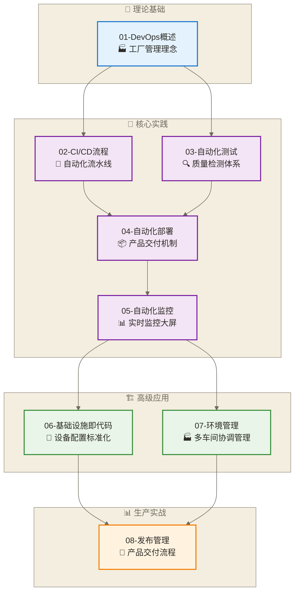

# 数据开发运维导览

> [!abstract] 📋 模块概览
> - 🎯 **学习目标**：构建现代化数据开发运维体系，实现稳定高效的数据服务交付
> - 📚 **模块内容**：8个核心文档，涵盖DevOps理念到实践落地全流程
> - ⏱️ **学习时长**：预计6周按下述阶段安排学习
> - 🔗 **前置要求**：[[【数据开发与数据架构】/10-云原生数据架构/00-云原生数据架构导览|云原生数据架构导览]]基础知识

## 🏭 什么是数据开发运维

数据开发运维（Data DevOps）是将DevOps理念与实践应用于数据开发领域，通过**自动化、标准化、可观测性**三大核心要素，构建高效稳定的数据产品交付体系。

> [!tip] 💡 生活化理解：现代制造工厂的生产管理体系
> 
> 想象数据开发运维就像管理一座现代化的智能制造工厂：
> 
> **🏭 生产车间** = 数据开发环境
> - 标准化的生产线设计
> - 统一的质量标准和流程
> - 灵活的产能调整能力
> 
> **🤖 自动化流水线** = CI/CD管道
> - 从原料（代码）到成品（数据产品）的全自动化生产
> - 每个环节都有质检点，确保产品质量
> - 故障自动停机，快速定位问题
> 
> **📊 中控大屏** = 监控告警系统
> - 实时展示所有生产线状态
> - 预警系统在问题发生前就提醒
> - 历史数据分析优化生产效率
> 
> **🔧 维修团队** = 运维工程师
> - 快速响应和解决生产故障
> - 定期维护保养确保设备稳定
> - 持续改进生产工艺和流程

### 🎯 为什么需要数据开发运维？

在数字化时代，数据开发运维解决了传统数据开发的核心痛点：

**🔥 传统痛点**：
- **手工部署**：容易出错，效率低下
- **环境不一致**：开发环境正常，生产环境出问题
- **故障发现滞后**：问题发生后才知道，影响业务
- **变更风险高**：不敢频繁更新，积累技术债务

**✅ DevOps价值**：
- **交付速度提升**：从手工部署的小时级到自动化的分钟级
- **质量保障增强**：自动化测试覆盖，减少人为错误
- **系统可靠性提升**：监控预警，快速故障恢复
- **团队协作优化**：开发运维一体化，消除沟通壁垒

## 📚 学习地图与内容架构

### 📋 核心文档清单

本模块围绕**理论基础 → 核心实践 → 高级应用 → 最佳实践**的学习路径设计：

| 阶段 | 文档名称 | 核心主题 | 实践能力 | 估计学习时间 |
|:---:|---|---|---|:---:|
| **🔰 基础篇** | [[【数据开发与数据架构】/11-数据开发运维/01-数据DevOps概述\|数据DevOps概述]] | DevOps理念、数据运维体系架构 | 理解运维价值和基本概念 | 3-4天 |
| **🚀 实践篇** | [[【数据开发与数据架构】/11-数据开发运维/02-数据CI-CD流程\|数据CI-CD流程]] | 持续集成、持续部署管道设计 | 构建自动化交付流水线 | 5-7天 |
| | [[【数据开发与数据架构】/11-数据开发运维/03-数据自动化测试\|数据自动化测试]] | 数据质量测试、管道测试策略 | 设计全面的测试体系 | 4-5天 |
| | [[【数据开发与数据架构】/11-数据开发运维/04-数据自动化部署\|数据自动化部署]] | 部署策略、环境管理、回滚机制 | 实现零停机部署 | 4-5天 |
| | [[【数据开发与数据架构】/11-数据开发运维/05-数据自动化监控\|数据自动化监控]] | 监控体系、告警策略、可观测性 | 构建全方位监控系统 | 5-6天 |
| **🏗️ 高级篇** | [[【数据开发与数据架构】/11-数据开发运维/06-数据基础设施即代码\|数据基础设施即代码]] | IaC理念、基础设施版本化管理 | 代码化管理基础设施 | 4-5天 |
| | [[【数据开发与数据架构】/11-数据开发运维/07-数据环境管理\|数据环境管理]] | 多环境治理、配置管理、环境一致性 | 标准化环境管理体系 | 3-4天 |
| **📊 实战篇** | [[【数据开发与数据架构】/11-数据开发运维/08-数据发布管理\|数据发布管理]] | 发布策略、风险控制、生产运维 | 安全高效的发布管理 | 5-6天 |

### 🗺️ 学习路径图

### 🎯 学习阶段说明

> [!info] 📚 各阶段学习重点
> 
> **🔰 理论基础阶段**
> - 建立DevOps思维模式
> - 理解数据运维的核心价值
> - 掌握运维体系设计原则
> 
> **🚀 核心实践阶段**
> - 动手搭建CI/CD管道
> - 实践自动化测试策略
> - 体验自动化部署流程
> - 构建监控告警体系
> 
> **🏗️ 高级应用阶段**
> - 掌握基础设施代码化管理
> - 实现环境标准化治理
> - 深入理解运维自动化
> 
> **📊 生产实战阶段**
> - 设计生产级发布流程
> - 掌握风险控制策略
> - 积累实战运维经验

## 🎯 能力建设目标

### 🎭 角色转换：从开发者到DevOps工程师

> [!quote] 💭 思维转变
> 
> **传统开发思维**："我的代码能跑就行"
> 
> **DevOps思维**："我的代码要在任何环境都稳定运行，出问题时能快速发现和解决"

### 📈 分层能力目标

#### 🟢 基础能力层（L1-L2）

**💡 理论认知**：
- 深入理解DevOps的核心理念和价值主张
- 掌握数据开发运维的关键概念和术语体系
- 建立"基础设施即代码"的现代化运维思维

**🛠️ 技能操作**：
- 能够设计和搭建基础的CI/CD管道
- 掌握基本的自动化测试和部署方法
- 具备基础的系统监控和告警配置能力

**🎯 实践应用**：
- 能够为小型项目设计完整的DevOps流程
- 具备基本的故障定位和问题解决能力
- 能够进行简单的性能分析和优化

#### 🟡 进阶能力层（L3-L4）

**🏗️ 架构设计**：
- 设计企业级的数据运维体系架构
- 掌握多环境管理和复杂部署策略
- 具备大规模系统的可观测性设计能力

**🚀 技术深度**：
- 熟练运用基础设施即代码（IaC）管理复杂环境
- 掌握高级的监控告警策略和故障自愈机制
- 具备跨平台、多云环境的运维管理能力

**👥 团队协作**：
- 能够建立开发运维一体化的团队文化
- 具备运维流程标准化和最佳实践推广能力
- 能够进行运维知识传承和团队培训

#### 🔴 专家能力层（L5+）

**🎨 创新实践**：
- 能够结合业务特点创新运维解决方案
- 具备行业运维标准制定和推广能力
- 能够在技术社区分享运维实践和经验

## 🔗 知识网络关联

### 📚 前置知识依赖

本模块建立在以下知识基础之上：

> [!note] 🏗️ 架构基础
> - [[【数据开发与数据架构】/10-云原生数据架构/00-云原生数据架构导览|云原生数据架构导览]]：容器化、微服务、K8s基础
> - [[【数据开发与数据架构】/07-数据服务架构/00-数据服务架构导览|数据服务架构导览]]：API管理、服务治理、负载均衡
> - [[【数据开发与数据架构】/09-实时数据架构/00-实时数据架构导览|实时数据架构导览]]：流处理、消息队列、事件驱动

> [!note] 🛠️ 技术工具
> - Docker容器基础：容器化技术基础
> - K8s集群管理：容器编排平台
> - Git版本控制：代码版本管理

### 🎯 后续学习路径

完成本模块学习后，建议继续深入：

> [!success] 📈 能力进阶方向
> 
> **🏢 团队管理方向**
> - [[【数据开发与数据架构】/12-数据开发团队/00-数据开发团队导览|数据开发团队导览]]
> - 学习如何在团队中推广和落地DevOps文化
> 
> **🔍 专业深化方向**
> - Prometheus监控实战
> - Ansible自动化运维
> 
> **🌐 行业应用方向**
> - 金融数据合规运维
> - 电商数据实时运维

### 🔄 横向技能关联

> [!info] 🧩 技能矩阵连接
> 
> | 运维技能 | 关联领域 | 应用场景 |
> |---------|---------|---------|
> | **CI/CD管道** | [[【技术与工具】/Oracle/15-Oracle银行数据质量管理\|Oracle银行数据质量]] | 数据质量自动化检测 |
> | **监控告警** | [[【数据治理与数据管理】/01-快速学习/02-实践方法/数据质量监控实施\|数据质量监控]] | 业务指标异常预警 |
> | **自动化部署** | [[【技术与工具】/Python/32-模型部署\|模型部署]] | ML模型生产化部署 |
> | **环境管理** | [[【数据治理与数据管理】/02-深度研究/02-实施框架/数据治理实施/02-数据标准管理/元数据管理\|元数据]] | 数据安全隔离环境 |

## 🚀 学习实践策略

### 🎓 高效学习方法论

> [!tip] 💡 "工厂学徒"学习法
> 
> 像学习管理现代化工厂一样学习数据运维：
> 
> **👀 观察阶段**：先理解整个"工厂"的运作流程
> **👋 参与阶段**：在"师傅"指导下操作简单"设备"
> **🎯 独立阶段**：能够独立管理一条"生产线"
> **🏆 创新阶段**：优化改进"工厂"的运作效率

#### 📋 分阶段学习策略

**🔰 第1周：概念建立**
- 每天30-60分钟理论学习
- 重点：建立DevOps思维模式
- 实践：搭建本地Git仓库，体验版本控制

**🚀 第2-3周：核心技能**
- 每天1-2小时动手实践
- 重点：CI/CD管道设计与实现
- 实践：用GitHub Actions或Jenkins搭建简单流水线

**🏗️ 第4-5周：高级应用**
- 每天2-3小时项目实战
- 重点：基础设施即代码、环境管理
- 实践：用Terraform或Docker Compose管理基础设施

**📊 第6周：综合实战**
- 完整项目实践
- 重点：发布管理、故障处理
- 实践：设计并实施一个完整的DevOps项目

### 🔧 必备实践工具

> [!example] 🛠️ 工具箱推荐
> 
> **版本控制**: Git + GitHub/GitLab
> **CI/CD平台**: GitHub Actions, Jenkins, GitLab CI
> **容器化**: Docker + Docker Compose
> **编排平台**: Kubernetes (可选用Minikube学习)
> **监控工具**: Prometheus + Grafana
> **日志管理**: ELK Stack (Elasticsearch + Logstash + Kibana)
> **基础设施即代码**: Terraform, Ansible
> **云平台**: AWS/阿里云/腾讯云 (使用前确认免费额度及收费条件)

### ⚠️ 学习重点与难点解析

#### 🎯 核心重点

> [!important] 📌 掌握要点
> 
> 1. **自动化思维**：凡是重复性工作都要考虑自动化
> 2. **可观测性设计**：系统要"能看见、能诊断、能预警"
> 3. **失败快速恢复**：设计要考虑故障场景和恢复策略
> 4. **渐进式改进**：持续优化，避免大爆炸式变更

#### ⚡ 常见难点突破

> [!warning] 🚧 难点攻克策略
> 
> **难点1：复杂系统的运维设计**
> - 解决方案：从单体应用开始，逐步过渡到分布式系统
> - 学习建议：掌握微服务架构基础知识
> 
> **难点2：故障诊断和处理**
> - 解决方案：建立故障知识库，积累常见问题解决方案
> - 学习建议：多看实际故障case，训练排查思路
> 
> **难点3：大规模环境管理**
> - 解决方案：先掌握IaC工具，再学习环境标准化
> - 学习建议：从管理几台机器开始，逐步扩展规模

## ✅ 学习成果检验

### 🎯 能力评估矩阵

> [!note] 📊 自我评估标准
> 
> **评分说明**：1分=了解概念，3分=能独立操作，5分=能教导他人

| 能力领域 | 基础能力（1-2分） | 熟练能力（3-4分） | 专家能力（5分） |
|---------|------------------|------------------|----------------|
| **DevOps理念** | 理解基本概念 | 能设计基础流程 | 能推广最佳实践 |
| **CI/CD实践** | 搭建简单管道 | 设计复杂流水线 | 优化企业级管道 |
| **自动化测试** | 编写基础测试 | 设计测试策略 | 建立测试文化 |
| **监控告警** | 配置基础监控 | 设计告警策略 | 构建可观测性体系 |
| **故障处理** | 基础问题定位 | 复杂故障诊断 | 故障预防与自愈 |
| **环境管理** | 管理开发环境 | 多环境治理 | 大规模环境自动化 |

### ✅ 分阶段检查清单

#### 🔰 基础阶段检查点

- [ ] **概念理解**：能用自己的话解释DevOps的价值和核心理念
- [ ] **工具熟悉**：能熟练使用Git进行代码版本管理
- [ ] **基础实践**：能搭建简单的CI/CD管道（如GitHub Actions）
- [ ] **监控基础**：能配置基本的应用监控和日志收集
- [ ] **故障意识**：具备基本的故障预防和处理意识

#### 🚀 进阶阶段检查点

- [ ] **架构设计**：能设计中等复杂度的运维架构
- [ ] **自动化实践**：能实现基础设施即代码管理
- [ ] **测试策略**：能设计完整的自动化测试策略
- [ ] **监控体系**：能构建全面的监控告警体系
- [ ] **环境管理**：能管理多环境的配置和部署

#### 🏆 高级阶段检查点

- [ ] **体系建设**：能建设企业级的DevOps体系
- [ ] **技术选型**：能进行合理的运维技术选型和架构决策
- [ ] **团队协作**：能推动团队DevOps文化建设
- [ ] **持续改进**：能建立运维效能的持续改进机制
- [ ] **知识传承**：能培训和指导其他团队成员

## 🧭 学习导航中心

### 📖 按学习阶段导航

> [!info] 🎯 推荐学习路径
> 
> **🔰 基础入门** → **🚀 核心实践** → **🏗️ 高级应用** → **📊 生产实战**

| 学习阶段 | 核心文档 | 学习重点 | 预计时间 |
|:-------:|---------|---------|:-------:|
| **🔰 基础** | [[【数据开发与数据架构】/11-数据开发运维/01-数据DevOps概述\|数据DevOps概述]] | DevOps理念与价值体系 | 3-4天 |
| **🚀 实践** | [[【数据开发与数据架构】/11-数据开发运维/02-数据CI-CD流程\|数据CI-CD流程]] | 自动化交付管道 | 5-7天 |
| | [[【数据开发与数据架构】/11-数据开发运维/03-数据自动化测试\|数据自动化测试]] | 质量保障体系 | 4-5天 |
| | [[【数据开发与数据架构】/11-数据开发运维/04-数据自动化部署\|数据自动化部署]] | 高效部署策略 | 4-5天 |
| | [[【数据开发与数据架构】/11-数据开发运维/05-数据自动化监控\|数据自动化监控]] | 可观测性建设 | 5-6天 |
| **🏗️ 高级** | [[【数据开发与数据架构】/11-数据开发运维/06-数据基础设施即代码\|数据基础设施即代码]] | 基础设施自动化 | 4-5天 |
| | [[【数据开发与数据架构】/11-数据开发运维/07-数据环境管理\|数据环境管理]] | 环境标准化治理 | 3-4天 |
| **📊 实战** | [[【数据开发与数据架构】/11-数据开发运维/08-数据发布管理\|数据发布管理]] | 生产发布管理 | 5-6天 |

### 🔄 模块间导航

> [!example] 🗺️ 知识网络连接
> 
> **⬅️ 前置模块**：
> - [[【数据开发与数据架构】/10-云原生数据架构/00-云原生数据架构导览|云原生数据架构导览]]：容器化与微服务基础
> - [[【数据开发与数据架构】/07-数据服务架构/00-数据服务架构导览|数据服务架构导览]]：API治理与服务管理
> 
> **➡️ 后续模块**：
> - [[【数据开发与数据架构】/12-数据开发团队/00-数据开发团队导览|数据开发团队导览]]：团队协作与文化建设
> 
> **🔗 相关领域**：
> - [[【技术与工具】/Oracle/15-Oracle银行数据质量管理|Oracle银行数据质量]]：质量检测自动化
> - 模型部署运维：ML运维实践

### 🚀 快速开始指南

> [!success] 🎯 30秒快速开始
> 
> 1. **如果你是初学者**：直接从 [[【数据开发与数据架构】/11-数据开发运维/01-数据DevOps概述|数据DevOps概述]] 开始
> 2. **如果有一些经验**：可以跳到 [[【数据开发与数据架构】/11-数据开发运维/02-数据CI-CD流程|数据CI-CD流程]] 开始实践
> 3. **如果想深入学习**：建议完整学习所有8个文档
> 4. **如果时间有限**：重点学习01、02、05、08四个核心文档

---

## 📝 文档信息

> [!metadata] 📋 版本信息
> - **📅 创建时间**：2024-12-19
> - **编辑更新时间**：见元数据 updated；原页尾日期2024-12-19  仅保留为历史记录，不作为现行更新时间或事实核验日期。
> - **⏱️ 预计学习时长**：6周完整学习
> - **🎯 目标读者**：数据工程师、运维工程师、架构师
> - **📊 难度等级**：中级到高级
> - **🔗 文档版本**：v1.0

> [!quote] 💭 学习寄语
> 
> "DevOps不仅仅是一套工具和技术，更是一种文化和思维方式。在数据领域，它能帮助我们构建更稳定、更高效、更可靠的数据产品交付体系。
> 
> 记住：**最好的运维是让系统能够自我管理，最好的DevOps是让团队能够快速交付价值。**"

---

**标签云**：#数据运维 #DevOps #CI/CD #自动化部署 #监控告警 #基础设施即代码 #环境管理 #发布管理 #数据架构 #工程效率 