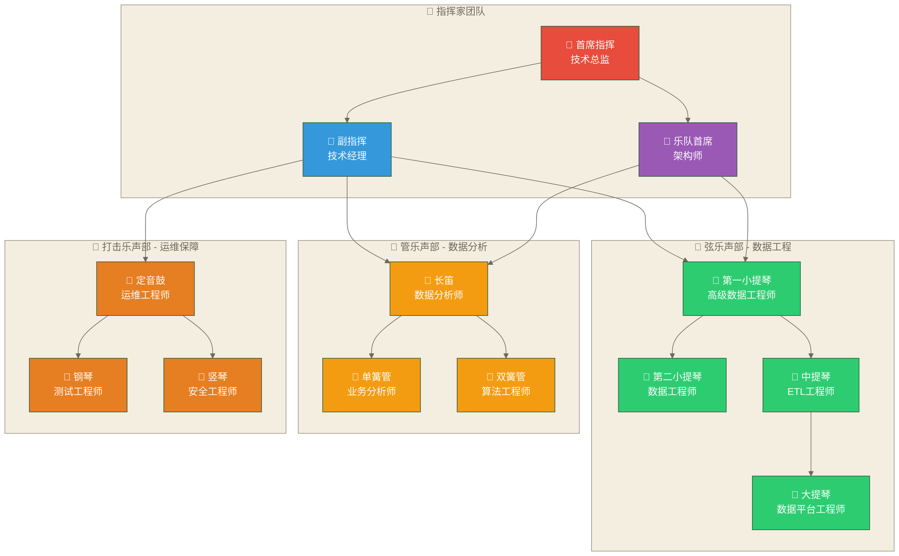

# 数据开发团队导览：交响乐团的数据艺术 🎼

> [!abstract] 🎵 模块概览：指挥家的总谱
> - 🎯 **学习目标**：掌握数据开发团队的组织设计、管理艺术和最佳实践
> - 📚 **模块内容**：7个核心乐章，构成完整的团队管理交响曲
> - ⏱️ **学习时长**：核心学习与完整实践周期尚未核定，请按已有经验和项目范围安排
> - 🔗 **前置要求**：[[【数据开发与数据架构】/11-数据开发运维/00-数据开发运维导览|数据开发运维导览]]

## 🎼 为什么用交响乐团来理解数据团队？

数据开发团队是数据开发与架构知识体系的**组织核心**，就像一支世界级交响乐团，需要精妙的组织、协调与指挥才能奏响数据的华美乐章。

> [!tip] 🎭 交响乐团与数据开发团队的完美映射
> 
> **数据开发团队 = 交响乐团**的深层类比：
> 
> **🎼 指挥家系统**：
> - **首席指挥**：技术总监/团队负责人（统筹全局）
> - **副指挥**：技术经理/项目经理（协调执行）
> - **乐队首席**：技术专家/架构师（技术引领）
> 
> **🎻 声部编制**：
> - **弦乐声部**：数据工程师（基础架构，如小提琴的主旋律）
> - **管乐声部**：数据分析师（业务洞察，如管乐的和声）
> - **铜管声部**：平台工程师（系统支撑，如铜管的力量）
> - **打击乐声部**：运维工程师（节奏控制，如打击乐的节拍）
> 
> **🎶 演奏协调**：
> - **乐谱**：项目需求和技术规范
> - **排练**：日常开发协作和代码评审
> - **演出**：产品交付和系统上线
> - **音乐会**：项目里程碑和成果展示

在数据驱动的时代，**交响式团队管理**决定了：
- **和谐统一**：各角色协同作战，避免"各自为政"
- **技艺精进**：持续学习提升，如音乐家的日常练习
- **创新表达**：在标准化基础上发挥创造力
- **完美演出**：高质量交付让"观众"（业务方）满意

### 🎼 数据开发团队的交响乐团结构

## 🎼 模块内容：七个乐章的交响曲

### 🎵 乐章清单：从乐队组建到完美演出

| 乐章 | 文档名称 | 音乐类比 | 核心内容 | 学习重点 |
|---|---|---|---|---|
| **第一乐章** | [[【数据开发与数据架构】/12-数据开发团队/01-数据开发团队组织\|数据开发团队组织]] | 🎼 **乐团编制设计** | 组织结构设计、团队模式选择 | 理解不同编制模式的适用场景 |
| **第二乐章** | [[【数据开发与数据架构】/12-数据开发团队/02-数据开发团队角色\|数据开发团队角色]] | 🎻 **声部角色定位** | 角色定义、职责划分、能力要求 | 掌握各"声部"的技能和协作方式 |
| **第三乐章** | [[【数据开发与数据架构】/12-数据开发团队/03-数据开发团队流程\|数据开发团队流程]] | 🎶 **排练节奏控制** | 工作流程、协作机制、节拍同步 | 理解高效"排练"的设计原则 |
| **第四乐章** | [[【数据开发与数据架构】/12-数据开发团队/04-数据开发团队协作\|数据开发团队协作]] | 🎺 **多声部和谐** | 协作模式、工具平台、同步机制 | 掌握跨"声部"协作的精妙技艺 |
| **第五乐章** | [[【数据开发与数据架构】/12-数据开发团队/05-团队技术管理方法论\|团队技术管理方法论]] | 🎓 **音乐学院教育** | 技术体系、知识管理、创新机制 | 构建技术"音乐教育"体系 |
| **第六乐章** | [[【数据开发与数据架构】/12-数据开发团队/06-团队文化与激励体系\|团队文化与激励体系]] | 🏆 **音乐家荣誉** | 文化建设、激励设计、团队发展 | 打造如维也纳爱乐般的团队文化 |
| **终章** | [[【数据开发与数据架构】/12-数据开发团队/07-数据团队管理最佳实践\|数据团队管理最佳实践]] | 🎯 **经典演出录音** | 管理实践、问题解决、案例分析 | 学习世界级"指挥家"的成功经验 |

### 🎼 学习路径：从学徒到大师的音乐之旅

```mermaid
%%{init: {"theme":"base","themeVariables":{"fontFamily":"PingFang SC, -apple-system, Source Han Serif SC, serif","fontSize":"16px","background":"#FDFBF5","primaryColor":"#FDFBF5","primaryTextColor":"#2D2A26","primaryBorderColor":"#6E6A60","secondaryColor":"#E8EFE8","secondaryBorderColor":"#8FA890","secondaryTextColor":"#2D2A26","tertiaryColor":"#FDFBF5","tertiaryBorderColor":"#9A9488","tertiaryTextColor":"#6E6A60","lineColor":"#6E6A60","textColor":"#2D2A26","mainBkg":"#FDFBF5","nodeBorder":"#2D5A3D","clusterBkg":"#F3EEDF","clusterBorder":"#9A9488","edgeLabelBackground":"#FDFBF5"},"flowchart":{"htmlLabels":true,"curve":"basis","padding":20,"nodeSpacing":60,"rankSpacing":70,"useMaxWidth":false},"themeCSS":".node rect, .node polygon, .node circle { stroke-width: 1.5px; } .edgePath .path { stroke-width: 1.5px; } .cluster-label .nodeLabel, .cluster-label foreignObject { color: #2D2A26 !important; } .edgeLabel, .edgeLabel foreignObject { color: #2D2A26 !important; background-color: #FDFBF5; } .edgeLabel rect { fill: #FDFBF5; }"}}%%
flowchart TD
    A["🎼 交响乐团概述<br/>理解团队如乐团"] --> B["🎻 乐团编制设计<br/>设计组织架构"]
    B --> C["🎺 声部角色分工<br/>定义团队角色"]
    C --> D["🎶 排练流程设计<br/>优化工作流程"]
    D --> E["🤝 和声协作技巧<br/>提升协作效率"]
    E --> F["🎓 技艺传承体系<br/>建设技术管理"]
    F --> G["🏆 乐团文化精神<br/>培养团队文化"]
    G --> H["🎯 大师指挥艺术<br/>掌握最佳实践"]
    H --> I["🎪 完美音乐会<br/>团队管理大师"]
    
    style A fill:#8b5a3c,color:#ffffff
    style B fill:#2e4057,color:#ffffff  
    style C fill:#2e4057,color:#ffffff
    style D fill:#2e4057,color:#ffffff
    style E fill:#2e4057,color:#ffffff
    style F fill:#2e4057,color:#ffffff
    style G fill:#2e4057,color:#ffffff
    style H fill:#2e4057,color:#ffffff
    style I fill:#8b5a3c,color:#ffffff
```

> [!note] 🎭 学习路径说明
> 
> 这个学习路径遵循音乐教育的经典模式：
> - **基础理论**：先理解乐团的整体概念
> - **技能训练**：逐步掌握各种"演奏技巧"
> - **实战演练**：在实际项目中应用团队管理方法
> - **大师境界**：最终达到"指挥家"的艺术高度

## 🎯 学习目标：音乐家的成长阶梯

### 🎼 第一阶段：音乐学徒（初级目标）

**🎵 音乐理论基础**：
- 理解"交响乐团"式数据团队的核心概念和组织哲学
- 掌握不同"乐团编制"（团队架构）的基本设计原理
- 了解"声部协作"（团队合作）的基本音乐规律

**🎻 演奏技能基础**：
- 能够设计基本的数据开发团队"乐团编制"
- 掌握"声部协调"（团队协作）的基本指挥技巧
- 能够进行简单的"排练管理"（项目管理）

**🎭 音乐素养培养**：
- 具备"指挥家思维"（团队管理思维）
- 能够根据"演出需求"（业务需求）设计合适的团队结构
- 理解团队"和谐演奏"对"音乐会成功"（项目成功）的影响

### 🏆 第二阶段：专业演奏家（中级目标）

**🎪 为大型演出准备**（为实战案例做准备）：
- 理解团队管理在实际"音乐会"（项目）中的应用艺术
- 掌握团队"演出录音"（案例）的分析和学习方法
- 了解"音乐经验"（团队经验）的总结和传承技巧

**🎓 为音乐事业发展准备**（为职业发展做准备）：
- 理解团队管理对"音乐家职业生涯"（职业发展）的深远影响
- 掌握"指挥家领导力"（团队领导力）的系统培养方法
- 了解从"演奏家"到"指挥家"（团队管理）的职业发展路径

## 🎼 与其他乐章的关联：音乐会的完整体验

### 🎵 前置乐章：音乐基础训练

本"团队管理交响曲"基于以下"基础练习"：

- **[[【数据开发与数据架构】/11-数据开发运维/00-数据开发运维导览|数据开发运维导览]]**：如乐团的"技术保障团队"，确保演出设备完美运行
- **[[【数据开发与数据架构】/08-数据中台架构/00-数据中台架构导览|数据中台架构导览]]**：如"音乐厅的声学设计"，为团队协作提供基础设施
- **[[【数据开发与数据架构】/07-数据服务架构/00-数据服务架构导览|数据服务架构导览]]**：如"分谱系统"，明确各声部的演奏内容和协作方式
- **[[【数据开发与数据架构】/10-云原生数据架构/00-云原生数据架构导览|云原生数据架构导览]]**：如"现代化音乐厅"，为团队提供先进的工作环境

> [!info] 🎭 音乐学习的连贯性
> 就像学习钢琴需要先练习音阶，团队管理需要对底层技术架构有深入理解，才能做出正确的组织决策。

### 🎪 后续音乐会：从练习到演出

完成本"交响乐团管理"学习后，你将能够：

- **进入[[【数据开发与数据架构】/13-技术选型与评估/00-技术选型与评估导览|技术选型与评估导览]]**：如"乐器选择大师"，为团队选择最适合的技术工具
- **开始[[【数据开发与数据架构】/16-实战案例/00-实战案例导览|实战案例导览]]**：如参与"世界级音乐会演出"，在真实项目中应用团队管理艺术
- **为[[【数据开发与数据架构】/99-职业发展/00-职业发展导览|职业发展导览]]做准备**：从"乐团成员"成长为"指挥家"，实现职业生涯的华丽转身

> [!tip] 🏆 音乐家的成长路径
> 
> **技术专家 → 团队管理 → 架构决策 → 实战应用 → 职业成长**
> 
> 这是一个完整的"从演奏家到指挥家"的成长旋律，每个阶段都相互依存，共同构成数据人的职业交响曲。

## 🎼 音乐学习实践建议

### 🎓 音乐教育方法论

1. **🎵 理论与实践结合**：像学习音乐一样，通过实际"演出"（项目）理解团队"指挥艺术"
2. **🎪 大师班学习**：通过成功的"音乐会录音"（案例）学习世界级"指挥家"的管理思路
3. **🎻 乐团实习**：在实际团队中应用"排练方法"，从"替补演奏员"做起
4. **📝 演出日志**：像音乐家写演出笔记一样，总结团队管理的"音乐心得"

### 🎯 技艺重点与难点突破

**🎼 核心技艺重点**：
- **乐团编制设计**：团队组织架构的设计原则，如弦乐队 vs 交响乐团的选择
- **排练流程优化**：团队协作流程的设计，如分声部练习 → 合奏彩排的节奏控制
- **乐团文化传承**：团队精神建设，如维也纳爱乐的百年传统

**🎪 高难度挑战**：
- **大型管弦乐团指挥**：大规模团队的组织管理，需要分层次的"副指挥"体系
- **多乐团协作演出**：跨部门协作的协调，如歌剧中交响乐团与合唱团的配合
- **音乐传统传承**：团队文化的代际传承，如老音乐家对新人的"师徒制"培养

> [!warning] ⚠️ 常见的"演奏失误"
> 
> - **节拍不齐**：团队成员步调不一致，缺乏统一的工作节奏
> - **声部抢戏**：某个角色过度表现，破坏团队和谐
> - **忽视伴奏**：只关注主角色，忽视支撑角色的重要性

## ✅ 音乐技能考级检查点

### 🎼 音乐基础级（业余2-3级水平）

**🎵 基础音乐理论**：
- [ ] 理解"交响乐团"式数据团队的核心概念和组织哲学
- [ ] 掌握基本的"乐团编制"（团队组织架构）设计方法
- [ ] 理解"声部协作"（团队合作）的基本音乐原理

**🎻 基础演奏技能**：
- [ ] 能够设计基本的"室内乐"（小团队）组织结构
- [ ] 掌握"分谱练习"（团队协作）的基本方法
- [ ] 能够进行简单的"排练计划"（项目管理）

**🎭 音乐素养入门**：
- [ ] 具备"指挥家思维"（团队管理思维）的基础认识
- [ ] 理解"团队和谐演奏"对"演出成功"（项目成功）的重要性

### 🏆 音乐专业级（专业演奏家水平）

**🎪 大型演出能力**：
- [ ] 能够设计复杂的"管弦乐团"（大规模团队）架构
- [ ] 掌握"多声部协作"（高级团队协作）的精妙技艺
- [ ] 能够进行"音乐学院"式的深度技能建设

**🎯 指挥家艺术**：
- [ ] 掌握复杂"音乐会"（项目）的全程指挥方法
- [ ] 能够设计如"维也纳爱乐"般的高绩效团队文化
- [ ] 掌握团队"演奏水平"（绩效）的高级评估和提升方法

**🎓 大师级领导力**：
- [ ] 具备"首席指挥"（团队领导者）的全面素质
- [ ] 能够指导和培养下一代"音乐家"（团队成员）
- [ ] 具备创建和传承"音乐传统"（团队文化）的能力

> [!success] 🎖️ 学习自查标准（音乐类比，非正式认证）
> 
> **业余级**：能够在小型"室内乐"团队中胜任一个声部  
> **专业级**：能够在大型交响乐团中担任"声部首席"  
> **大师级**：能够作为"指挥家"领导整个乐团创造音乐奇迹

## 🎼 音乐厅快速导航

### 🎵 交响曲乐章导航

**🎼 第一乐章**：[[【数据开发与数据架构】/12-数据开发团队/01-数据开发团队组织|数据开发团队组织]] - 设计你的交响乐团  
**🎻 第二乐章**：[[【数据开发与数据架构】/12-数据开发团队/02-数据开发团队角色|数据开发团队角色]] - 定义每个声部的职责  
**🎶 第三乐章**：[[【数据开发与数据架构】/12-数据开发团队/03-数据开发团队流程|数据开发团队流程]] - 从练习到完美演出  
**🎺 第四乐章**：[[【数据开发与数据架构】/12-数据开发团队/04-数据开发团队协作|数据开发团队协作]] - 多声部和谐协作的艺术  
**🎓 第五乐章**：[[【数据开发与数据架构】/12-数据开发团队/05-团队技术管理方法论|团队技术管理]] - 音乐学院式的人才培养  
**🏆 第六乐章**：[[【数据开发与数据架构】/12-数据开发团队/06-团队文化与激励体系|团队文化与激励]] - 建设如维也纳爱乐般的团队文化  
**🎯 终章**：[[【数据开发与数据架构】/12-数据开发团队/07-数据团队管理最佳实践|数据团队管理]] - 世界级指挥家的管理智慧  

### 🎪 音乐会季节票

**🎵 上一场演出**：[[【数据开发与数据架构】/11-数据开发运维/00-数据开发运维导览|数据开发运维导览]] - 技术保障团队的艺术  
**🎭 下一场演出**：[[【数据开发与数据架构】/16-实战案例/00-实战案例导览|实战案例导览]] - 在真实舞台上的华彩演出  

### 🎖️ 相关音乐会推荐

- **[[【数据开发与数据架构】/13-技术选型与评估/00-技术选型与评估导览|技术选型与评估导览]]** - 为你的乐团选择最佳装备
- **[[【数据开发与数据架构】/99-职业发展/00-职业发展导览|职业发展导览]]** - 从学徒到大师的成长之路

---

> [!quote] 🎼 指挥家寄语
> 
> *"一个伟大的交响乐团，不是因为拥有最好的单个演奏家，而是因为每个音乐家都知道如何让自己的声音与整体和谐共鸣。数据开发团队亦如是。"*
> 
> — 本文教学类比寄语，不作为卡拉扬原话或已核实观点

**创建时间**：2024-12-19  
**编辑更新时间**：见元数据 updated；原页尾日期2024-12-19  仅保留为历史记录，不作为现行更新时间或事实核验日期。
**预计完成**：完整学习与实践周期未核定  

#团队管理 #交响乐团 #组织架构 #协作艺术 #指挥家智慧 #音乐家成长
