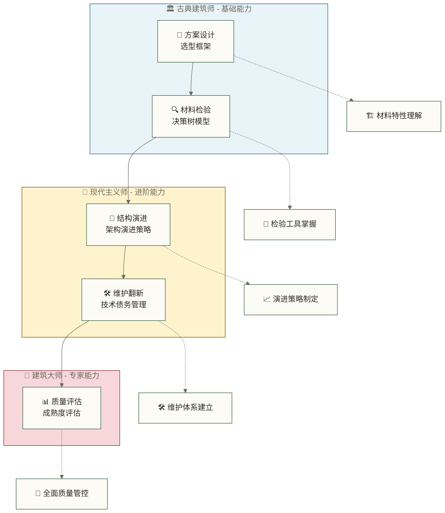

# 技术选型与评估导览 - 建筑大师的设计哲学

> [!quote] 🏛️ 建筑大师的智慧
> "伟大的建筑源于深思熟虑的材料选择和精湛的工艺评估。技术选型如同建筑设计，需要平衡美学、功能、成本和可持续性。" 
> 
> —— 本文教学类比寄语；原文提到路易斯·康(Louis Kahn)，但未提供出处，不作为其原话或已核实观点。

建筑大师工作室汇聚了技术选型与评估的核心理念。我们像建筑大师一样进行技术选型，追求功能与美学的完美结合。工作室涵盖5种建筑风格，对应从古典到现代主义的不同技术选型场景。我们的设计流程遵循「材料选择 → 质量检验 → 结构演进 → 维护策略 → 成熟度评估」的系统化路径，与[[【数据开发与数据架构】/04-数据架构设计/00-数据架构设计导览.md|数据架构设计导览]]和[[【数据开发与数据架构】/17-技术趋势/00-技术趋势导览.md|技术趋势导览]]形成深度协同关系。

## 🏛️ 为什么数据工程师需要建筑大师思维？

### 🏗️ 建筑大师的选材困境

> 🏛️ **大师级架构师的设计挑战**
> 
> 想象一位建筑大师正在设计一座现代数据中心大厦，他面临的选择困境：
> - **结构材料**：应该选择传统的钢筋混凝土(MySQL)，还是现代的预制构件(ClickHouse)，或者是轻质钢结构(Elasticsearch)？
> - **设计风格**：古典稳重风格适合长期使用，现代简约风格更符合当前潮流，后现代融合风格则兼顾创新
> - **考虑因素**：承重能力(性能)、建造成本、施工难度(技能要求)、维护便利性、未来扩建可能...
> - **决策困惑**：没有系统的材料评估体系，担心选择失误影响整体建筑质量
> 
> **这就是建筑大师设计哲学的价值**：提供系统的材料选择与工艺评估框架，以结合工作负载验证和持续复评、提高设计决策的长期适用性为目标。

### 🏛️ 技术选型的建筑设计挑战

```mermaid
%%{init: {"theme":"base","themeVariables":{"fontFamily":"PingFang SC, -apple-system, Source Han Serif SC, serif","fontSize":"16px","background":"#FDFBF5","primaryColor":"#FDFBF5","primaryTextColor":"#2D2A26","primaryBorderColor":"#6E6A60","secondaryColor":"#E8EFE8","secondaryBorderColor":"#8FA890","secondaryTextColor":"#2D2A26","tertiaryColor":"#FDFBF5","tertiaryBorderColor":"#9A9488","tertiaryTextColor":"#6E6A60","lineColor":"#6E6A60","textColor":"#2D2A26","mainBkg":"#FDFBF5","nodeBorder":"#2D5A3D","clusterBkg":"#F3EEDF","clusterBorder":"#9A9488","edgeLabelBackground":"#FDFBF5"},"flowchart":{"htmlLabels":true,"curve":"basis","padding":20,"nodeSpacing":60,"rankSpacing":70,"useMaxWidth":false},"themeCSS":".node rect, .node polygon, .node circle { stroke-width: 1.5px; } .edgePath .path { stroke-width: 1.5px; } .cluster-label .nodeLabel, .cluster-label foreignObject { color: #2D2A26 !important; } .edgeLabel, .edgeLabel foreignObject { color: #2D2A26 !important; background-color: #FDFBF5; } .edgeLabel rect { fill: #FDFBF5; }"}}%%
flowchart TB
    A[🏛️ 建筑设计挑战] --> B[🏗️ 材料复杂性]
    A --> C[📈 需求不确定性]
    A --> D[💰 资源约束]
    A --> E[👥 工匠能力]
    
    B --> B1[材料选择众多<br/>技术选项丰富]
    B --> B2[工艺发展快速<br/>技术更新迭代]
    B --> B3[结构集成复杂<br/>系统整合难度]
    
    C --> C1[设计需求变化<br/>业务需求调整]
    C --> C2[使用规模预估<br/>业务增长预测]
    C --> C3[应用场景多样<br/>使用模式复杂]
    
    D --> D1[⏰ 建设工期压力]
    D --> D2[💸 建造成本限制]
    D --> D3[👷 施工人力不足]
    
    E --> E1[🛠️ 工匠技能差异]
    E --> E2[📚 学习培训成本]
    E --> E3[🔧 后期维护能力]
    
    style A fill:#e8f4f7
    style B fill:#fff3cd
    style C fill:#f8d7da
    style D fill:#d4edda
    style E fill:#cce5ff
```

## 🏗️ 建筑大师工作室的五大设计风格

### 🏛️ 建筑风格与技术选型的对应关系

> [!tip] 🎨 建筑美学与技术理念
> 下表用建筑风格类比不同设计理念和技术特征，仅用于学习导览，不是技术产品的正式分类；实际选型仍需结合工作负载、可靠性、成本和团队能力进行评估。

| 建筑风格 | 技术特征 | 适用场景 | 设计要点 |
|----------|----------|----------|----------|
| 🏛️ **古典建筑** | 成熟稳定的传统技术栈 *如MySQL, Java, Spring* | 金融、政务等对稳定性要求极高的场景 | 注重可靠性与兼容性 |
| 🏢 **现代主义** | 简约高效的现代技术方案 *如PostgreSQL, Go, Microservices* | 中等规模的企业应用 | 追求功能性与效率 |
| 🌉 **后现代主义** | 创新融合的新兴技术架构 *如NoSQL, Cloud Native, Serverless* | 互联网公司、创新项目 | 强调灵活性与创新 |
| 🏘️ **实用主义** | 务实的混合技术组合 *如SQL+NoSQL, Batch+Stream* | 大多数企业级应用 | 平衡各方面需求 |
| 🔮 **未来主义** | 前沿实验性技术 *如AI Native, Quantum Computing* | 研究项目、技术探索 | 面向未来的技术布局 |

### 🎯 建筑大师的设计方法论

| 建筑阶段 | 对应文档 | 核心设计理念 | 掌握技能 |
|----------|----------|-------------|----------|
| 📐 **方案设计** | [[【数据开发与数据架构】/13-技术选型与评估/01-数据技术选型框架.md\|数据技术选型框架]] | 建筑材料与工艺选择 | 掌握系统性选型方法 |
| 🔍 **材料检验** | [[【数据开发与数据架构】/13-技术选型与评估/02-数据技术选型决策树与评估模型.md\|数据技术选型决策树与评估模型]] | 建筑材料质量检验 | 学会评估工具使用 |
| 🔄 **结构演进** | [[【数据开发与数据架构】/13-技术选型与评估/03-技术架构演进策略.md\|技术架构演进策略]] | 建筑风格发展改造 | 理解演进路径规划 |
| 🛠️ **维护翻新** | [[【数据开发与数据架构】/13-技术选型与评估/04-技术债务管理方法论.md\|技术债务管理方法论]] | 建筑维护与翻新策略 | 掌握债务管理方法 |
| 📊 **质量评估** | [[【数据开发与数据架构】/13-技术选型与评估/05-数据架构成熟度评估.md\|数据架构成熟度评估]] | 建筑技术成熟度判断 | 学会架构诊断技能 |
| 🧭 **治理工具链** | [[【数据开发与数据架构】/13-技术选型与评估/06-元数据血缘与数据质量工具链.md\|元数据血缘与数据质量工具链]] | 目录、血缘与质量闭环 | 形成组合架构和验收标准 |
| ⚡ **查询服务层** | [[【数据开发与数据架构】/13-技术选型与评估/07-现代查询引擎与实时OLAP选型.md\|现代查询引擎与实时OLAP选型]] | 联邦查询、实时OLAP与表格式分层 | 按工作负载选择查询体系 |

### 🏗️ 建筑大师的成长路径

> [!note] 📐 建筑设计的层次进阶
> 如同建筑师从学徒到大师的成长历程，技术选型能力也需要层层递进的培养过程。

## 🎓 建筑大师的进阶成长目标

### 🏛️ 古典建筑师阶段 (掌握基础设计理念)

> [!success] 🎯 **建筑学徒的基本功**
> 像古典建筑师一样，注重基础的扎实和原理的理解，为后续的设计创新打下坚实基础。

古典建筑师阶段的学习目标是逐步建立扎实的设计基础能力。首先，学习目标是深入理解建筑材料（技术）的基本特性和适用场景，学会识别不同材料的优势与局限。同时，学习目标是掌握建筑设计（选型）的基本原则和评估维度，形成系统性的选型思维。此外，学习目标还包括学会使用基础的材料检验（评估）工具，为后续的高级设计工作奠定坚实基础。

建筑师资格检验要求你能够为简单建筑项目选择合适的材料方案，充分理解建筑材料选择的主要考虑因素。你需要掌握基本的材料特性对比方法，具备识别不同建筑风格特点的能力。

### 🏢 现代主义建筑师阶段 (运用设计工具)

> [!success] 🎯 **现代建筑师的系统思维**
> 具备现代主义的功能导向思维，能够系统性地进行建筑设计决策和项目管理。

现代主义建筑师阶段以提升系统设计能力为学习目标。本阶段的学习目标是熟练掌握建筑设计决策框架和评估模型，并练习运用量化方法进行技术选型。同时，学习目标包括理解建筑结构演进和改造的规划方法，逐步培养前瞻性的架构演进视野。此外，学习目标包括掌握建筑维护和翻新的管理策略，培养全生命周期的管理思维。

现代主义建筑师资格检验需要你能够制定中等复杂度建筑的技术选型方案，熟练使用决策树模型进行材料和工艺评估。你必须具备规划建筑结构演进和改造路径的能力，并全面掌握建筑项目的风险控制方法。

### 🌟 建筑大师阶段 (建立评估体系)

> [!success] 🎯 **建筑大师的综合能力**
> 具备大师级的全局视野和领导能力，能够建立完整的建筑设计治理体系。

建筑大师阶段代表着技术选型能力的最高境界。本阶段的学习目标是练习建立企业级建筑设计（技术选型）治理体系，探索标准化、可复制的选型方法论。学习目标包括掌握建筑质量（架构成熟度）评估的方法体系，并在项目中练习评估和持续改进架构健康度。更重要的是，本阶段旨在培养建筑设计决策的领导力和影响力，为参与和引导团队技术决策积累经验。

建筑大师认证标准要求你能够设计完整的企业级技术选型流程和治理体系，具备进行全面建筑健康度（架构成熟度）评估的专业能力。你需要具备指导团队进行技术决策的专家水准，并能够预见和应对建筑设计的未来发展趋势。

## 💡 建筑大师设计哲学的实际价值

### 🏗️ 对企业建筑项目的价值

> [!example] 🏢 **企业级建筑设计的投资回报**
> 采用建筑大师的设计思维，有望在适用场景和有效实施的条件下，为企业技术投资创造长期价值。

建筑大师设计哲学可能帮助企业改善技术投资回报，具体效果需结合工作负载、实施成本与实际结果评估。合理选型在需求清晰、方案适配并有效实施时，可能降低部分技术风险和质量问题，仍需用项目结果评估。标准化的设计流程在适配项目需求并有效执行时，有望提升决策效率、改善项目进度。评估成本与预期效果可为资源配置提供依据，能否优化仍取决于预算、约束和执行结果。架构风格与可扩展设计是否有助于业务发展或竞争优势，需结合实际需求、维护成本与后续使用结果判断。

### 🎯 对个人建筑师职业的价值

> [!example] 👤 **建筑师职业能力的全面提升**
> 学习建筑设计的权衡思路，积累技术决策能力；能否承担关键决策职责还取决于项目实践、岗位要求和组织机会。

学习并实践建筑师设计理念，有助于提升个人职业能力；学习目标是培养系统性的技术架构设计全局视野，逐步积累技术架构决策经验。技术选型能力作为数据架构师的核心竞争力，可作为职业发展的能力积累方向。同时，学习目标包括培养风险控制能力，降低技术选择失误带来的项目和职业风险。更重要的是，持续的项目实践与成果积累有助于建立技术决策的专业声誉和团队领导影响力。

## 🌉 建筑大师的协作网络

### 🏗️ 建筑设计的基础工程

> [!note] 📚 **建筑师的专业基础**
> 在学习建筑大师的设计哲学之前，需要掌握基本的建筑工程知识和结构设计原理。

在学习建筑大师设计哲学之前，你需要掌握扎实的建筑基础知识。[[【数据开发与数据架构】/04-数据架构设计/00-数据架构设计导览.md|数据架构设计导览]]将帮助你掌握基础的建筑结构设计原理。[[【数据开发与数据架构】/05-数据存储架构/00-数据存储架构导览.md|数据存储架构导览]]让你深入了解各种建筑材料的特性和用途。[[【数据开发与数据架构】/06-数据处理架构/00-数据处理架构导览.md|数据处理架构导览]]则帮助你理解建筑施工的工艺和流程模式。

为了保持与时俱进的设计理念，建议你关注行业发展趋势。[[【数据开发与数据架构】/17-技术趋势/00-技术趋势导览.md|技术趋势导览]]将帮助你跟上现代建筑设计的发展方向，[[【数据开发与数据架构】/99-职业发展/02-数据架构师成长路径.md|数据架构师成长路径]]则让你了解建筑师（数据架构师）的完整能力模型。

### 🔄 建筑大师的后续深化

> [!tip] 🎯 **设计理念的实践应用**
> 掌握建筑大师的设计理念后，需要在实际的建筑项目中验证和完善这些方法。

**学完本模块后，建议继续学习：**
- [[【数据开发与数据架构】/15-性能优化/00-性能优化导览.md|性能优化导览]] - 验证建筑材料选择的效果
- [[【数据开发与数据架构】/11-数据开发运维/00-数据开发运维导览.md|数据开发运维导览]] - 将设计理念落地到实际项目中
- [[【数据开发与数据架构】/16-实战案例/00-实战案例导览.md|实战案例导览]] - 学习大师级建筑项目的选型实践

### 🏛️ 建筑风格的融合发展

> [!abstract] 🌟 **跨领域的设计整合**
> 现代建筑设计需要融合多种风格和技术，形成具有前瞻性的综合解决方案。

**高级进阶路径：**
- [[【数据开发与数据架构】/14-跨领域集成方法论/00-跨领域集成方法论导览.md|跨领域集成方法论导览]] - 学习不同技术的整合方法
- 机器学习 模型开发与部署（引用待维护） - 了解智能化设计辅助工具
- 技术学习与成长策略 - 建立终身学习的专业发展体系

## 🚀 建筑大师工作室的学习计划

### 📐 建筑师培养的三周进阶计划

> [!tip] 🏗️ **系统性的建筑师培养方案**
> 按照建筑师从学徒到大师的成长路径，制定循序渐进的学习计划。

#### 🏛️ 第1周：古典建筑师基础训练
**掌握建筑材料与工艺选择的基础理念**

1. **📐 方案设计基础** - [[【数据开发与数据架构】/13-技术选型与评估/01-数据技术选型框架.md\|数据技术选型框架]] (40分钟)
   - 学习建筑材料的分类和特性分析方法
   - 掌握工艺选择的基本原则和评估维度
   
2. **🔍 材料检验技术** - [[【数据开发与数据架构】/13-技术选型与评估/02-数据技术选型决策树与评估模型.md|数据技术选型决策树与评估]] (35分钟)
   - 学会使用检验工具进行材料质量评估
   - 掌握决策树模型进行系统性选择

#### 🏢 第2周：现代主义建筑师进阶训练
**掌握建筑结构演进与维护管理**

3. **🔄 结构演进规划** - [[【数据开发与数据架构】/13-技术选型与评估/03-技术架构演进策略.md|技术架构演进]] (45分钟)
   - 理解建筑风格的演进历程和发展趋势
   - 掌握建筑改造和结构升级的规划方法
   
4. **🛠️ 维护翻新策略** - [[【数据开发与数据架构】/13-技术选型与评估/04-技术债务管理方法论.md|技术债务管理]] (35分钟)
   - 学习建筑老化识别和维护策略制定
   - 掌握翻新项目的成本控制和风险管理

#### 🌟 第3周：建筑大师综合能力培养
**建立完整的建筑质量评估体系**

5. **📊 质量评估体系** - [[【数据开发与数据架构】/13-技术选型与评估/05-数据架构成熟度评估.md|数据架构成熟度评估]] (40分钟)
6. **🧭 治理工具链** - [[【数据开发与数据架构】/13-技术选型与评估/06-元数据血缘与数据质量工具链.md|元数据血缘与数据质量工具链]]
7. **⚡ 查询体系** - [[【数据开发与数据架构】/13-技术选型与评估/07-现代查询引擎与实时OLAP选型.md|现代查询引擎与实时OLAP选型]]
   - 建立建筑质量的全面评估模型
   - 掌握建筑技术成熟度的判断标准

### 🎯 建筑大师的学习原则

> [!important] 📚 **建筑设计的实践导向学习法**
> 建筑大师的智慧来源于理论与实践的完美结合，每个设计理念都要在实际项目中验证。

1. **🏗️ 理论联系实践**：每学习一个建筑设计理念，都要结合实际的数据项目思考应用
2. **🔧 工具化应用**：将建筑设计框架制作成可复用的选型评估工具和检查清单
3. **📚 案例积累建档**：收集和分析真实的建筑设计(技术选型)案例，建立个人案例库
4. **🔄 持续学习更新**：关注建筑潮流(技术发展)，定期更新设计知识和材料信息
5. **👥 同行交流学习**：参与建筑师社区，与其他设计师分享经验和最佳实践

## ✅ 建筑大师资格认证标准

### 🏗️ 建筑师能力评估体系

> [!success] 🎓 **分级式建筑师资格认证**
> 借用建筑师成长阶段的类比，建立本模块的技术选型能力学习自评标准；下文“资格”“认证”均指模块自评，不代表建筑职业资格或外部授证。

#### 🏛️ 古典建筑师资格 (基础能力认证)
**必须掌握的核心技能：**
- [ ] 🏗️ 理解建筑材料(技术)选型的核心原则和基本方法
- [ ] 📊 掌握建筑质量(技术)评估的主要维度和指标
- [ ] 🔧 会使用基本的材料检验(决策)工具和评估框架
- [ ] 🎨 能够识别不同建筑风格(技术路线)的特点和适用场景

#### 🏢 现代主义建筑师资格 (进阶能力认证)
**建议掌握的专业技能：**
- [ ] 📐 能够制定中等复杂度建筑项目的技术选型方案
- [ ] 🔄 掌握建筑结构(架构)演进的规划和实施方法
- [ ] 🛠️ 理解建筑维护(技术债务)的识别和管理策略
- [ ] ⚖️ 具备平衡功能、成本、美学的综合设计能力

#### 🌟 建筑大师资格 (专家能力认证)
**努力达到的大师级技能：**
- [ ] 🏗️ 建立企业级建筑设计(技术选型)治理体系
- [ ] 📊 进行全面的建筑健康度(架构成熟度)评估
- [ ] 👥 具备建筑设计(技术)决策的领导力和影响力
- [ ] 🔮 能够预见并引领建筑设计(技术)发展趋势

### 🎯 建筑师作品集要求

> [!example] 📚 **实践项目成果展示**
> 建筑大师不仅需要理论知识，更需要丰富的实践经验和成功案例。

**个人建筑设计作品集应包含：**
- 🏛️ 至少3个不同风格的建筑设计(技术选型)案例
- 📊 完整的材料选择(技术评估)决策过程文档
- 🔄 成功的建筑改造(架构演进)项目经验
- 🛠️ 建筑维护(技术债务管理)的方法论和工具
- 📈 建筑质量评估和改进的量化成果

---

> [!quote] 🌟 **建筑大师的最终目标**
> "伟大的建筑师不仅能设计出功能完善的建筑，更能通过深思熟虑的材料选择和工艺评估，创造出经得起时间考验的杰作。在数据工程的世界里，我们同样需要这种追求卓越的匠心精神。"

---

**创建时间**：2024-12-19  
**编辑更新时间**：见元数据 updated；历史页尾日期2024-12-19来源与含义未核定，不作为现行更新时间或事实核验日期。  
**预计完成学习时间**：3周  
**本篇导览难度**：基础（模块学习自评涉及中级至高级能力目标）

#技术选型 #架构评估 #建筑设计 #材料选择 #工艺评估 #建筑大师