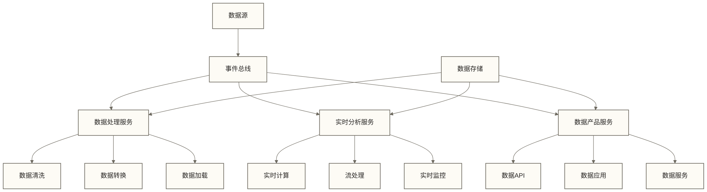
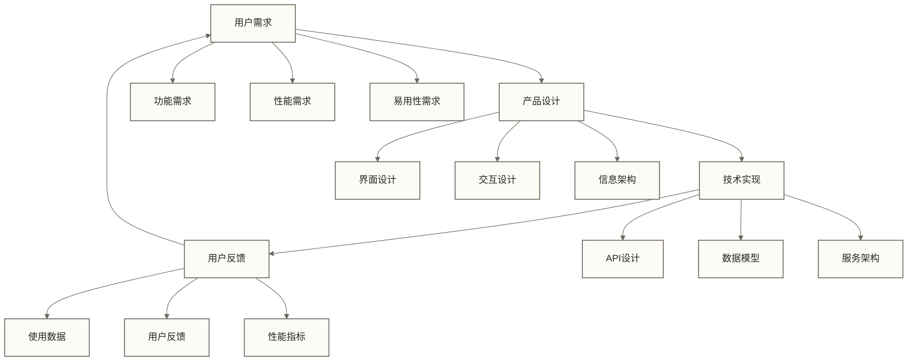
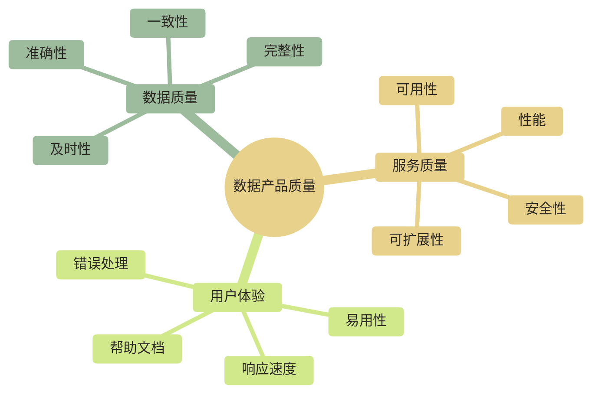
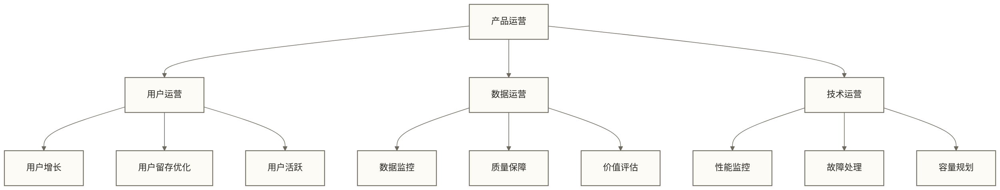
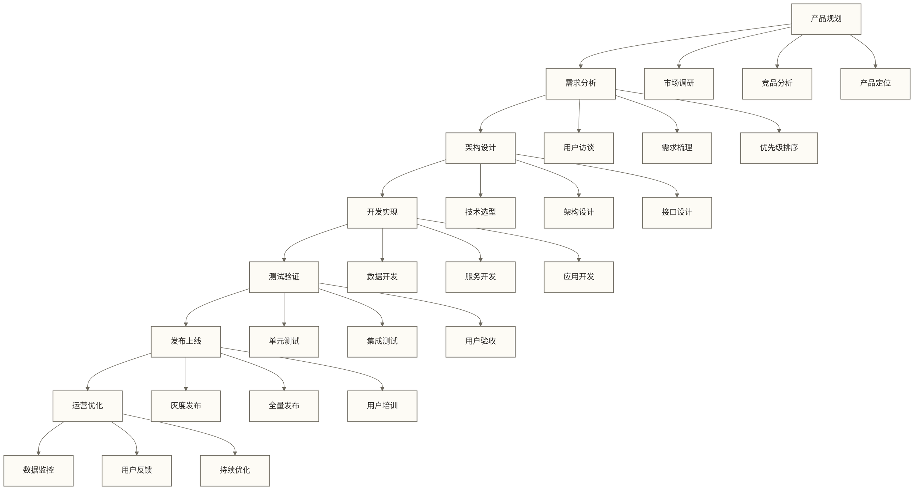
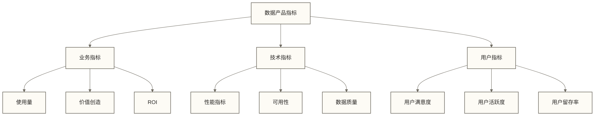

# 数据产品架构 - 从数据到产品的转变

> [!abstract] 📋 本节概览
> - 🎯 学习目标：理解数据产品化思维和架构设计方法
> - 📚 前置知识：[[【数据治理与数据管理】/01-快速学习/02-实践方法/数据架构设计方法.md|数据治理 数据架构设计]], [[【数据开发与数据架构】/07-数据服务架构/00-数据服务架构导览.md|数据服务架构导览]]
> - ⏱️ 预计用时：20分钟
> - 🤖 AI时代延伸：[[【数据分析与数据运营】/04-职业成长路径/03-复合型人才/05-AI时代数据产品经理/00-AI时代数据产品经理专题导览.md|AI时代数据产品经理专题导览]]

## 🎁 数据产品架构：数据价值的'产品化引擎'

数据产品架构是**现代数据商业化的价值核心**，让数据能力从内部工具向市场产品的商业化升级。

**数据产品架构的价值**：
- 🎯 **用户导向**：从技术实现向用户需求、体验设计和价值交付的转化
- ⚡ **产品思维**：建立市场分析、竞品研究和持续迭代的商业体系
- 🔧 **可复用性**：掌握模块设计、标准化封装和规模化交付的实战技能
- 📈 **商业变现**：构建收入模式、用户增长和市场扩展的竞争优势

在数据商业化实践中，产品架构是连接数据技术能力与市场商业需求的重要桥梁。
## 💡 数据产品化思维

> [!abstract] 🎯 什么是数据产品化？
> 将数据能力包装成可复用、可交付的产品，以用户为中心，提供持续价值

### 传统数据开发 vs 数据产品开发

传统数据开发与数据产品开发的差异体现在多个维度。传统数据开发往往采用项目导向的方式，以解决具体问题为目标，技术驱动且以一次性交付为特征，主要面向内部使用。相比之下，数据产品开发采用产品导向的理念，以用户驱动为核心，强调持续迭代和多用户服务能力。这种转变意味着从解决单一问题向构建可持续服务的产品生态转型。

**生活化类比**：就像从定制家具到标准化家具产品的转变，从满足单一需求到服务多个用户。

### 数据产品化核心要素

数据产品化核心要素包含四个关键维度。**用户导向**是数据产品化的基础，需要深入的用户需求分析、精心的用户体验设计和有效的用户反馈机制。**产品思维**要求明确产品定位、清晰价值主张和可持续的商业模式。**技术架构**需要具备可扩展性、可维护性和高性能特征，支撑产品的长期发展。**运营管理**包括版本管理、质量监控和持续优化，确保产品的稳定运行和持续改进。

## 🔍 数据产品架构设计

### 1. 数据产品分类体系

数据产品分类体系包含四大类型，每类都有其特定的应用场景和价值。**数据服务产品**主要通过API服务、数据接口和实时数据流的形式提供数据访问能力，为其他系统和应用提供数据支持。**数据应用产品**包括报表应用、分析应用和可视化应用，直接为用户提供数据洞察和分析能力。**数据平台产品**包含数据中台、数据湖和数据仓库，为组织提供数据存储和管理的基础设施。**数据工具产品**包含数据质量工具、数据治理工具和数据开发工具，为数据从业者提供专业的工作工具。

**生活化类比**：就像家具产品线，有成品家具、定制服务、家具租赁、工具设备等不同类型。

### 2. 数据产品架构层次

数据产品架构分为五个层次，形成了从用户到基础设施的完整体系。用户层包含业务用户、分析师和开发者等不同类型的使用者，他们通过应用层的Web应用、移动应用和API接口来访问数据产品。服务层提供业务服务、数据服务和计算服务，将应用层的需求转化为具体的数据操作。数据层包含数据仓库、数据湖和实时数据，为上层服务提供数据存储和管理能力。基础设施层包括计算资源、存储资源和网络资源，为整个产品架构提供可靠的基础设施支撑。

### 3. 数据产品生命周期

数据产品生命周期包括七个关键阶段，每个阶段都有其特定的目标和交付物。首先是需求分析阶段，通过用户调研、需求定义和价值评估来明确产品的市场需求和业务价值。然后进入产品设计阶段，包括产品原型、技术方案和架构设计，将用户需求转化为可实施的技术方案。开发实现阶段包含数据开发、服务开发和应用开发，将设计方案落地成可用的产品。测试验证阶段通过功能测试、性能测试和用户测试，确保产品质量符合要求。发布上线阶段包括灰度发布、全量发布和用户培训，确保产品安全稳定地交付给用户。运营维护阶段包括监控运维、问题处理和性能优化，保障产品的正常运行。最后是版本迭代阶段，通过需求收集、功能迭代和技术升级，实现产品的持续改进和发展。

## 🔍 数据产品架构模式

### 1. 微服务数据产品架构

```mermaid
%%{init: {"theme":"base","themeVariables":{"fontFamily":"PingFang SC, -apple-system, Source Han Serif SC, serif","fontSize":"16px","background":"#FDFBF5","primaryColor":"#FDFBF5","primaryTextColor":"#2D2A26","primaryBorderColor":"#6E6A60","secondaryColor":"#E8EFE8","secondaryBorderColor":"#8FA890","secondaryTextColor":"#2D2A26","tertiaryColor":"#FDFBF5","tertiaryBorderColor":"#9A9488","tertiaryTextColor":"#6E6A60","lineColor":"#6E6A60","textColor":"#2D2A26","mainBkg":"#FDFBF5","nodeBorder":"#2D5A3D","clusterBkg":"#F3EEDF","clusterBorder":"#9A9488","edgeLabelBackground":"#FDFBF5"},"flowchart":{"htmlLabels":true,"curve":"basis","padding":20,"nodeSpacing":60,"rankSpacing":70,"useMaxWidth":false},"themeCSS":".node rect, .node polygon, .node circle { stroke-width: 1.5px; } .edgePath .path { stroke-width: 1.5px; } .cluster-label .nodeLabel, .cluster-label foreignObject { color: #2D2A26 !important; } .edgeLabel, .edgeLabel foreignObject { color: #2D2A26 !important; background-color: #FDFBF5; } .edgeLabel rect { fill: #FDFBF5; }"}}%%
flowchart TD
    classDef default fill:#FDFBF5,stroke:#6E6A60,color:#2D2A26,stroke-width:1.5px
    classDef startend fill:#2D2A26,stroke:#2D2A26,color:#FDFBF5,font-weight:bold
    classDef decision fill:#F6EAD8,stroke:#C08A1A,color:#2D2A26,font-weight:bold
    classDef hub fill:#3B5A80,stroke:#3B5A80,color:#FDFBF5,font-weight:bold
    classDef io fill:#E5EAF0,stroke:#3B5A80,color:#2D2A26
    classDef accent fill:#A6432C,stroke:#A6432C,color:#FDFBF5,font-weight:bold
    classDef storage fill:#F3EEDF,stroke:#9A9488,color:#2D2A26
    A[API网关] --> B[用户服务]
    A --> C[订单服务]
    A --> D[商品服务]
    A --> E[数据服务]
    B --> B1[用户数据]
    B --> B2[用户画像]
    C --> C1[订单数据]
    C --> C2[交易数据]
    D --> D1[商品数据]
    D --> D2[库存数据]
    E --> E1[数据API]
    E --> E2[分析服务]
    E --> E3[报表服务]
    F[数据存储] --> B1
    F --> C1
    F --> D1
    F --> E1
    class A,B,C,D,E,B1,B2,C1,C2,D1,D2,E1,E2,E3,F default
```

**生活化类比**：就像模块化家具，每个模块独立，可以灵活组合使用。

### 2. 事件驱动数据产品架构

### 3. 数据网格产品架构

```mermaid
%%{init: {"theme":"base","themeVariables":{"fontFamily":"PingFang SC, -apple-system, Source Han Serif SC, serif","fontSize":"16px","background":"#FDFBF5","primaryColor":"#FDFBF5","primaryTextColor":"#2D2A26","primaryBorderColor":"#6E6A60","secondaryColor":"#E8EFE8","secondaryBorderColor":"#8FA890","secondaryTextColor":"#2D2A26","tertiaryColor":"#FDFBF5","tertiaryBorderColor":"#9A9488","tertiaryTextColor":"#6E6A60","lineColor":"#6E6A60","textColor":"#2D2A26","mainBkg":"#FDFBF5","nodeBorder":"#2D5A3D","clusterBkg":"#F3EEDF","clusterBorder":"#9A9488","edgeLabelBackground":"#FDFBF5"},"flowchart":{"htmlLabels":true,"curve":"basis","padding":20,"nodeSpacing":60,"rankSpacing":70,"useMaxWidth":false},"themeCSS":".node rect, .node polygon, .node circle { stroke-width: 1.5px; } .edgePath .path { stroke-width: 1.5px; } .cluster-label .nodeLabel, .cluster-label foreignObject { color: #2D2A26 !important; } .edgeLabel, .edgeLabel foreignObject { color: #2D2A26 !important; background-color: #FDFBF5; } .edgeLabel rect { fill: #FDFBF5; }"}}%%
flowchart TD
    classDef default fill:#FDFBF5,stroke:#6E6A60,color:#2D2A26,stroke-width:1.5px
    classDef startend fill:#2D2A26,stroke:#2D2A26,color:#FDFBF5,font-weight:bold
    classDef decision fill:#F6EAD8,stroke:#C08A1A,color:#2D2A26,font-weight:bold
    classDef hub fill:#3B5A80,stroke:#3B5A80,color:#FDFBF5,font-weight:bold
    classDef io fill:#E5EAF0,stroke:#3B5A80,color:#2D2A26
    classDef accent fill:#A6432C,stroke:#A6432C,color:#FDFBF5,font-weight:bold
    classDef storage fill:#F3EEDF,stroke:#9A9488,color:#2D2A26
    A[数据产品目录] --> B[用户域数据产品]
    A --> C[订单域数据产品]
    A --> D[商品域数据产品]
    A --> E[营销域数据产品]
    B --> B1[用户画像API]
    B --> B2[用户行为数据]
    B --> B3[用户偏好分析]
    C --> C1[订单分析API]
    C --> C2[交易数据]
    C --> C3[销售报表]
    D --> D1[商品推荐API]
    D --> D2[商品数据]
    D --> D3[库存分析]
    E --> E1[营销效果API]
    E --> E2[营销数据]
    E --> E3[ROI分析]
    F[数据基础设施] --> B
    F --> C
    F --> D
    F --> E
    class A,B,C,D,E,B1,B2,B3,C1,C2,C3,D1,D2,D3,E1,E2,E3,F default
```

## 🔍 数据产品设计原则

### 1. 用户体验设计

### 2. 数据产品质量保障

### 3. 数据产品运营

## 🔍 数据产品化实践

### 1. 数据产品开发流程

### 2. 数据产品评估指标

## ✅ 掌握检查

数据产品架构的学习成果检查包括多个关键方面。首先需要理解数据产品化的核心概念，掌握从技术导向向产品导向、从项目思维向产品思维的转变。其次要掌握数据产品架构的设计原则和方法，包括层次化设计、微服务架构和事件驱动设计等。第三需要了解不同类型数据产品的特点和适用场景，能够根据业务需求选择合适的产品形态。第四要认识数据产品生命周期管理的重要性，理解从需求分析到版本迭代的完整流程。最后要明确数据产品化对组织的影响和价值，包括提升数据价值、改善用户体验和促进数据驱动文化建设。

## 🔗 学习连接

**前置知识**: [[【数据治理与数据管理】/01-快速学习/02-实践方法/数据架构设计方法.md|数据治理 数据架构设计]], [[【数据开发与数据架构】/07-数据服务架构/00-数据服务架构导览.md|数据服务架构导览]]
**相关概念**: [[【数据开发与数据架构】/17-技术趋势/05-数据开发发展趋势.md|数据开发发展趋势]], [[【数据开发与数据架构】/17-技术趋势/07-数据开发自动化.md|数据开发自动化]], [[【数据开发与数据架构】/17-技术趋势/08-数据开发智能化.md|数据开发智能化]]
**下一步**: [[【数据开发与数据架构】/17-技术趋势/06-低代码数据开发.md|低代码数据开发]], [[【数据开发与数据架构】/17-技术趋势/08-数据开发智能化.md|数据开发智能化]]

---

> [!tip] 💡 实践建议
> 1. **思维转变**：从技术导向转向产品导向，从项目思维转向产品思维
> 2. **用户研究**：深入了解用户需求，设计符合用户习惯的数据产品
> 3. **持续迭代**：建立快速迭代机制，根据用户反馈持续优化产品
> 4. **价值评估**：建立数据产品价值评估体系，确保产品持续创造价值 