# 数据开发自动化 - 让数据开发更高效

> [!abstract] 📋 本节概览
> - 🎯 学习目标：理解数据开发自动化的概念、方法和最佳实践
> - 📚 前置知识：[[【数据开发与数据架构】/01-数据开发基础/00-数据开发基础导览.md|数据开发基础导览]], [[【数据开发与数据架构】/11-数据开发运维/00-数据开发运维导览.md|数据开发运维导览]]
> - ⏱️ 预计用时：20分钟

## ⚙️ 开发自动化：数据开发的"效率引擎"

数据开发自动化是**现代开发效率的核心驱动**，让开发过程从手工劳动向智能自动化的系统化升级。

**自动化的价值**：
- 🎯 **流程标准化**：从手工操作向代码生成、测试执行和部署发布的自动化转化
- ⚡ **质量保障**：建立自动测试、代码审查和质量检查的可靠性体系
- 🔧 **持续交付**：掌握CI/CD流水线、监控运维和持续改进的实战技能
- 📈 **开发效率**：构建快速迭代、错误减少和成本降低的竞争优势

在敏捷开发时代，自动化是连接开发速度与产品质量的重要桥梁。
## 💡 数据开发自动化概念

> [!abstract] 🎯 什么是数据开发自动化？
> 通过工具和流程，将数据开发过程中的重复性工作自动化，提高开发效率和质量

### 传统开发 vs 自动化开发

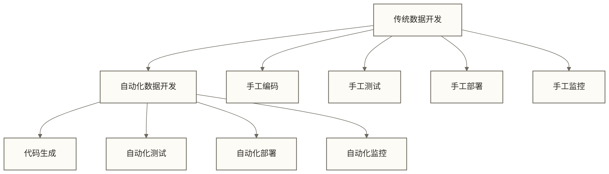

**生活化类比**：就像从手工制作到自动化生产线的转变，大大提高了生产效率和产品质量。

### 自动化开发的核心要素

```mermaid
%%{init: {"theme":"base","themeVariables":{"fontFamily":"PingFang SC, -apple-system, Source Han Serif SC, serif","fontSize":"16px","background":"#FDFBF5","primaryColor":"#FDFBF5","primaryTextColor":"#2D2A26","primaryBorderColor":"#6E6A60","secondaryColor":"#E8EFE8","secondaryBorderColor":"#8FA890","secondaryTextColor":"#2D2A26","tertiaryColor":"#FDFBF5","tertiaryBorderColor":"#9A9488","tertiaryTextColor":"#6E6A60","lineColor":"#6E6A60","textColor":"#2D2A26","mainBkg":"#FDFBF5","nodeBorder":"#2D5A3D","clusterBkg":"#F3EEDF","clusterBorder":"#9A9488","edgeLabelBackground":"#FDFBF5"},"flowchart":{"htmlLabels":true,"curve":"basis","padding":20,"nodeSpacing":60,"rankSpacing":70,"useMaxWidth":false},"themeCSS":".node rect, .node polygon, .node circle { stroke-width: 1.5px; } .edgePath .path { stroke-width: 1.5px; } .cluster-label .nodeLabel, .cluster-label foreignObject { color: #2D2A26 !important; } .edgeLabel, .edgeLabel foreignObject { color: #2D2A26 !important; background-color: #FDFBF5; } .edgeLabel rect { fill: #FDFBF5; }"}}%%
flowchart TD
    classDef default fill:#FDFBF5,stroke:#6E6A60,color:#2D2A26,stroke-width:1.5px
    classDef startend fill:#2D2A26,stroke:#2D2A26,color:#FDFBF5,font-weight:bold
    classDef decision fill:#F6EAD8,stroke:#C08A1A,color:#2D2A26,font-weight:bold
    classDef hub fill:#3B5A80,stroke:#3B5A80,color:#FDFBF5,font-weight:bold
    classDef io fill:#E5EAF0,stroke:#3B5A80,color:#2D2A26
    classDef accent fill:#A6432C,stroke:#A6432C,color:#FDFBF5,font-weight:bold
    classDef storage fill:#F3EEDF,stroke:#9A9488,color:#2D2A26
    root((自动化要素)) --> A[流程自动化]
    root --> B[质量保障]
    root --> C[监控运维]
    root --> D[持续改进]
    A --> A1[代码生成]
    A --> A2[测试执行]
    A --> A3[部署发布]
    B --> B1[自动化测试]
    B --> B2[代码审查]
    B --> B3[质量检查]
    C --> C1[性能监控]
    C --> C2[错误告警]
    C --> C3[自动恢复]
    D --> D1[反馈收集]
    D --> D2[性能优化]
    D --> D3[流程优化]
    class root accent
```

## 🔍 数据开发自动化架构

### 1. 自动化平台架构

```mermaid
%%{init: {"theme":"base","themeVariables":{"fontFamily":"PingFang SC, -apple-system, Source Han Serif SC, serif","fontSize":"16px","background":"#FDFBF5","primaryColor":"#FDFBF5","primaryTextColor":"#2D2A26","primaryBorderColor":"#6E6A60","secondaryColor":"#E8EFE8","secondaryBorderColor":"#8FA890","secondaryTextColor":"#2D2A26","tertiaryColor":"#FDFBF5","tertiaryBorderColor":"#9A9488","tertiaryTextColor":"#6E6A60","lineColor":"#6E6A60","textColor":"#2D2A26","mainBkg":"#FDFBF5","nodeBorder":"#2D5A3D","clusterBkg":"#F3EEDF","clusterBorder":"#9A9488","edgeLabelBackground":"#FDFBF5"},"flowchart":{"htmlLabels":true,"curve":"basis","padding":20,"nodeSpacing":60,"rankSpacing":70,"useMaxWidth":false},"themeCSS":".node rect, .node polygon, .node circle { stroke-width: 1.5px; } .edgePath .path { stroke-width: 1.5px; } .cluster-label .nodeLabel, .cluster-label foreignObject { color: #2D2A26 !important; } .edgeLabel, .edgeLabel foreignObject { color: #2D2A26 !important; background-color: #FDFBF5; } .edgeLabel rect { fill: #FDFBF5; }"}}%%
flowchart TD
    classDef default fill:#FDFBF5,stroke:#6E6A60,color:#2D2A26,stroke-width:1.5px
    classDef startend fill:#2D2A26,stroke:#2D2A26,color:#FDFBF5,font-weight:bold
    classDef decision fill:#F6EAD8,stroke:#C08A1A,color:#2D2A26,font-weight:bold
    classDef hub fill:#3B5A80,stroke:#3B5A80,color:#FDFBF5,font-weight:bold
    classDef io fill:#E5EAF0,stroke:#3B5A80,color:#2D2A26
    classDef accent fill:#A6432C,stroke:#A6432C,color:#FDFBF5,font-weight:bold
    classDef storage fill:#F3EEDF,stroke:#9A9488,color:#2D2A26
    A[用户界面] --> B[自动化引擎]
    B --> C[代码生成器]
    B --> D[测试执行器]
    B --> E[部署管理器]
    B --> F[监控系统]
    A --> A1[Web界面]
    A --> A2[API接口]
    A --> A3[CLI工具]
    B --> B1[工作流引擎]
    B --> B2[规则引擎]
    B --> B3[调度引擎]
    C --> C1[模板引擎]
    C --> C2[代码生成]
    C --> C3[代码优化]
    D --> D1[单元测试]
    D --> D2[集成测试]
    D --> D3[性能测试]
    E --> E1[环境管理]
    E --> E2[版本控制]
    E --> E3[回滚机制]
    F --> F1[性能监控]
    F --> F2[错误告警]
    F --> F3[日志分析]
    class A,B,C,D,E,F,A1,A2,A3,B1,B2,B3,C1,C2,C3,D1,D2,D3,E1,E2,E3,F1,F2,F3 default
```

### 2. 自动化开发流程

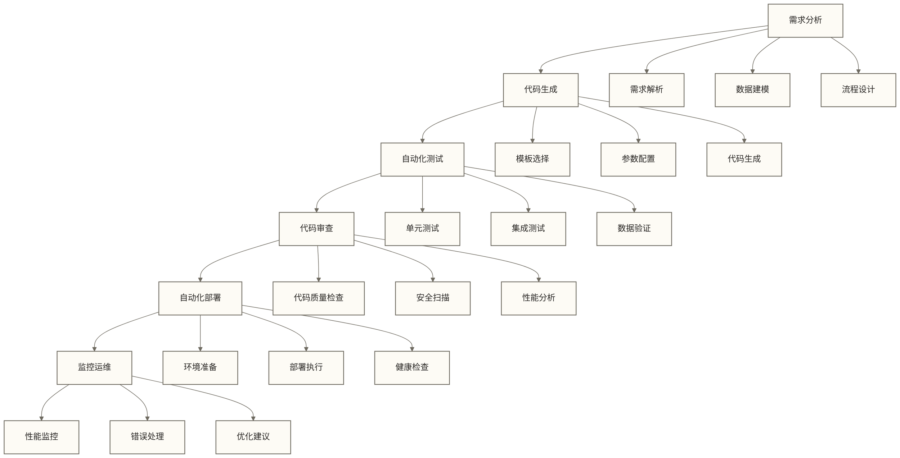

### 3. CI/CD流水线

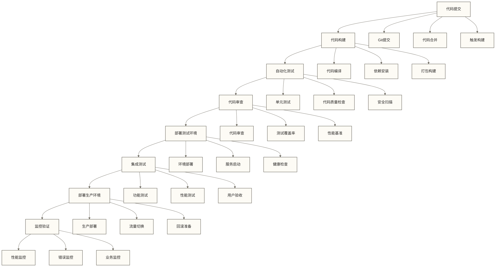

## 🔍 自动化开发技术

### 1. 代码生成技术

```mermaid
%%{init: {"theme":"base","themeVariables":{"fontFamily":"PingFang SC, -apple-system, Source Han Serif SC, serif","fontSize":"16px","background":"#FDFBF5","primaryColor":"#FDFBF5","primaryTextColor":"#2D2A26","primaryBorderColor":"#6E6A60","secondaryColor":"#E8EFE8","secondaryBorderColor":"#8FA890","secondaryTextColor":"#2D2A26","tertiaryColor":"#FDFBF5","tertiaryBorderColor":"#9A9488","tertiaryTextColor":"#6E6A60","lineColor":"#6E6A60","textColor":"#2D2A26","mainBkg":"#FDFBF5","nodeBorder":"#2D5A3D","clusterBkg":"#F3EEDF","clusterBorder":"#9A9488","edgeLabelBackground":"#FDFBF5"},"flowchart":{"htmlLabels":true,"curve":"basis","padding":20,"nodeSpacing":60,"rankSpacing":70,"useMaxWidth":false},"themeCSS":".node rect, .node polygon, .node circle { stroke-width: 1.5px; } .edgePath .path { stroke-width: 1.5px; } .cluster-label .nodeLabel, .cluster-label foreignObject { color: #2D2A26 !important; } .edgeLabel, .edgeLabel foreignObject { color: #2D2A26 !important; background-color: #FDFBF5; } .edgeLabel rect { fill: #FDFBF5; }"}}%%
flowchart TD
    classDef default fill:#FDFBF5,stroke:#6E6A60,color:#2D2A26,stroke-width:1.5px
    classDef startend fill:#2D2A26,stroke:#2D2A26,color:#FDFBF5,font-weight:bold
    classDef decision fill:#F6EAD8,stroke:#C08A1A,color:#2D2A26,font-weight:bold
    classDef hub fill:#3B5A80,stroke:#3B5A80,color:#FDFBF5,font-weight:bold
    classDef io fill:#E5EAF0,stroke:#3B5A80,color:#2D2A26
    classDef accent fill:#A6432C,stroke:#A6432C,color:#FDFBF5,font-weight:bold
    classDef storage fill:#F3EEDF,stroke:#9A9488,color:#2D2A26
    A[代码生成] --> B[模板引擎]
    A --> C[AI代码生成]
    A --> D[配置驱动]
    B --> B1[Jinja2]
    B --> B2[Velocity]
    B --> B3[FreeMarker]
    C --> C1[GPT代码生成]
    C --> C2[代码补全]
    C --> C3[智能重构]
    D --> D1[YAML配置]
    D --> D2[JSON配置]
    D --> D3[数据库配置]
    class A,B,C,D,B1,B2,B3,C1,C2,C3,D1,D2,D3 default
```

**生活化类比**：就像使用模具制作产品，只需要改变参数就能生成不同的代码。

### 2. 自动化测试技术

```mermaid
%%{init: {"theme":"base","themeVariables":{"fontFamily":"PingFang SC, -apple-system, Source Han Serif SC, serif","fontSize":"16px","background":"#FDFBF5","primaryColor":"#FDFBF5","primaryTextColor":"#2D2A26","primaryBorderColor":"#6E6A60","secondaryColor":"#E8EFE8","secondaryBorderColor":"#8FA890","secondaryTextColor":"#2D2A26","tertiaryColor":"#FDFBF5","tertiaryBorderColor":"#9A9488","tertiaryTextColor":"#6E6A60","lineColor":"#6E6A60","textColor":"#2D2A26","mainBkg":"#FDFBF5","nodeBorder":"#2D5A3D","clusterBkg":"#F3EEDF","clusterBorder":"#9A9488","edgeLabelBackground":"#FDFBF5"},"flowchart":{"htmlLabels":true,"curve":"basis","padding":20,"nodeSpacing":60,"rankSpacing":70,"useMaxWidth":false},"themeCSS":".node rect, .node polygon, .node circle { stroke-width: 1.5px; } .edgePath .path { stroke-width: 1.5px; } .cluster-label .nodeLabel, .cluster-label foreignObject { color: #2D2A26 !important; } .edgeLabel, .edgeLabel foreignObject { color: #2D2A26 !important; background-color: #FDFBF5; } .edgeLabel rect { fill: #FDFBF5; }"}}%%
flowchart TD
    classDef default fill:#FDFBF5,stroke:#6E6A60,color:#2D2A26,stroke-width:1.5px
    classDef startend fill:#2D2A26,stroke:#2D2A26,color:#FDFBF5,font-weight:bold
    classDef decision fill:#F6EAD8,stroke:#C08A1A,color:#2D2A26,font-weight:bold
    classDef hub fill:#3B5A80,stroke:#3B5A80,color:#FDFBF5,font-weight:bold
    classDef io fill:#E5EAF0,stroke:#3B5A80,color:#2D2A26
    classDef accent fill:#A6432C,stroke:#A6432C,color:#FDFBF5,font-weight:bold
    classDef storage fill:#F3EEDF,stroke:#9A9488,color:#2D2A26
    A[自动化测试] --> B[单元测试]
    A --> C[集成测试]
    A --> D[端到端测试]
    A --> E[性能测试]
    B --> B1[数据验证]
    B --> B2[逻辑测试]
    B --> B3[边界测试]
    C --> C1[数据流测试]
    C --> C2[接口测试]
    C --> C3[依赖测试]
    D --> D1[业务流程测试]
    D --> D2[用户场景测试]
    D --> D3[数据一致性测试]
    E --> E1[负载测试]
    E --> E2[压力测试]
    E --> E3[容量测试]
    class A,B,C,D,E,B1,B2,B3,C1,C2,C3,D1,D2,D3,E1,E2,E3 default
```

### 3. 自动化部署技术

```mermaid
%%{init: {"theme":"base","themeVariables":{"fontFamily":"PingFang SC, -apple-system, Source Han Serif SC, serif","fontSize":"16px","background":"#FDFBF5","primaryColor":"#FDFBF5","primaryTextColor":"#2D2A26","primaryBorderColor":"#6E6A60","secondaryColor":"#E8EFE8","secondaryBorderColor":"#8FA890","secondaryTextColor":"#2D2A26","tertiaryColor":"#FDFBF5","tertiaryBorderColor":"#9A9488","tertiaryTextColor":"#6E6A60","lineColor":"#6E6A60","textColor":"#2D2A26","mainBkg":"#FDFBF5","nodeBorder":"#2D5A3D","clusterBkg":"#F3EEDF","clusterBorder":"#9A9488","edgeLabelBackground":"#FDFBF5"},"flowchart":{"htmlLabels":true,"curve":"basis","padding":20,"nodeSpacing":60,"rankSpacing":70,"useMaxWidth":false},"themeCSS":".node rect, .node polygon, .node circle { stroke-width: 1.5px; } .edgePath .path { stroke-width: 1.5px; } .cluster-label .nodeLabel, .cluster-label foreignObject { color: #2D2A26 !important; } .edgeLabel, .edgeLabel foreignObject { color: #2D2A26 !important; background-color: #FDFBF5; } .edgeLabel rect { fill: #FDFBF5; }"}}%%
flowchart TD
    classDef default fill:#FDFBF5,stroke:#6E6A60,color:#2D2A26,stroke-width:1.5px
    classDef startend fill:#2D2A26,stroke:#2D2A26,color:#FDFBF5,font-weight:bold
    classDef decision fill:#F6EAD8,stroke:#C08A1A,color:#2D2A26,font-weight:bold
    classDef hub fill:#3B5A80,stroke:#3B5A80,color:#FDFBF5,font-weight:bold
    classDef io fill:#E5EAF0,stroke:#3B5A80,color:#2D2A26
    classDef accent fill:#A6432C,stroke:#A6432C,color:#FDFBF5,font-weight:bold
    classDef storage fill:#F3EEDF,stroke:#9A9488,color:#2D2A26
    A[自动化部署] --> B[容器化部署]
    A --> C[基础设施即代码]
    A --> D[蓝绿部署]
    A --> E[滚动部署]
    B --> B1[容器化数据应用]
    B --> B2[Kubernetes数据部署]
    B --> B3[服务网格]
    C --> C1[Terraform]
    C --> C2[CloudFormation]
    C --> C3[Ansible]
    D --> D1[双环境切换]
    D --> D2[零停机部署]
    D --> D3[快速回滚]
    E --> E1[渐进式部署]
    E --> E2[健康检查]
    E --> E3[自动回滚]
    class A,B,C,D,E,B1,B2,B3,C1,C2,C3,D1,D2,D3,E1,E2,E3 default
```

## 🔍 自动化开发应用场景

### 1. ETL开发自动化

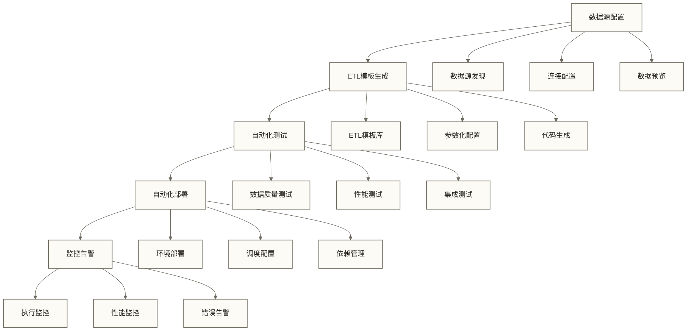

### 2. 数据模型自动化

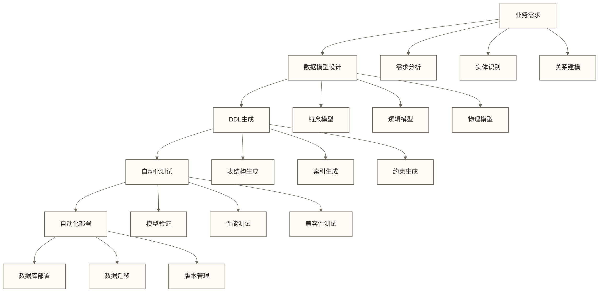

### 3. 数据应用自动化

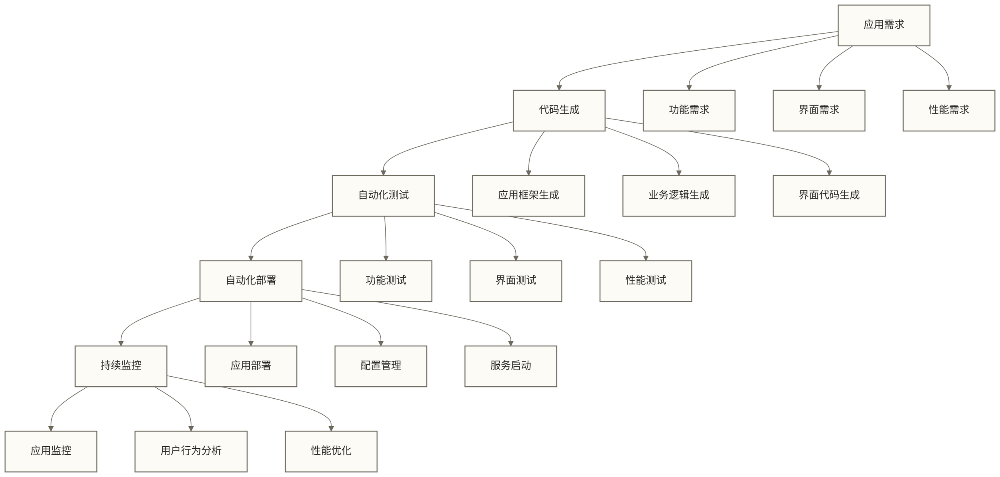

## 🔍 自动化开发最佳实践

### 1. 自动化策略

```mermaid
%%{init: {"theme":"base","themeVariables":{"fontFamily":"PingFang SC, -apple-system, Source Han Serif SC, serif","fontSize":"16px","background":"#FDFBF5","primaryColor":"#FDFBF5","primaryTextColor":"#2D2A26","primaryBorderColor":"#6E6A60","secondaryColor":"#E8EFE8","secondaryBorderColor":"#8FA890","secondaryTextColor":"#2D2A26","tertiaryColor":"#FDFBF5","tertiaryBorderColor":"#9A9488","tertiaryTextColor":"#6E6A60","lineColor":"#6E6A60","textColor":"#2D2A26","mainBkg":"#FDFBF5","nodeBorder":"#2D5A3D","clusterBkg":"#F3EEDF","clusterBorder":"#9A9488","edgeLabelBackground":"#FDFBF5"},"flowchart":{"htmlLabels":true,"curve":"basis","padding":20,"nodeSpacing":60,"rankSpacing":70,"useMaxWidth":false},"themeCSS":".node rect, .node polygon, .node circle { stroke-width: 1.5px; } .edgePath .path { stroke-width: 1.5px; } .cluster-label .nodeLabel, .cluster-label foreignObject { color: #2D2A26 !important; } .edgeLabel, .edgeLabel foreignObject { color: #2D2A26 !important; background-color: #FDFBF5; } .edgeLabel rect { fill: #FDFBF5; }"}}%%
flowchart TD
    classDef default fill:#FDFBF5,stroke:#6E6A60,color:#2D2A26,stroke-width:1.5px
    classDef startend fill:#2D2A26,stroke:#2D2A26,color:#FDFBF5,font-weight:bold
    classDef decision fill:#F6EAD8,stroke:#C08A1A,color:#2D2A26,font-weight:bold
    classDef hub fill:#3B5A80,stroke:#3B5A80,color:#FDFBF5,font-weight:bold
    classDef io fill:#E5EAF0,stroke:#3B5A80,color:#2D2A26
    classDef accent fill:#A6432C,stroke:#A6432C,color:#FDFBF5,font-weight:bold
    classDef storage fill:#F3EEDF,stroke:#9A9488,color:#2D2A26
    A[自动化策略] --> B[渐进式自动化]
    A --> C[标准化流程]
    A --> D[质量优先]
    A --> E[持续改进]
    B --> B1[从简单开始]
    B --> B2[逐步扩展]
    B --> B3[验证效果]
    C --> C1[统一标准]
    C --> C2[流程规范]
    C --> C3[工具统一]
    D --> D1[质量检查]
    D --> D2[测试覆盖]
    D --> D3[监控告警]
    E --> E1[反馈收集]
    E --> E2[流程优化]
    E --> E3[技术升级]
    class A,B,C,D,E,B1,B2,B3,C1,C2,C3,D1,D2,D3,E1,E2,E3 default
```

### 2. 团队协作模式

```mermaid
%%{init: {"theme":"base","themeVariables":{"fontFamily":"PingFang SC, -apple-system, Source Han Serif SC, serif","fontSize":"16px","background":"#FDFBF5","primaryColor":"#FDFBF5","primaryTextColor":"#2D2A26","primaryBorderColor":"#6E6A60","secondaryColor":"#E8EFE8","secondaryBorderColor":"#8FA890","secondaryTextColor":"#2D2A26","tertiaryColor":"#FDFBF5","tertiaryBorderColor":"#9A9488","tertiaryTextColor":"#6E6A60","lineColor":"#6E6A60","textColor":"#2D2A26","mainBkg":"#FDFBF5","nodeBorder":"#2D5A3D","clusterBkg":"#F3EEDF","clusterBorder":"#9A9488","edgeLabelBackground":"#FDFBF5"},"flowchart":{"htmlLabels":true,"curve":"basis","padding":20,"nodeSpacing":60,"rankSpacing":70,"useMaxWidth":false},"themeCSS":".node rect, .node polygon, .node circle { stroke-width: 1.5px; } .edgePath .path { stroke-width: 1.5px; } .cluster-label .nodeLabel, .cluster-label foreignObject { color: #2D2A26 !important; } .edgeLabel, .edgeLabel foreignObject { color: #2D2A26 !important; background-color: #FDFBF5; } .edgeLabel rect { fill: #FDFBF5; }"}}%%
flowchart TD
    classDef default fill:#FDFBF5,stroke:#6E6A60,color:#2D2A26,stroke-width:1.5px
    classDef startend fill:#2D2A26,stroke:#2D2A26,color:#FDFBF5,font-weight:bold
    classDef decision fill:#F6EAD8,stroke:#C08A1A,color:#2D2A26,font-weight:bold
    classDef hub fill:#3B5A80,stroke:#3B5A80,color:#FDFBF5,font-weight:bold
    classDef io fill:#E5EAF0,stroke:#3B5A80,color:#2D2A26
    classDef accent fill:#A6432C,stroke:#A6432C,color:#FDFBF5,font-weight:bold
    classDef storage fill:#F3EEDF,stroke:#9A9488,color:#2D2A26
    A[自动化团队] --> B[开发工程师]
    A --> C[测试工程师]
    A --> D[运维工程师]
    A --> E[业务分析师]
    B --> B1[代码开发]
    B --> B2[自动化脚本]
    B --> B3[工具开发]
    C --> C1[测试用例设计]
    C --> C2[自动化测试]
    C --> C3[质量保障]
    D --> D1[环境管理]
    D --> D2[部署自动化]
    D --> D3[监控运维]
    E --> E1[需求分析]
    E --> E2[流程设计]
    E --> E3[效果评估]
    class A,B,C,D,E,B1,B2,B3,C1,C2,C3,D1,D2,D3,E1,E2,E3 default
```

### 3. 工具链集成

```mermaid
%%{init: {"theme":"base","themeVariables":{"fontFamily":"PingFang SC, -apple-system, Source Han Serif SC, serif","fontSize":"16px","background":"#FDFBF5","primaryColor":"#FDFBF5","primaryTextColor":"#2D2A26","primaryBorderColor":"#6E6A60","secondaryColor":"#E8EFE8","secondaryBorderColor":"#8FA890","secondaryTextColor":"#2D2A26","tertiaryColor":"#FDFBF5","tertiaryBorderColor":"#9A9488","tertiaryTextColor":"#6E6A60","lineColor":"#6E6A60","textColor":"#2D2A26","mainBkg":"#FDFBF5","nodeBorder":"#2D5A3D","clusterBkg":"#F3EEDF","clusterBorder":"#9A9488","edgeLabelBackground":"#FDFBF5"},"flowchart":{"htmlLabels":true,"curve":"basis","padding":20,"nodeSpacing":60,"rankSpacing":70,"useMaxWidth":false},"themeCSS":".node rect, .node polygon, .node circle { stroke-width: 1.5px; } .edgePath .path { stroke-width: 1.5px; } .cluster-label .nodeLabel, .cluster-label foreignObject { color: #2D2A26 !important; } .edgeLabel, .edgeLabel foreignObject { color: #2D2A26 !important; background-color: #FDFBF5; } .edgeLabel rect { fill: #FDFBF5; }"}}%%
flowchart TD
    classDef default fill:#FDFBF5,stroke:#6E6A60,color:#2D2A26,stroke-width:1.5px
    classDef startend fill:#2D2A26,stroke:#2D2A26,color:#FDFBF5,font-weight:bold
    classDef decision fill:#F6EAD8,stroke:#C08A1A,color:#2D2A26,font-weight:bold
    classDef hub fill:#3B5A80,stroke:#3B5A80,color:#FDFBF5,font-weight:bold
    classDef io fill:#E5EAF0,stroke:#3B5A80,color:#2D2A26
    classDef accent fill:#A6432C,stroke:#A6432C,color:#FDFBF5,font-weight:bold
    classDef storage fill:#F3EEDF,stroke:#9A9488,color:#2D2A26
    A[自动化工具链] --> B[代码管理]
    A --> C[构建工具]
    A --> D[测试工具]
    A --> E[部署工具]
    A --> F[监控工具]
    B --> B1[Git版本控制]
    B --> B2[代码审查]
    B --> B3[分支管理]
    C --> C1[Jenkins]
    C --> C2[GitLab CI]
    C --> C3[GitHub Actions]
    D --> D1[单元测试框架]
    D --> D2[集成测试工具]
    D --> D3[性能测试工具]
    E --> E1[容器化工具]
    E --> E2[编排工具]
    E --> E3[配置管理]
    F --> F1[监控平台]
    F --> F2[日志分析]
    F --> F3[告警系统]
    class A,B,C,D,E,F,B1,B2,B3,C1,C2,C3,D1,D2,D3,E1,E2,E3,F1,F2,F3 default
```

## ✅ 掌握检查

- [ ] 理解数据开发自动化的核心概念和价值
- [ ] 掌握自动化开发平台的架构设计
- [ ] 了解CI/CD流水线的构建方法
- [ ] 认识自动化开发的关键技术
- [ ] 明确自动化开发的最佳实践

## 🔗 学习连接

**前置知识**: [[【数据开发与数据架构】/01-数据开发基础/00-数据开发基础导览.md|数据开发基础导览]], [[【数据开发与数据架构】/11-数据开发运维/00-数据开发运维导览.md|数据开发运维导览]]
**相关概念**: [[【数据开发与数据架构】/17-技术趋势/05-数据开发发展趋势.md|数据开发发展趋势]], [[【数据开发与数据架构】/17-技术趋势/06-低代码数据开发.md|低代码数据开发]], [[【数据开发与数据架构】/17-技术趋势/08-数据开发智能化.md|数据开发智能化]]
**下一步**: [[【数据开发与数据架构】/17-技术趋势/08-数据开发智能化.md|数据开发智能化]], [[【数据开发与数据架构】/17-技术趋势/04-数据产品架构.md|数据产品]]

---

> [!tip] 💡 实践建议
> 1. **渐进式实施**：从简单的自动化任务开始，逐步扩展到复杂流程
> 2. **标准化流程**：建立统一的开发规范和自动化标准
> 3. **工具链集成**：选择合适的技术栈，构建完整的自动化工具链
> 4. **持续改进**：根据实际效果，不断优化自动化流程和工具
</rewritten_file> 