# 数据开发智能化 - AI驱动的数据开发未来

> [!abstract] 📋 本节概览
> - 🎯 学习目标：理解数据开发智能化的概念、技术和应用前景
> - 📚 前置知识：[[【数据开发与数据架构】/01-数据开发基础/00-数据开发基础导览.md|数据开发基础导览]], [[【数据开发与数据架构】/17-技术趋势/07-数据开发自动化.md|数据开发自动化]]
> - ⏱️ 预计用时：20分钟

## 🤖 开发智能化：数据开发的"AI助手"

数据开发智能化是**现代开发效率的倍增器**，让开发过程从人工编码向AI辅助的智能化协作升级。

**智能协作的价值**：
- 🎯 **代码生成**：从手工编程向AI辅助生成和智能补全的开发模式转化
- ⚡ **自动优化**：建立性能调优、测试生成和部署优化的智能化体系
- 🔧 **智能决策**：掌握架构推荐、技术选型和最佳实践的AI决策实战技能
- 📈 **持续学习**：构建经验积累、模型迭代和能力进化的智能竞争力

在AI赋能时代，开发智能化是连接人类创意与机器效率的重要桥梁。
## 💡 数据开发智能化概念

> [!abstract] 🎯 什么是数据开发智能化？
> 利用人工智能技术，让数据开发过程更加智能、高效和自适应，实现从自动化到智能化的跨越

### 自动化 vs 智能化

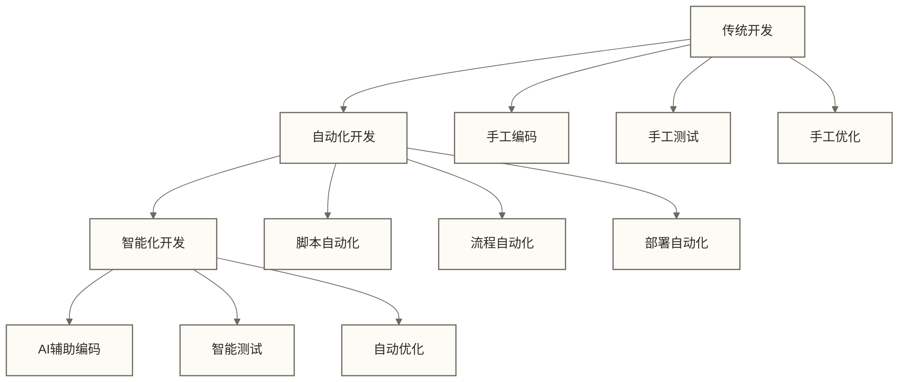

**生活化类比**：就像从手工制作到自动化生产，再到智能制造的演进，每一步都是质的飞跃。

### 智能化开发的核心特征

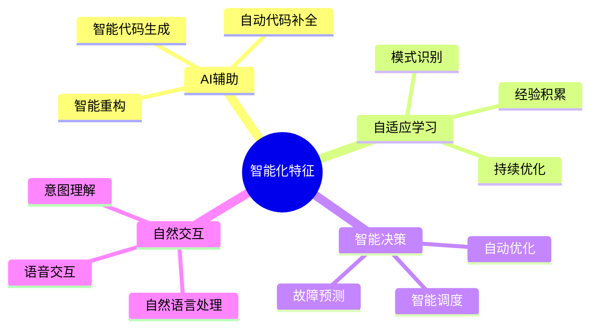

## 🔍 数据开发智能化架构

### 1. 智能化平台架构

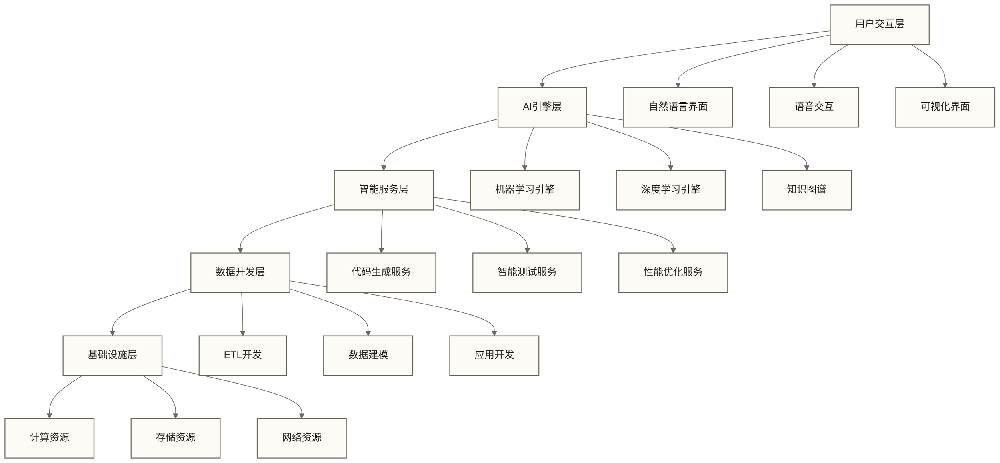

### 2. 智能化开发流程

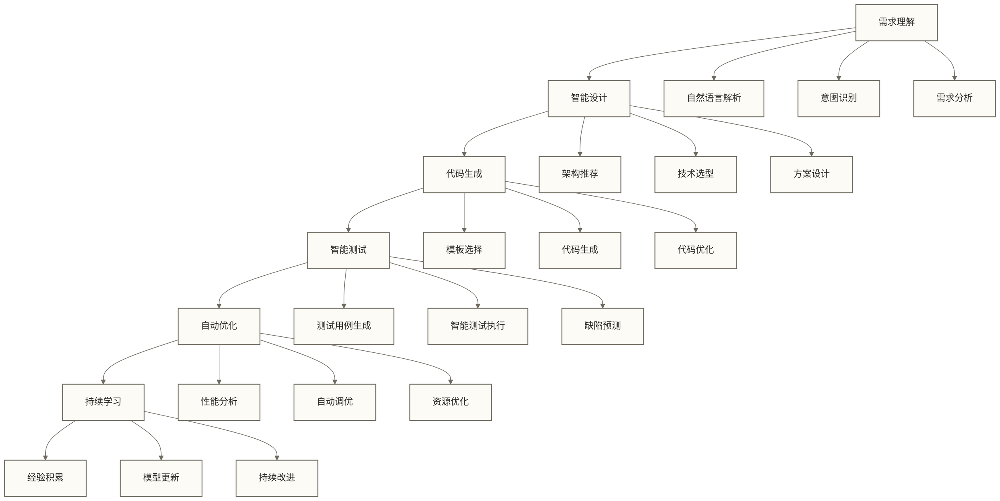

### 3. AI技术栈

```mermaid
%%{init: {"theme":"base","themeVariables":{"fontFamily":"PingFang SC, -apple-system, Source Han Serif SC, serif","fontSize":"16px","background":"#FDFBF5","primaryColor":"#FDFBF5","primaryTextColor":"#2D2A26","primaryBorderColor":"#6E6A60","secondaryColor":"#E8EFE8","secondaryBorderColor":"#8FA890","secondaryTextColor":"#2D2A26","tertiaryColor":"#FDFBF5","tertiaryBorderColor":"#9A9488","tertiaryTextColor":"#6E6A60","lineColor":"#6E6A60","textColor":"#2D2A26","mainBkg":"#FDFBF5","nodeBorder":"#2D5A3D","clusterBkg":"#F3EEDF","clusterBorder":"#9A9488","edgeLabelBackground":"#FDFBF5"},"flowchart":{"htmlLabels":true,"curve":"basis","padding":20,"nodeSpacing":60,"rankSpacing":70,"useMaxWidth":false},"themeCSS":".node rect, .node polygon, .node circle { stroke-width: 1.5px; } .edgePath .path { stroke-width: 1.5px; } .cluster-label .nodeLabel, .cluster-label foreignObject { color: #2D2A26 !important; } .edgeLabel, .edgeLabel foreignObject { color: #2D2A26 !important; background-color: #FDFBF5; } .edgeLabel rect { fill: #FDFBF5; }"}}%%
flowchart TD
    classDef default fill:#FDFBF5,stroke:#6E6A60,color:#2D2A26,stroke-width:1.5px
    classDef startend fill:#2D2A26,stroke:#2D2A26,color:#FDFBF5,font-weight:bold
    classDef decision fill:#F6EAD8,stroke:#C08A1A,color:#2D2A26,font-weight:bold
    classDef hub fill:#3B5A80,stroke:#3B5A80,color:#FDFBF5,font-weight:bold
    classDef io fill:#E5EAF0,stroke:#3B5A80,color:#2D2A26
    classDef accent fill:#A6432C,stroke:#A6432C,color:#FDFBF5,font-weight:bold
    classDef storage fill:#F3EEDF,stroke:#9A9488,color:#2D2A26
    A[AI技术栈] --> B[自然语言处理]
    A --> C[机器学习]
    A --> D[深度学习]
    A --> E[知识图谱]
    B --> B1[语言理解]
    B --> B2[代码生成]
    B --> B3[文档生成]
    C --> C1[模式识别]
    C --> C2[异常检测]
    C --> C3[性能预测]
    D --> D1[代码补全]
    D --> D2[智能重构]
    D --> D3[自动优化]
    E --> E1[知识推理]
    E --> E2[关系发现]
    E --> E3[智能推荐]
    class A,B,C,D,E,B1,B2,B3,C1,C2,C3,D1,D2,D3,E1,E2,E3 default
```

## 🔍 智能化开发技术

### 1. 智能代码生成

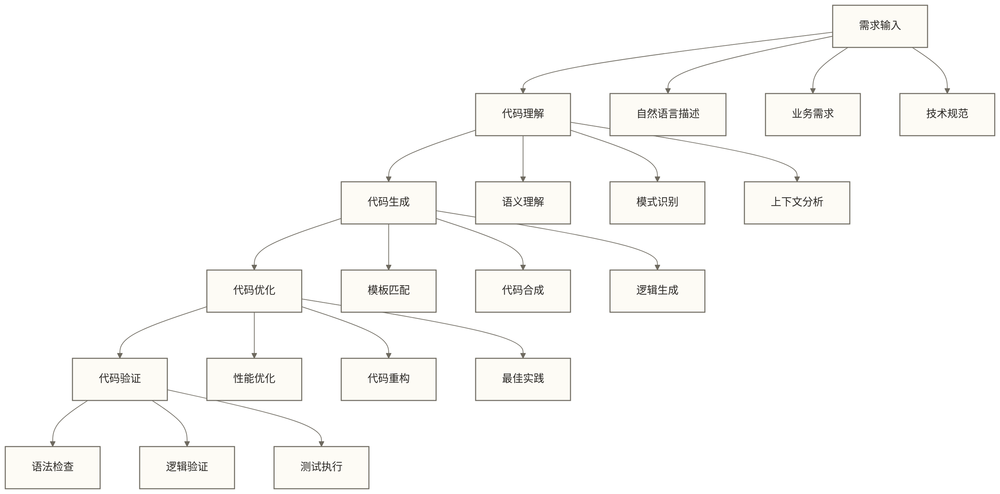

**生活化类比**：就像有了一个懂编程的智能助手，你只需要描述需求，它就能生成相应的代码。

### 2. 智能测试技术

```mermaid
%%{init: {"theme":"base","themeVariables":{"fontFamily":"PingFang SC, -apple-system, Source Han Serif SC, serif","fontSize":"16px","background":"#FDFBF5","primaryColor":"#FDFBF5","primaryTextColor":"#2D2A26","primaryBorderColor":"#6E6A60","secondaryColor":"#E8EFE8","secondaryBorderColor":"#8FA890","secondaryTextColor":"#2D2A26","tertiaryColor":"#FDFBF5","tertiaryBorderColor":"#9A9488","tertiaryTextColor":"#6E6A60","lineColor":"#6E6A60","textColor":"#2D2A26","mainBkg":"#FDFBF5","nodeBorder":"#2D5A3D","clusterBkg":"#F3EEDF","clusterBorder":"#9A9488","edgeLabelBackground":"#FDFBF5"},"flowchart":{"htmlLabels":true,"curve":"basis","padding":20,"nodeSpacing":60,"rankSpacing":70,"useMaxWidth":false},"themeCSS":".node rect, .node polygon, .node circle { stroke-width: 1.5px; } .edgePath .path { stroke-width: 1.5px; } .cluster-label .nodeLabel, .cluster-label foreignObject { color: #2D2A26 !important; } .edgeLabel, .edgeLabel foreignObject { color: #2D2A26 !important; background-color: #FDFBF5; } .edgeLabel rect { fill: #FDFBF5; }"}}%%
flowchart TD
    classDef default fill:#FDFBF5,stroke:#6E6A60,color:#2D2A26,stroke-width:1.5px
    classDef startend fill:#2D2A26,stroke:#2D2A26,color:#FDFBF5,font-weight:bold
    classDef decision fill:#F6EAD8,stroke:#C08A1A,color:#2D2A26,font-weight:bold
    classDef hub fill:#3B5A80,stroke:#3B5A80,color:#FDFBF5,font-weight:bold
    classDef io fill:#E5EAF0,stroke:#3B5A80,color:#2D2A26
    classDef accent fill:#A6432C,stroke:#A6432C,color:#FDFBF5,font-weight:bold
    classDef storage fill:#F3EEDF,stroke:#9A9488,color:#2D2A26
    A[智能测试] --> B[测试用例生成]
    A --> C[测试执行优化]
    A --> D[缺陷预测]
    A --> E[测试报告分析]
    B --> B1[基于代码分析]
    B --> B2[基于历史数据]
    B --> B3[基于业务场景]
    C --> C1[智能调度]
    C --> C2[并行执行]
    C --> C3[资源优化]
    D --> D1[风险分析]
    D --> D2[缺陷预测]
    D --> D3[质量评估]
    E --> E1[结果分析]
    E --> E2[趋势预测]
    E --> E3[改进建议]
    class A,B,C,D,E,B1,B2,B3,C1,C2,C3,D1,D2,D3,E1,E2,E3 default
```

### 3. 智能优化技术

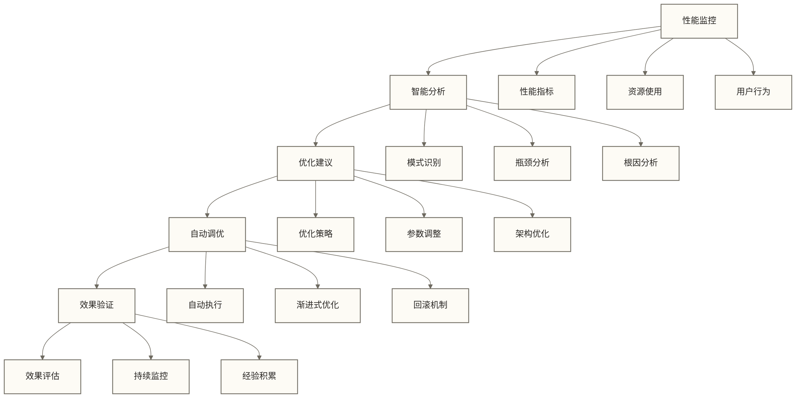

## 🔍 智能化开发应用场景

### 1. 智能ETL开发

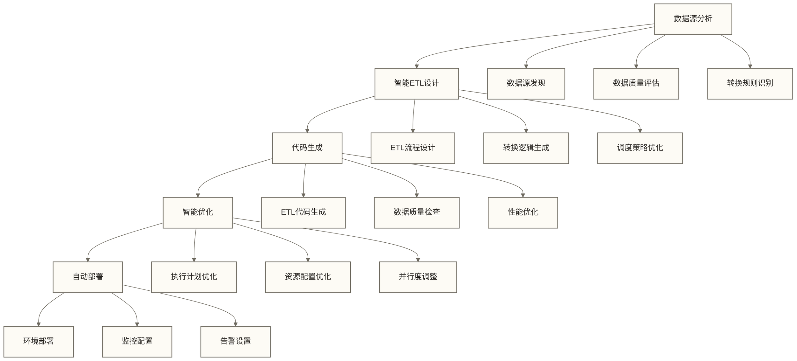

### 2. 智能数据建模

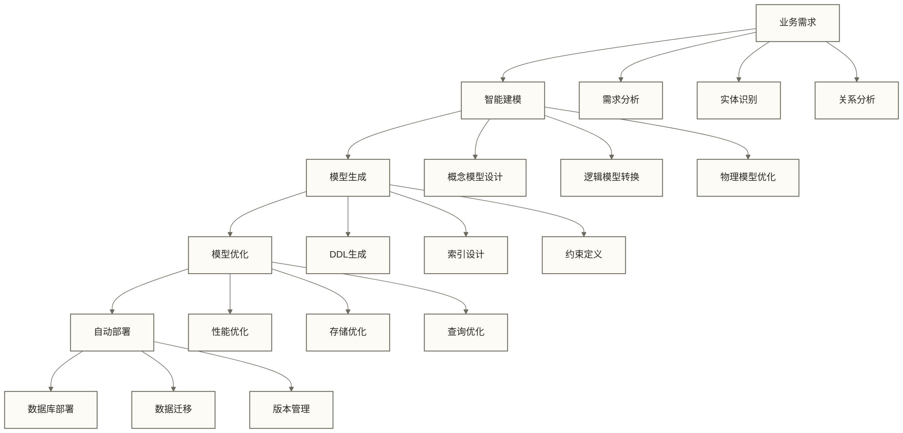

### 3. 智能数据应用开发

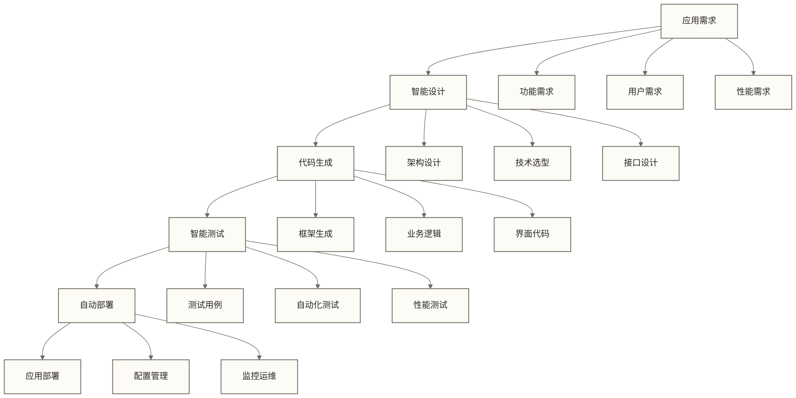

## 🔍 智能化开发挑战与前景

### 1. 技术挑战

```mermaid
%%{init: {"theme":"base","themeVariables":{"fontFamily":"PingFang SC, -apple-system, Source Han Serif SC, serif","fontSize":"16px","background":"#FDFBF5","primaryColor":"#FDFBF5","primaryTextColor":"#2D2A26","primaryBorderColor":"#6E6A60","secondaryColor":"#E8EFE8","secondaryBorderColor":"#8FA890","secondaryTextColor":"#2D2A26","tertiaryColor":"#FDFBF5","tertiaryBorderColor":"#9A9488","tertiaryTextColor":"#6E6A60","lineColor":"#6E6A60","textColor":"#2D2A26","mainBkg":"#FDFBF5","nodeBorder":"#2D5A3D","clusterBkg":"#F3EEDF","clusterBorder":"#9A9488","edgeLabelBackground":"#FDFBF5"},"flowchart":{"htmlLabels":true,"curve":"basis","padding":20,"nodeSpacing":60,"rankSpacing":70,"useMaxWidth":false},"themeCSS":".node rect, .node polygon, .node circle { stroke-width: 1.5px; } .edgePath .path { stroke-width: 1.5px; } .cluster-label .nodeLabel, .cluster-label foreignObject { color: #2D2A26 !important; } .edgeLabel, .edgeLabel foreignObject { color: #2D2A26 !important; background-color: #FDFBF5; } .edgeLabel rect { fill: #FDFBF5; }"}}%%
flowchart TD
    classDef default fill:#FDFBF5,stroke:#6E6A60,color:#2D2A26,stroke-width:1.5px
    classDef startend fill:#2D2A26,stroke:#2D2A26,color:#FDFBF5,font-weight:bold
    classDef decision fill:#F6EAD8,stroke:#C08A1A,color:#2D2A26,font-weight:bold
    classDef hub fill:#3B5A80,stroke:#3B5A80,color:#FDFBF5,font-weight:bold
    classDef io fill:#E5EAF0,stroke:#3B5A80,color:#2D2A26
    classDef accent fill:#A6432C,stroke:#A6432C,color:#FDFBF5,font-weight:bold
    classDef storage fill:#F3EEDF,stroke:#9A9488,color:#2D2A26
    A[技术挑战] --> B[AI模型精度]
    A --> C[数据质量]
    A --> D[计算资源]
    A --> E[安全性]
    B --> B1[代码生成准确性]
    B --> B2[理解能力限制]
    B --> B3[上下文理解]
    C --> C1[训练数据质量]
    C --> C2[数据标注成本]
    C --> C3[数据隐私保护]
    D --> D1[计算资源需求]
    D --> D2[实时性要求]
    D --> D3[成本控制]
    E --> E1[代码安全]
    E --> E2[数据安全]
    E --> E3[隐私保护]
    class A,B,C,D,E,B1,B2,B3,C1,C2,C3,D1,D2,D3,E1,E2,E3 default
```

### 2. 发展前景

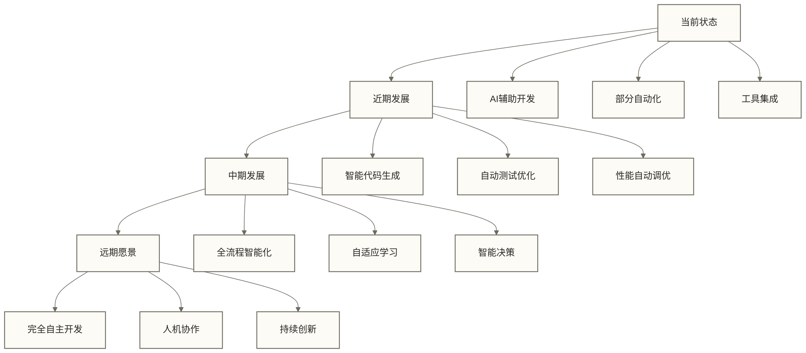

### 3. 实施策略

```mermaid
%%{init: {"theme":"base","themeVariables":{"fontFamily":"PingFang SC, -apple-system, Source Han Serif SC, serif","fontSize":"16px","background":"#FDFBF5","primaryColor":"#FDFBF5","primaryTextColor":"#2D2A26","primaryBorderColor":"#6E6A60","secondaryColor":"#E8EFE8","secondaryBorderColor":"#8FA890","secondaryTextColor":"#2D2A26","tertiaryColor":"#FDFBF5","tertiaryBorderColor":"#9A9488","tertiaryTextColor":"#6E6A60","lineColor":"#6E6A60","textColor":"#2D2A26","mainBkg":"#FDFBF5","nodeBorder":"#2D5A3D","clusterBkg":"#F3EEDF","clusterBorder":"#9A9488","edgeLabelBackground":"#FDFBF5"},"flowchart":{"htmlLabels":true,"curve":"basis","padding":20,"nodeSpacing":60,"rankSpacing":70,"useMaxWidth":false},"themeCSS":".node rect, .node polygon, .node circle { stroke-width: 1.5px; } .edgePath .path { stroke-width: 1.5px; } .cluster-label .nodeLabel, .cluster-label foreignObject { color: #2D2A26 !important; } .edgeLabel, .edgeLabel foreignObject { color: #2D2A26 !important; background-color: #FDFBF5; } .edgeLabel rect { fill: #FDFBF5; }"}}%%
flowchart TD
    classDef default fill:#FDFBF5,stroke:#6E6A60,color:#2D2A26,stroke-width:1.5px
    classDef startend fill:#2D2A26,stroke:#2D2A26,color:#FDFBF5,font-weight:bold
    classDef decision fill:#F6EAD8,stroke:#C08A1A,color:#2D2A26,font-weight:bold
    classDef hub fill:#3B5A80,stroke:#3B5A80,color:#FDFBF5,font-weight:bold
    classDef io fill:#E5EAF0,stroke:#3B5A80,color:#2D2A26
    classDef accent fill:#A6432C,stroke:#A6432C,color:#FDFBF5,font-weight:bold
    classDef storage fill:#F3EEDF,stroke:#9A9488,color:#2D2A26
    A[智能化实施] --> B[渐进式推进]
    A --> C[场景化应用]
    A --> D[生态化建设]
    A --> E[持续优化]
    B --> B1[从简单场景开始]
    B --> B2[逐步扩展应用]
    B --> B3[验证效果改进]
    C --> C1[ETL开发智能化]
    C --> C2[数据建模智能化]
    C --> C3[应用开发智能化]
    D --> D1[工具链集成]
    D --> D2[平台生态]
    D --> D3[社区建设]
    E --> E1[模型持续训练]
    E --> E2[算法优化]
    E --> E3[用户体验改进]
    class A,B,C,D,E,B1,B2,B3,C1,C2,C3,D1,D2,D3,E1,E2,E3 default
```

## ✅ 掌握检查

- [ ] 理解数据开发智能化的核心概念和特征
- [ ] 掌握智能化开发平台的架构设计
- [ ] 了解AI技术在数据开发中的应用
- [ ] 认识智能化开发的技术挑战和发展前景
- [ ] 明确智能化开发的实施策略

## 🔗 学习连接

**前置知识**: [[【数据开发与数据架构】/01-数据开发基础/00-数据开发基础导览.md|数据开发基础导览]], [[【数据开发与数据架构】/17-技术趋势/07-数据开发自动化.md|数据开发自动化]]
**相关概念**: [[【数据开发与数据架构】/17-技术趋势/05-数据开发发展趋势.md|数据开发发展趋势]], [[【数据开发与数据架构】/17-技术趋势/06-低代码数据开发.md|低代码数据开发]], [[【数据开发与数据架构】/17-技术趋势/04-数据产品架构.md|数据产品]]
**下一步**: [[【数据开发与数据架构】/17-技术趋势/04-数据产品架构.md|数据产品]], 数据开发团队创新

---

> [!tip] 💡 实践建议
> 1. **渐进式实施**：从简单的AI辅助功能开始，逐步扩展到复杂场景
> 2. **场景化应用**：优先在标准化、重复性强的场景中应用智能化技术
> 3. **持续学习**：关注AI技术发展，及时更新智能化工具和方法
> 4. **人机协作**：建立人机协作的工作模式，发挥各自优势 