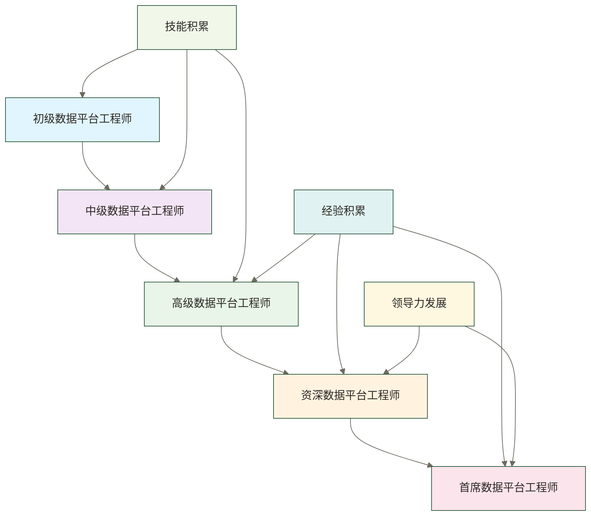

# 数据平台工程师成长路径 - 从入门到专家的完整指南

> [!abstract] 📋 本节概览
> - 🎯 **学习目标**：了解数据平台工程师的完整成长路径和技能要求
> - 📚 **前置知识**：[[【数据开发与数据架构】/08-数据中台架构/00-数据中台架构导览.md|数据中台架构导览]]
> - ⏱️ **预计用时**：30分钟
> - 🔗 **相关概念**：[[【数据开发与数据架构】/07-数据服务架构/00-数据服务架构导览.md|数据服务架构导览]], [[【数据开发与数据架构】/05-数据存储架构/01-数据存储架构概述.md|数据存储架构]]

## 🏗️ 平台构建：技术架构的"总设计师"

数据平台工程师成长路径是**现代技术人才的进阶蓝图**，让个人发展从随机学习升级为系统化的专业成长。

**技术成长的价值**：
- 🎯 **架构思维**：从单点技能向平台架构思维的系统升级
- ⚡ **技术深度**：建立从基础运维到企业级架构的技术纵深
- 🔧 **工程实践**：掌握平台设计、建设、运营的全生命周期
- 📈 **职业发展**：构建从工程师到首席专家的清晰成长阶梯

在技术驱动时代，平台工程师成长路径是连接技术能力与职业价值的重要桥梁。
### 🎯 数据平台工程师成长路径的价值

**对个人而言**：
了解数据平台工程师的成长路径能够帮助个人制定清晰的职业发展规划，明确每个阶段需要掌握的技能和知识，避免盲目学习和技能断层。通过系统化的成长路径，个人可以更有针对性地提升自己的能力，实现职业的持续发展。

**对企业而言**：
了解数据平台工程师的成长路径能够帮助企业建立完善的人才培养体系，制定合理的晋升标准，为数据平台工程师提供清晰的职业发展通道。通过系统化的人才培养，企业可以培养出更多优秀的数据平台工程师，提升企业的数据平台能力。

## 💡 什么是数据平台工程师？

### 🎯 数据平台工程师的核心定义

数据平台工程师是负责设计、构建、维护和优化数据平台的专业人员，需要具备扎实的平台技术功底、深入的系统理解能力和优秀的平台运营能力。数据平台工程师不仅要掌握各种平台技术，还要理解业务需求，能够构建出高效、可靠、可扩展的数据平台。

> [!note] 📝 简单理解
> 数据平台工程师就是数据世界的"平台建设专家"，负责构建和维护整个数据平台。

### 🔍 数据平台工程师的核心特征

#### 平台技术深度
数据平台工程师需要具备扎实的平台技术功底，掌握各种平台技术栈，包括云计算技术、容器技术、微服务技术、DevOps技术等。平台技术深度是数据平台工程师的基础能力，决定了其能够构建出什么样的数据平台。

#### 系统架构思维
数据平台工程师需要具备深入的系统架构理解能力，能够从平台角度思考问题，理解各个组件之间的关系和影响。系统架构思维是数据平台工程师的核心能力，决定了其构建的数据平台的质量和性能。

#### 平台运营能力
数据平台工程师需要具备优秀的平台运营能力，能够保证平台的稳定运行、性能优化、安全防护等。平台运营能力是数据平台工程师的重要能力，决定了其能否保证平台的稳定性和可靠性。

#### 持续优化能力
数据平台工程师需要具备持续优化的能力，因为平台技术发展迅速，需要不断优化和升级平台。持续优化能力是数据平台工程师的关键能力，决定了其能否跟上技术发展的步伐。

## 🏗️ 数据平台工程师的成长阶段

### 🎯 数据平台工程师成长路径概览

以下五阶段为职业规划参考模型，所列年限为假设性规划区间，不代表行业统一晋升标准或晋升保证；实际职级、职责和成长速度取决于组织及项目经历。技能清单应按岗位需求选学，不要求同时掌握所有列举的语言、云平台和工具。

### 📊 第一阶段：初级数据平台工程师（0-2年）

初级数据平台工程师是数据平台工程师成长的起点，主要任务是掌握基础的平台技术技能和工具。

**核心技能要求**：
- **编程语言**：熟练掌握Python、Java、Go等基础编程语言
- **操作系统**：掌握Linux系统的基本操作和管理
- **网络技术**：了解基本的网络协议和网络配置
- **数据库技术**：掌握关系型数据库和NoSQL数据库的基本操作
- **容器技术**：了解Docker等容器技术的基本使用

**主要工作内容**：
- 平台环境的搭建和配置
- 基础服务的部署和维护
- 平台监控和日志管理
- 简单的平台功能开发
- 平台文档的编写和维护

**成长重点**：
- 建立扎实的平台技术基础
- 培养平台思维和运维思维
- 学习团队协作和沟通技巧
- 掌握基本的平台运维流程

### 🔄 第二阶段：中级数据平台工程师（2-4年）

中级数据平台工程师开始承担更复杂的平台任务，需要具备独立解决问题的能力。

**核心技能要求**：
- **云计算技术**：掌握AWS、Azure、阿里云等云平台技术
- **容器编排**：熟练使用Kubernetes等容器编排技术
- **微服务架构**：了解微服务架构的设计和实现
- **DevOps技术**：掌握CI/CD、自动化部署等技术
- **监控告警**：熟练使用Prometheus、Grafana等监控工具

**主要工作内容**：
- 复杂平台环境的搭建和配置
- 微服务架构的设计和实现
- 自动化部署流程的建立和维护
- 平台性能优化和调优
- 平台安全防护和加固

**成长重点**：
- 提升平台技术深度和广度
- 培养架构思维和设计思维
- 增强项目管理和团队协作能力
- 掌握大规模平台运维技术

### ⚙️ 第三阶段：高级数据平台工程师（4-6年）

高级数据平台工程师开始承担平台架构设计和技术决策的责任，需要具备全局思维。

**核心技能要求**：
- **平台架构设计**：能够设计复杂的数据平台架构
- **技术选型**：具备技术选型和架构决策能力
- **性能调优**：深入理解平台性能优化和调优技术
- **团队管理**：开始承担团队管理和技术指导责任
- **业务分析**：深入理解业务需求和业务模式

**主要工作内容**：
- 数据平台架构的设计和规划
- 技术方案的制定和评审
- 复杂平台系统的设计和实现
- 团队技术指导和人才培养
- 平台性能优化和调优

**成长重点**：
- 培养架构思维和战略思维
- 提升技术领导力和团队管理能力
- 增强业务理解和商业敏感度
- 掌握平台架构设计和优化技术

### 🏗️ 第四阶段：资深数据平台工程师（6-8年）

资深数据平台工程师是数据平台的核心负责人，需要具备全面的平台设计和管理能力。

**核心技能要求**：
- **企业级平台架构**：掌握企业级数据平台架构设计方法
- **技术战略**：具备技术战略规划和决策能力
- **团队领导**：优秀的团队管理和领导能力
- **业务战略**：深入理解企业业务战略和商业模式
- **行业洞察**：具备行业发展趋势和技术趋势洞察能力

**主要工作内容**：
- 企业数据平台战略的制定和规划
- 数据平台的顶层设计和规划
- 平台治理体系的建立和维护
- 跨部门平台项目的协调和管理
- 技术团队的建设和培养

**成长重点**：
- 培养战略思维和商业思维
- 提升领导力和影响力
- 增强行业洞察和趋势判断能力
- 掌握企业级平台设计方法

### 🎯 第五阶段：首席数据平台工程师（8年以上）

本参考模型中的首席数据平台工程师以深厚的技术功底和丰富的实践经验为能力目标；具体岗位标准由组织确定，不必然要求行业知名度。

**核心技能要求**：
- **技术专家**：在特定平台技术领域具备专家级能力
- **创新思维**：具备技术创新和平台创新能力
- **行业影响**：在行业内具备一定的影响力和知名度
- **战略规划**：具备企业级技术战略规划能力
- **人才培养**：优秀的团队建设和人才培养能力

**主要工作内容**：
- 前沿平台技术的研究和应用
- 复杂数据平台的设计和实现
- 技术团队的建设和培养
- 行业技术交流和分享
- 企业技术战略的制定和执行

**成长重点**：
- 培养创新思维和前瞻性思维
- 提升行业影响力和知名度
- 增强战略规划和决策能力
- 掌握前沿技术和创新方法

## 🔧 数据平台工程师的核心技能体系

### 🎯 学习目标

**基础技术技能**：
- **编程语言**：[[【数据分析与数据运营】/98-专业术语词典/08-技能方法类/Python.md|Python]]、Java、Go、Shell等
- **操作系统**：Linux、Windows Server等
- **网络技术**：TCP/IP、HTTP、HTTPS、DNS等
- **数据库技术**：关系型数据库、NoSQL数据库、数据仓库等
- **容器技术**：Docker 和 [[【数据开发与数据架构】/10-云原生数据架构/03-Kubernetes数据部署.md|Kubernetes数据部署]]、容器编排等

**高级技术技能**：
- **云计算技术**：AWS、Azure、阿里云、腾讯云等
- **微服务架构**：服务拆分、服务治理、服务监控等
- **DevOps技术**：CI/CD、自动化部署、配置管理等
- **监控告警**：Prometheus、Grafana、ELK Stack等
- **安全技术**：网络安全、数据安全、应用安全等

### 🔄 平台技能体系

**平台设计技能**：
- **架构设计**：平台架构、系统架构、技术架构设计
- **服务设计**：微服务、API服务、数据服务设计
- **集成设计**：系统集成、数据集成、服务集成设计
- **安全设计**：平台安全、数据安全、网络安全设计
- **性能设计**：性能优化、负载均衡、缓存设计

**平台运营技能**：
- **运维管理**：平台运维、系统运维、应用运维
- **监控管理**：性能监控、业务监控、安全监控
- **故障处理**：故障诊断、故障恢复、故障预防
- **容量规划**：资源规划、容量评估、扩容管理
- **变更管理**：版本管理、发布管理、回滚管理

### 🏗️ 业务技能体系

**业务理解技能**：
- **行业知识**：深入理解所在行业的业务模式和特点
- **业务流程**：掌握企业的业务流程和业务规则
- **业务需求**：能够准确理解和分析业务需求
- **业务价值**：理解平台对业务的价值和意义
- **业务创新**：能够通过平台驱动业务创新

**管理技能**：
- **项目管理**：项目规划、执行、监控、收尾等
- **团队管理**：团队建设、人才培养、绩效管理等
- **沟通协调**：与各方的有效沟通和协调
- **决策制定**：技术决策和业务决策的制定
- **风险管理**：技术风险和业务风险的管理

## 📊 数据平台工程师的成长策略

### 🎯 技能发展策略

**技术技能发展**：
- **持续学习**：保持对新技术的持续学习和关注
- **实践应用**：在实际项目中应用和验证技术
- **深度专精**：在特定技术领域进行深度专精
- **广度拓展**：拓展技术视野，了解相关技术
- **技术分享**：通过技术分享提升技术影响力

**平台技能发展**：
- **平台实践**：积极参与各种平台建设项目
- **架构设计**：参与平台架构设计和系统设计
- **性能优化**：深入学习和实践性能优化技术
- **运维自动化**：建立和完善运维自动化体系
- **平台最佳实践**：学习和应用平台最佳实践

### 🔄 经验积累策略

**项目经验积累**：
- **项目参与**：积极参与各种平台建设项目
- **角色转换**：在不同项目中承担不同角色
- **项目总结**：及时总结项目经验和教训
- **最佳实践**：积累和分享最佳实践
- **失败学习**：从失败中学习和成长

**团队经验积累**：
- **团队协作**：积极参与团队协作和合作
- **知识分享**：主动分享知识和经验
- **导师指导**：寻找导师进行指导和学习
- **新人培养**：培养新人，提升管理能力
- **团队建设**：参与团队建设和文化建设

### 🏗️ 职业发展策略

**职业规划**：
- **目标设定**：设定清晰的职业发展目标
- **路径规划**：制定详细的职业发展路径
- **能力评估**：定期评估自身能力和差距
- **调整优化**：根据情况调整和优化规划
- **持续改进**：持续改进和提升能力

**网络建设**：
- **行业交流**：积极参与行业交流活动
- **技术社区**：加入技术社区和论坛
- **专业认证**：获取相关专业认证
- **人脉建设**：建设专业人脉网络
- **影响力提升**：提升在行业内的影响力

## ✅ 掌握检查

- [ ] 理解数据平台工程师的完整成长路径和各个阶段的特点
- [ ] 掌握数据平台工程师在各个阶段需要具备的核心技能
- [ ] 了解数据平台工程师成长的关键策略和方法
- [ ] 能够制定个人的数据平台工程师成长规划
- [ ] 理解数据平台工程师在企业中的重要地位和价值

## 🔗 学习连接

**前置知识**: [[【数据开发与数据架构】/08-数据中台架构/00-数据中台架构导览.md|数据中台架构导览]], [[【数据开发与数据架构】/07-数据服务架构/00-数据服务架构导览.md|数据服务架构导览]]
**相关概念**: [[【数据开发与数据架构】/05-数据存储架构/01-数据存储架构概述.md|数据存储架构]], [[【数据开发与数据架构】/06-数据处理架构/00-数据处理架构导览.md|数据处理架构导览]]
**下一步**: [[【数据开发与数据架构】/99-职业发展/02-数据架构师成长路径.md|数据架构师成长路径]], [[【数据开发与数据架构】/99-职业发展/03-数据工程师成长路径.md|数据工程师成长路径]] 