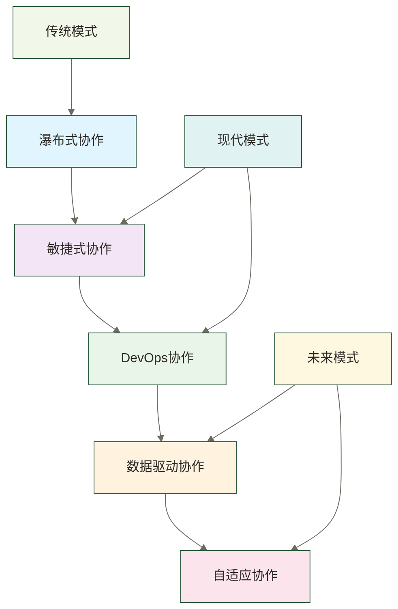

# 数据团队协作能力 - 从个人到团队的协作艺术

> [!abstract] 📋 本节概览
> - 🎯 **学习目标**：掌握数据团队协作的核心方法和技巧
> - 📚 **前置知识**：[[【数据开发与数据架构】/01-数据开发基础/00-数据开发基础导览.md|数据开发基础导览]], [[【数据开发与数据架构】/02-数据工程实践/00-数据工程实践导览.md|数据工程实践导览]]
> - ⏱️ **预计用时**：30分钟
> - 🔗 **相关概念**：[[【数据开发与数据架构】/99-职业发展/07-数据技术领导力.md|数据技术领导力]], [[【数据开发与数据架构】/99-职业发展/08-数据职业发展规划.md|数据职业发展规划]]

## 🤝 团队协作：数据项目的"合奏指挥"

数据团队协作能力是**现代数据工作的核心软技能**，让个人价值从单打独斗升级为团队合力的放大器。

**协作能力的价值**：
- 🎯 **影响力放大**：从个人贡献向团队影响力的系统跃迁
- ⚡ **效率倍增**：建立团队协同机制实现1+1>2的协作效果
- 🔧 **问题解决**：掌握跨团队沟通和冲突解决的实战技能
- 📈 **职业发展**：构建从技术专家到团队领袖的成长路径

在协作时代，团队协作能力是连接技术实力与领导力的重要桥梁。
### 🎯 数据团队协作能力的价值

**对个人而言**：
掌握数据团队协作能力能够帮助个人在团队中更好地发挥作用，提升团队贡献度和个人影响力。通过有效的团队协作，个人可以实现从个人贡献者到团队合作者的转变，实现更大的个人价值。

**对团队而言**：
掌握数据团队协作能力能够帮助团队提升协作效率，增强团队凝聚力和创新能力。通过有效的团队协作，团队可以构建更高效、更有创新力的工作环境，提升团队的整体绩效。

## 💡 什么是数据团队协作？

### 🎯 数据团队协作的核心定义

数据团队协作是指在数据项目中，团队成员通过有效的沟通、协调、配合，共同完成数据开发、数据处理、数据分析等任务的过程。数据团队协作不仅需要个人技术能力，还需要团队协作能力和沟通协调能力。

> [!note] 📝 简单理解
> 数据团队协作就是数据项目中的"团队合作艺术"，能够让团队成员高效地协同工作。

### 🔍 数据团队协作的核心特征

#### 目标一致
数据团队协作需要团队成员对项目目标有共同的理解和认同，确保所有成员朝着同一个方向努力。目标一致是数据团队协作的基础，决定了团队能否形成合力。

#### 角色明确
数据团队协作需要明确每个团队成员的角色和职责，确保团队成员知道自己应该做什么，以及如何与其他成员配合。角色明确是数据团队协作的关键，决定了团队能否高效运转。

#### 沟通有效
数据团队协作需要团队成员之间进行有效的沟通，包括技术沟通、进度沟通、问题沟通等。沟通有效是数据团队协作的桥梁，决定了团队能否及时协调和解决问题。

#### 配合默契
数据团队协作需要团队成员之间形成默契的配合，能够预测和配合其他成员的工作，减少协调成本。配合默契是数据团队协作的高级特征，决定了团队能否达到最佳状态。

#### 持续改进
数据团队协作需要团队持续改进协作方式和流程，不断提升协作效率和质量。持续改进是数据团队协作的长期特征，确保团队能够适应变化和挑战。

## 🏗️ 数据团队协作的模式

### 🎯 数据团队协作模式概览

### 📊 瀑布式协作模式

瀑布式协作模式是传统的团队协作模式，适用于需求明确、变化较少的项目。

**核心特征**：
- **阶段明确**：项目分为明确的阶段，每个阶段有明确的交付物
- **角色固定**：团队成员角色相对固定，职责明确
- **文档驱动**：通过文档进行沟通和协调
- **里程碑管理**：通过里程碑进行进度管理
- **变更控制**：严格控制项目变更

**适用场景**：
- 需求明确且稳定的项目
- 团队规模较大且稳定的项目
- 对质量要求较高的项目
- 有明确交付时间要求的项目

**优缺点**：
- **优点**：计划性强、质量可控、风险较低
- **缺点**：灵活性差、响应变化慢、沟通成本高

### 🔄 敏捷式协作模式

敏捷式协作模式是现代团队协作的主流模式，适用于需求变化频繁的项目。

**核心特征**：
- **迭代开发**：通过短周期迭代进行开发
- **持续交付**：持续交付可用的产品
- **团队自组织**：团队自主组织和协调
- **快速响应**：快速响应需求变化
- **持续改进**：持续改进开发过程

**适用场景**：
- 需求变化频繁的项目
- 需要快速响应用户反馈的项目
- 团队规模适中且灵活的项目
- 创新性较强的项目

**优缺点**：
- **优点**：灵活性高、响应快、用户参与度高
- **缺点**：计划性相对较弱、质量依赖团队能力

### ⚙️ DevOps协作模式

DevOps协作模式是开发和运维一体化的协作模式，适用于需要快速交付的项目。

**核心特征**：
- **开发运维一体化**：开发和运维团队紧密协作
- **自动化流程**：通过自动化提升协作效率
- **持续集成部署**：持续集成和持续部署
- **监控反馈**：通过监控和反馈持续改进
- **文化融合**：开发和运维文化融合

**适用场景**：
- 需要快速交付的项目
- 开发和运维紧密相关的项目
- 对自动化要求较高的项目
- 需要持续改进的项目

**优缺点**：
- **优点**：交付速度快、质量稳定、协作效率高
- **缺点**：对团队能力要求高、初期投入较大

### 🏗️ 数据驱动协作模式

数据驱动协作模式是基于数据分析和决策的协作模式，适用于数据密集型项目。

**核心特征**：
- **数据驱动决策**：基于数据分析进行决策
- **实时监控**：实时监控项目进度和质量
- **预测分析**：通过预测分析优化协作
- **个性化协作**：根据个人特点进行协作
- **智能辅助**：通过智能工具辅助协作

**适用场景**：
- 数据密集型项目
- 需要精确控制的项目
- 团队规模较大的项目
- 对效率要求极高的项目

**优缺点**：
- **优点**：决策科学、效率高、可预测性强
- **缺点**：对数据质量要求高、初期建设成本高

## 🔧 数据团队协作的核心技能

### 🎯 沟通技能体系

**技术沟通技能**：
- **技术表达**：能够清晰表达技术观点和方案
- **技术理解**：能够准确理解他人的技术观点
- **技术讨论**：能够进行有效的技术讨论
- **技术文档**：能够编写清晰的技术文档
- **技术演示**：能够进行有效的技术演示

**业务沟通技能**：
- **需求理解**：能够准确理解业务需求
- **方案解释**：能够向业务人员解释技术方案
- **进度汇报**：能够向管理层汇报项目进度
- **问题沟通**：能够与业务人员沟通问题
- **价值传递**：能够向业务人员传递技术价值

**团队沟通技能**：
- **团队会议**：能够组织和参与有效的团队会议
- **一对一沟通**：能够进行有效的一对一沟通
- **冲突处理**：能够处理和化解团队冲突
- **反馈给予**：能够给予和接受有效的反馈
- **知识分享**：能够进行有效的知识分享

### 🔄 协调技能体系

**任务协调技能**：
- **任务分配**：能够合理分配团队任务
- **进度协调**：能够协调团队成员的工作进度
- **资源协调**：能够协调团队资源的使用
- **依赖协调**：能够协调任务之间的依赖关系
- **风险协调**：能够协调项目风险的应对

**接口协调技能**：
- **接口定义**：能够定义清晰的接口规范
- **接口对接**：能够进行有效的接口对接
- **接口测试**：能够进行接口测试和验证
- **接口维护**：能够维护接口的稳定性
- **接口优化**：能够优化接口的性能

**跨团队协调技能**：
- **跨团队沟通**：能够与跨团队进行有效沟通
- **跨团队协作**：能够进行跨团队协作
- **跨团队冲突**：能够处理跨团队冲突
- **跨团队资源**：能够协调跨团队资源
- **跨团队目标**：能够协调跨团队目标

### 🏗️ 配合技能体系

**工作配合技能**：
- **工作交接**：能够进行有效的工作交接
- **工作支持**：能够为其他成员提供工作支持
- **工作检查**：能够进行有效的工作检查
- **工作优化**：能够优化工作流程和方法
- **工作创新**：能够进行工作创新和改进

**技术配合技能**：
- **代码协作**：能够进行有效的代码协作
- **技术评审**：能够进行有效的技术评审
- **技术测试**：能够进行有效的技术测试
- **技术部署**：能够进行有效的技术部署
- **技术维护**：能够进行有效的技术维护

**文化配合技能**：
- **团队文化**：能够融入和建设团队文化
- **价值观认同**：能够认同团队的价值观
- **行为规范**：能够遵守团队的行为规范
- **团队精神**：能够发扬团队精神
- **团队荣誉**：能够维护团队荣誉

## 📊 数据团队协作的实践方法

### 🎯 团队建设方法

**团队组建**：
- **角色设计**：根据项目需求设计团队角色
- **人员选拔**：选拔合适的人员加入团队
- **能力评估**：评估团队成员的能力和特点
- **团队配置**：合理配置团队成员
- **团队培训**：对团队成员进行培训

**团队培养**：
- **技能培训**：对团队成员进行技能培训
- **协作培训**：对团队成员进行协作培训
- **文化培训**：对团队成员进行文化培训
- **领导力培训**：对团队成员进行领导力培训
- **创新培训**：对团队成员进行创新培训

**团队激励**：
- **目标激励**：通过目标激励团队成员
- **物质激励**：通过物质激励团队成员
- **精神激励**：通过精神激励团队成员
- **发展激励**：通过发展机会激励团队成员
- **认可激励**：通过认可和表扬激励团队成员

### 🔄 协作流程方法

**需求协作流程**：
- **需求收集**：收集和分析用户需求
- **需求分析**：分析需求的可行性和优先级
- **需求确认**：与用户确认需求
- **需求变更**：处理需求变更
- **需求跟踪**：跟踪需求的实现情况

**开发协作流程**：
- **设计协作**：协作进行系统设计
- **开发协作**：协作进行系统开发
- **测试协作**：协作进行系统测试
- **部署协作**：协作进行系统部署
- **维护协作**：协作进行系统维护

**质量协作流程**：
- **质量规划**：规划质量保证活动
- **质量检查**：检查产品质量
- **质量改进**：改进产品质量
- **质量评估**：评估质量改进效果
- **质量总结**：总结质量保证经验

### 🏗️ 工具支持方法

**沟通工具**：
- **即时通讯**：使用即时通讯工具进行沟通
- **视频会议**：使用视频会议工具进行远程沟通
- **文档协作**：使用文档协作工具进行文档编写
- **知识管理**：使用知识管理工具进行知识分享
- **项目管理**：使用项目管理工具进行项目管理

**开发工具**：
- **版本控制**：使用版本控制工具进行代码管理
- **持续集成**：使用持续集成工具进行自动化构建
- **代码审查**：使用代码审查工具进行代码审查
- **测试工具**：使用测试工具进行自动化测试
- **部署工具**：使用部署工具进行自动化部署

**协作工具**：
- **任务管理**：使用任务管理工具进行任务分配和跟踪
- **时间管理**：使用时间管理工具进行时间规划
- **资源管理**：使用资源管理工具进行资源分配
- **风险管理**：使用风险管理工具进行风险识别和管理
- **绩效管理**：使用绩效管理工具进行绩效评估

## ✅ 掌握检查

- [ ] 理解数据团队协作的核心概念和重要性
- [ ] 掌握数据团队协作的不同模式和适用场景
- [ ] 了解数据团队协作的核心技能体系
- [ ] 能够应用数据团队协作方法进行实际协作
- [ ] 理解数据团队协作在项目成功中的重要价值

## 🔗 学习连接

**前置知识**: [[【数据开发与数据架构】/01-数据开发基础/00-数据开发基础导览.md|数据开发基础导览]], [[【数据开发与数据架构】/02-数据工程实践/00-数据工程实践导览.md|数据工程实践导览]]
**相关概念**: [[【数据开发与数据架构】/99-职业发展/07-数据技术领导力.md|数据技术领导力]], [[【数据开发与数据架构】/99-职业发展/08-数据职业发展规划.md|数据职业发展规划]]
**下一步**: [[【数据开发与数据架构】/99-职业发展/07-数据技术领导力.md|数据技术领导力]], [[【数据开发与数据架构】/99-职业发展/08-数据职业发展规划.md|数据职业发展规划]] 