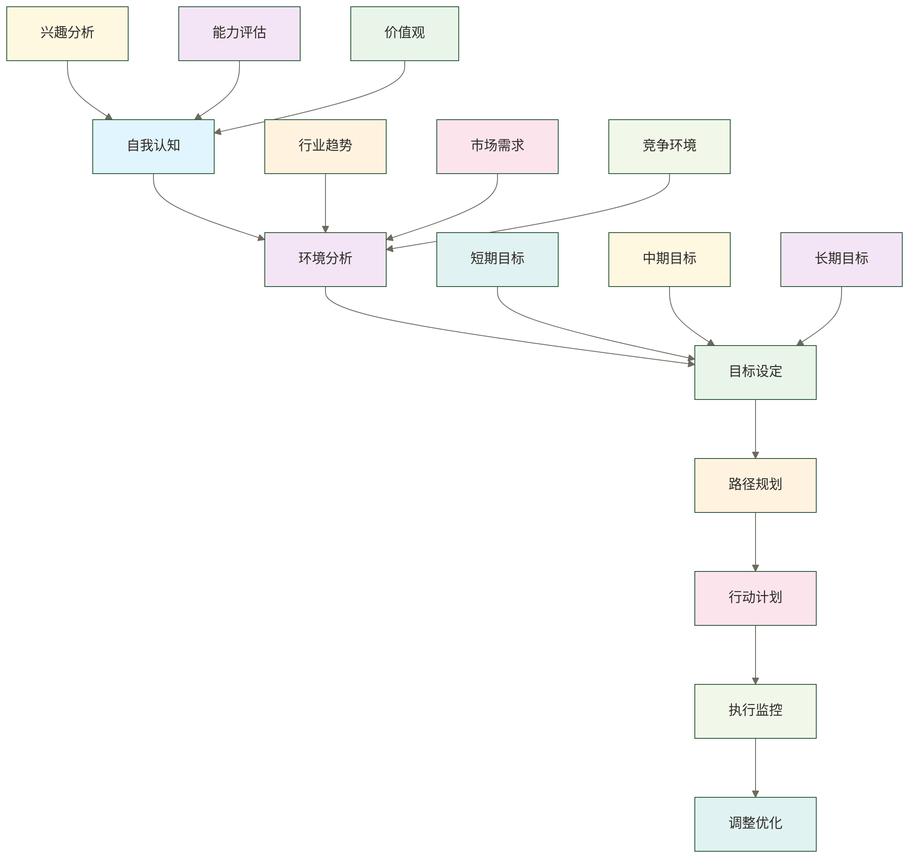

# 数据职业发展规划 - 从规划到执行的完整指南

> [!abstract] 📋 本节概览
> - 🎯 **学习目标**：掌握数据职业发展规划的核心方法和执行策略
> - 📚 **前置知识**：[[【数据开发与数据架构】/99-职业发展/02-数据架构师成长路径.md|数据架构师成长路径]], [[【数据开发与数据架构】/99-职业发展/03-数据工程师成长路径.md|数据工程师成长路径]]
> - ⏱️ **预计用时**：30分钟
> - 🔗 **相关概念**：[[【数据开发与数据架构】/99-职业发展/07-数据技术领导力.md|数据技术领导力]], [[【数据开发与数据架构】/99-职业发展/06-数据团队协作能力.md|数据团队协作能力]]

## 📋 发展规划：职业成长的"战略蓝图"

数据职业发展规划是**个人价值管理的系统工程**，让职业发展从随机机会升级为有计划的价值实现。

**规划体系的价值**：
- 🎯 **方向明确**：从职业迷茫向清晰目标体系的战略转型
- ⚡ **路径优化**：建立技能、经验、网络的系统性发展路径
- 🔧 **风险管控**：掌握职业发展中的机会识别和风险应对
- 📈 **价值最大化**：构建从个人成长到行业影响力的价值跃迁

在变化加速时代，职业发展规划是连接当前状态与理想未来的重要桥梁。
### 🎯 数据职业发展规划的价值

**对个人而言**：
制定数据职业发展规划能够帮助个人明确职业目标，制定清晰的发展路径，避免职业发展的盲目性和随意性。通过系统化的职业规划，个人可以更有针对性地提升自己的能力，实现职业的持续发展。

**对企业而言**：
制定数据职业发展规划能够帮助企业了解员工的职业发展需求，制定合理的人才培养计划，为员工提供清晰的职业发展通道。通过有效的职业规划，企业可以培养出更多优秀的数据人才，提升企业的数据能力。

## 💡 什么是数据职业发展规划？

### 🎯 数据职业发展规划的核心定义

数据职业发展规划是指个人在数据领域，基于自身兴趣、能力、价值观和外部环境，制定明确的职业目标和发展路径，并通过持续的学习、实践和调整，实现职业发展目标的过程。数据职业发展规划不仅需要考虑短期目标，还要考虑长期发展。

> [!note] 📝 简单理解
> 数据职业发展规划就是数据领域的"人生规划"，帮助我们在数据道路上走得更远、更好。

### 🔍 数据职业发展规划的核心特征

#### 目标导向
数据职业发展规划必须以明确的职业目标为导向，所有的规划活动都要围绕实现职业目标进行。目标导向是数据职业发展规划的核心特征，决定了规划的方向和重点。

#### 个性化
数据职业发展规划必须基于个人的兴趣、能力、价值观等个性化因素，不能照搬他人的规划。个性化是数据职业发展规划的基本原则，确保规划符合个人特点。

#### 系统性
数据职业发展规划需要从多个维度进行系统性的规划，包括技能发展、经验积累、网络建设、影响力提升等。系统性是数据职业发展规划的重要特征，确保规划的全面性。

#### 动态性
数据职业发展规划不是一成不变的，需要根据个人发展情况和外部环境变化进行动态调整。动态性是数据职业发展规划的长期特征，确保规划的适应性。

#### 可执行性
数据职业发展规划必须具有可执行性，包括明确的时间节点、具体的行动计划和可衡量的目标。可执行性是数据职业发展规划的关键特征，确保规划能够落地实施。

## 🏗️ 数据职业发展规划的方法

### 🎯 数据职业发展规划方法概览

### 📊 第一步：自我认知

自我认知是数据职业发展规划的第一步，需要深入理解自己的兴趣、能力和价值观。

**兴趣分析**：
- **技术兴趣**：分析对哪些数据技术感兴趣
- **业务兴趣**：分析对哪些业务领域感兴趣
- **工作兴趣**：分析对哪些工作内容感兴趣
- **学习兴趣**：分析对哪些学习内容感兴趣
- **发展兴趣**：分析对哪些发展方向感兴趣

**能力评估**：
- **技术能力**：评估当前的技术能力水平
- **业务能力**：评估当前的业务理解能力
- **管理能力**：评估当前的管理能力水平
- **沟通能力**：评估当前的沟通协调能力
- **学习能力**：评估当前的学习能力水平

**价值观分析**：
- **工作价值观**：分析对工作的价值追求
- **生活价值观**：分析对生活的价值追求
- **发展价值观**：分析对发展的价值追求
- **成就价值观**：分析对成就的价值追求
- **平衡价值观**：分析对工作生活平衡的追求

### 🔄 第二步：环境分析

环境分析是数据职业发展规划的关键步骤，需要了解外部环境的发展趋势和机会。

**行业趋势分析**：
- **技术趋势**：分析数据技术的发展趋势
- **业务趋势**：分析数据业务的发展趋势
- **市场趋势**：分析数据市场的发展趋势
- **政策趋势**：分析相关政策的发展趋势
- **竞争趋势**：分析竞争环境的发展趋势

**市场需求分析**：
- **岗位需求**：分析数据岗位的市场需求
- **技能需求**：分析数据技能的市场需求
- **经验需求**：分析数据经验的市场需求
- **能力需求**：分析数据能力的市场需求
- **发展需求**：分析数据发展的市场需求

**竞争环境分析**：
- **竞争对手**：分析主要竞争对手的情况
- **竞争优势**：分析自身的竞争优势
- **竞争劣势**：分析自身的竞争劣势
- **竞争机会**：分析竞争中的机会
- **竞争威胁**：分析竞争中的威胁

### ⚙️ 第三步：目标设定

目标设定是数据职业发展规划的核心步骤，需要设定明确、可衡量的职业目标。

**短期目标（1-2年）**：
- **技能目标**：设定具体的技能提升目标
- **经验目标**：设定具体的经验积累目标
- **岗位目标**：设定具体的岗位发展目标
- **项目目标**：设定具体的项目参与目标
- **学习目标**：设定具体的学习提升目标

**中期目标（3-5年）**：
- **专业目标**：设定具体的专业发展目标
- **管理目标**：设定具体的管理发展目标
- **影响力目标**：设定具体的影响力提升目标
- **收入目标**：设定具体的收入提升目标
- **地位目标**：设定具体的地位提升目标

**长期目标（5-10年）**：
- **职业目标**：设定具体的职业发展目标
- **行业目标**：设定具体的行业影响力目标
- **价值目标**：设定具体的价值创造目标
- **成就目标**：设定具体的成就实现目标
- **人生目标**：设定具体的人生发展目标

### 🏗️ 第四步：路径规划

路径规划是数据职业发展规划的重要步骤，需要设计实现目标的具体路径。

**技能发展路径**：
- **基础技能**：规划基础技能的提升路径
- **专业技能**：规划专业技能的提升路径
- **管理技能**：规划管理技能的提升路径
- **领导技能**：规划领导技能的提升路径
- **创新技能**：规划创新技能的提升路径

**经验积累路径**：
- **项目经验**：规划项目经验的积累路径
- **管理经验**：规划管理经验的积累路径
- **行业经验**：规划行业经验的积累路径
- **创业经验**：规划创业经验的积累路径
- **国际经验**：规划国际经验的积累路径

**网络建设路径**：
- **技术网络**：规划技术人脉的建设路径
- **业务网络**：规划业务人脉的建设路径
- **管理网络**：规划管理人脉的建设路径
- **行业网络**：规划行业人脉的建设路径
- **国际网络**：规划国际人脉的建设路径

### 🎯 第五步：行动计划

行动计划是数据职业发展规划的执行步骤，需要制定具体的行动计划。

**学习计划**：
- **学习内容**：制定具体的学习内容计划
- **学习方式**：制定具体的学习方式计划
- **学习时间**：制定具体的学习时间计划
- **学习资源**：制定具体的学习资源计划
- **学习评估**：制定具体的学习评估计划

**实践计划**：
- **实践项目**：制定具体的实践项目计划
- **实践方式**：制定具体的实践方式计划
- **实践时间**：制定具体的实践时间计划
- **实践资源**：制定具体的实践资源计划
- **实践评估**：制定具体的实践评估计划

**发展计划**：
- **发展机会**：制定具体的发展机会计划
- **发展方式**：制定具体的发展方式计划
- **发展时间**：制定具体的发展时间计划
- **发展资源**：制定具体的发展资源计划
- **发展评估**：制定具体的发展评估计划

## 🔧 数据职业发展规划的执行策略

### 🎯 目标管理策略

**目标分解**：
- **年度目标**：将长期目标分解为年度目标
- **季度目标**：将年度目标分解为季度目标
- **月度目标**：将季度目标分解为月度目标
- **周度目标**：将月度目标分解为周度目标
- **日度目标**：将周度目标分解为日度目标

**目标跟踪**：
- **进度跟踪**：定期跟踪目标完成进度
- **质量跟踪**：定期跟踪目标完成质量
- **效果跟踪**：定期跟踪目标完成效果
- **问题跟踪**：定期跟踪目标完成中的问题
- **调整跟踪**：定期跟踪目标调整情况

**目标激励**：
- **成就激励**：通过成就激励目标完成
- **奖励激励**：通过奖励激励目标完成
- **认可激励**：通过认可激励目标完成
- **挑战激励**：通过挑战激励目标完成
- **成长激励**：通过成长激励目标完成

### 🔄 能力建设策略

**技能提升策略**：
- **系统学习**：通过系统学习提升技能
- **实践应用**：通过实践应用提升技能
- **项目锻炼**：通过项目锻炼提升技能
- **导师指导**：通过导师指导提升技能
- **自我反思**：通过自我反思提升技能

**经验积累策略**：
- **项目参与**：积极参与各种项目
- **角色转换**：在不同项目中承担不同角色
- **责任承担**：主动承担更多责任
- **挑战接受**：主动接受各种挑战
- **总结反思**：及时总结和反思经验

**网络建设策略**：
- **主动社交**：主动参与社交活动
- **知识分享**：通过知识分享建立网络
- **价值贡献**：通过价值贡献建立网络
- **合作共赢**：通过合作共赢建立网络
- **持续维护**：持续维护人脉网络

### 🏗️ 风险应对策略

**技术风险应对**：
- **技术更新**：及时更新技术知识
- **技术储备**：建立技术储备能力
- **技术合作**：通过技术合作降低风险
- **技术投资**：通过技术投资降低风险
- **技术保险**：通过技术保险降低风险

**市场风险应对**：
- **市场关注**：持续关注市场变化
- **市场适应**：及时适应市场变化
- **市场预测**：提前预测市场变化
- **市场布局**：提前布局市场机会
- **市场合作**：通过市场合作降低风险

**竞争风险应对**：
- **竞争优势**：持续保持竞争优势
- **竞争合作**：通过竞争合作降低风险
- **竞争创新**：通过竞争创新降低风险
- **竞争差异化**：通过竞争差异化降低风险
- **竞争联盟**：通过竞争联盟降低风险

## 📊 数据职业发展规划的评估与调整

### 🎯 规划评估方法

**目标达成评估**：
- **进度评估**：评估目标达成的进度
- **质量评估**：评估目标达成的质量
- **效果评估**：评估目标达成的效果
- **价值评估**：评估目标达成的价值
- **满意度评估**：评估目标达成的满意度

**能力提升评估**：
- **技能评估**：评估技能提升的情况
- **经验评估**：评估经验积累的情况
- **能力评估**：评估能力提升的情况
- **影响力评估**：评估影响力提升的情况
- **竞争力评估**：评估竞争力提升的情况

**规划执行评估**：
- **执行效率**：评估规划执行的效率
- **执行质量**：评估规划执行的质量
- **执行效果**：评估规划执行的效果
- **执行成本**：评估规划执行的成本
- **执行风险**：评估规划执行的风险

### 🔄 规划调整策略

**目标调整策略**：
- **目标优化**：根据实际情况优化目标
- **目标调整**：根据变化情况调整目标
- **目标补充**：根据发展需要补充目标
- **目标删除**：根据实际情况删除目标
- **目标重新设定**：根据变化重新设定目标

**路径调整策略**：
- **路径优化**：根据实际情况优化路径
- **路径调整**：根据变化情况调整路径
- **路径补充**：根据发展需要补充路径
- **路径删除**：根据实际情况删除路径
- **路径重新设计**：根据变化重新设计路径

**策略调整策略**：
- **策略优化**：根据实际情况优化策略
- **策略调整**：根据变化情况调整策略
- **策略补充**：根据发展需要补充策略
- **策略删除**：根据实际情况删除策略
- **策略重新制定**：根据变化重新制定策略

## ✅ 掌握检查

- [ ] 理解数据职业发展规划的核心概念和重要性
- [ ] 掌握数据职业发展规划的完整方法和流程
- [ ] 了解数据职业发展规划的执行策略和调整方法
- [ ] 能够制定个人的数据职业发展规划
- [ ] 理解数据职业发展规划在职业发展中的重要价值

## 🔗 学习连接

**前置知识**: [[【数据开发与数据架构】/99-职业发展/02-数据架构师成长路径.md|数据架构师成长路径]], [[【数据开发与数据架构】/99-职业发展/03-数据工程师成长路径.md|数据工程师成长路径]]
**相关概念**: [[【数据开发与数据架构】/99-职业发展/07-数据技术领导力.md|数据技术领导力]], [[【数据开发与数据架构】/99-职业发展/06-数据团队协作能力.md|数据团队协作能力]]
**下一步**: [[【数据开发与数据架构】/01-数据开发基础/00-数据开发基础导览.md|数据开发基础导览]], [[【数据开发与数据架构】/02-数据工程实践/00-数据工程实践导览.md|数据工程实践导览]] 