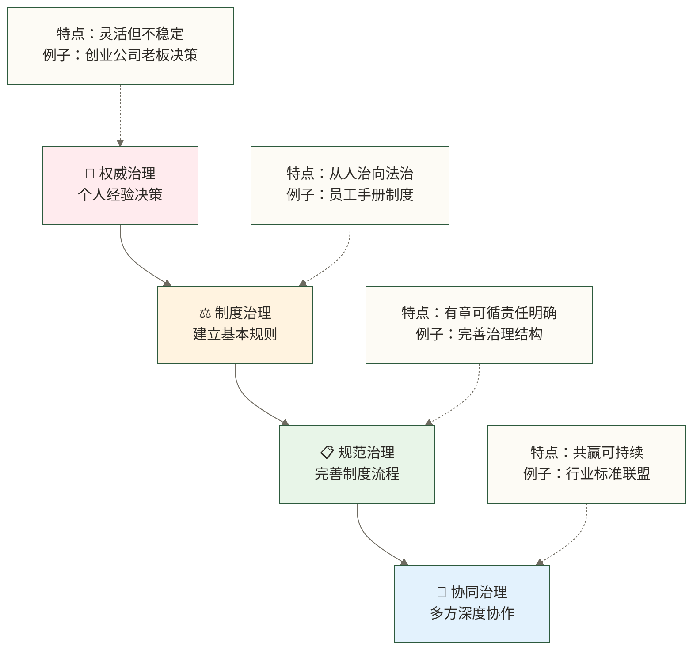

# 什么是治理 - 从管理到治理的思维转变

> [!abstract] 📋 本原子概览
> - 🎯 **学习目标**：理解治理的本质含义，区分治理与管理的差别
> - 📚 **前置知识**：[[【数据治理与数据管理】/01-快速学习/01-基础概念/什么是数据.md|什么是数据]]（建议先了解）
> - ⏱️ **预计用时**：15分钟
> - 🏷️ **适合人群**：对治理概念模糊的学习者，希望理解治理本质的人员

## 🔄 数据管理的"运营引擎"

治理通过**明确决策权责、建立规则和监督协调机制**，为数据管理的执行提供方向与约束，支持数据治理策略在组织中落地。

**治理概念的流程价值**：

治理概念在数据管理流程中发挥着关键作用：将抽象的数据策略转化为具体可操作的流程和机制；明确多方利益相关者的职责分工和协作方式，避免权责不清；建立数据管理的监控反馈和持续改进机制；提升组织在复杂环境下的数据管理成熟度。

有效的数据治理有助于改善决策所依据的数据质量；具体成效需结合指标定义、实施条件和实际测量评估。
## 💡 核心概念

> [!tip] 🎯 简单来说
> **治理是通过建立规则、制度和机制，让多个参与者能够协调合作，实现共同目标的过程**。就像制定交通规则让所有司机都能安全出行一样。

### 治理的核心特征

#### 1. 🤝 **适当参与与明确权责** - 按事务性质配置参与和监督

治理需要按事务性质明确决策权责、相关方参与渠道与监督机制，并不要求所有决定都由多方共同协商作出。以小区事务为例，业主、物业公司、社区和有关部门可按职责参与；具体决策仍依法律、授权和规则进行。参与式治理是常见形态之一，不是治理的唯一形式。

#### 2. 📋 **规则导向** - 按制度办事，不看人情面子

治理强调按照既定的制度和规则来办事。例如公司请假制度应对所有员工一视同仁，不因个人关系给予特殊待遇。治理的重点在于建立公平透明的规则体系，而非依赖个人权威或主观判断。

#### 3. 🔄 **协调机制** - 有冲突时知道怎么解决

治理体系应建立有效的协调机制，当出现冲突和问题时有明确的处理路径。例如，装修噪音扰民问题应有清晰的投诉渠道、调解程序和处罚措施，确保问题出现时有章可循。

#### 4. 🎯 **目标导向** - 大家为了共同目标而努力

治理的各参与方应为共同目标协作，而非博弈对抗。以交通管理为例，司机、行人、交通管理部门等各方共同目标是营造安全有序的交通环境，这种目标一致性有助于治理发挥作用，但有效性还取决于权责安排、规则执行和监督反馈。

### 治理 VS 管理：一张表看懂区别

| 维度 | 管理（Management） | 治理（Governance） |
|---|---|---|
| **决策方式** | 在既定权限内作出执行决策，可采用层级或协作方式 | 明确决策权责、参与和监督机制，不一定由多方协商决定 |
| **权力结构** | 侧重执行职责与汇报关系 | 侧重权责配置、规则与问责，可采用层级或网络结构 |
| **关注重点** | 执行效率，完成任务 | 规则制定，机制建设 |
| **时间视角** | 解决当前问题 | 建立长期机制 |
| **适用场景** | 组织内部，权责清晰 | 多方利益，需要协调 |
| **典型例子** | 公司部门管理 | 行业自律组织 |

## 🔍 实际应用

### 生活中的治理例子

#### 🏘️ **社区治理**

社区治理是一个典型的多方参与治理案例。参与者包括业主、物业公司、居委会、政府相关部门等多个主体。治理机制体现在业主大会决策重大事项、物业管理委员会日常监督、完善的投诉处理流程等方面。所有参与方的共同目标是创造一个安全、干净、和谐的居住环境，这种目标一致性有助于治理发挥作用，但有效性还取决于权责安排、规则执行和监督反馈。

#### 🚗 **交通治理**

交通治理涉及司机、行人、交警、交通管理部门、道路管理部门等众多参与者。治理机制包括统一的交通规则、公平的违章处罚制度、标准化的事故处理程序等。各方都致力于实现安全、有序、高效的交通环境这一共同目标，通过规则约束和协调配合来维护良好的交通秩序。

#### 🌐 **互联网治理**

互联网治理体现了现代治理的复杂性，参与者包括用户、平台企业、政府监管部门、行业组织等。治理机制表现为平台内部规则、用户协议约定、法律法规约束、用户举报机制等多层次的规范体系。各方共同追求安全、健康、有序的网络环境，通过多种手段实现网络空间的良性发展。

### 为什么需要治理？

> [!example] 📝 假设示例：小区停车治理
> 
> **问题背景**：某小区车位不够，经常因为停车问题产生邻里纠纷
> 
> **管理方式的尝试**：
> - 物业指定停车位 → 业主不满意，觉得不公平
> - 保安严格执法 → 与业主关系紧张，效果不好
> 
> **治理方式的解决**：
> 1. **多方参与**：召集业主代表、物业、居委会开会讨论
> 2. **制定规则**：共同制定《小区停车管理办法》
> 3. **建立机制**：成立停车管理委员会，建立投诉处理流程
> 4. **明确目标**：所有人都能公平使用停车资源
> 
> **结果**：虽然车位还是不够，但大家按规则办事，纠纷大大减少

## 💡 学习目标

> [!tip] 💭 重要认知转变
> 
> **从"有人管"到"有机制"**
> 
> 很多人习惯于"找领导"、"找负责人"的思维，但治理思维是"找规则"、"找机制"：
> 
> - **管理思维**："这件事谁管？找他去！"
> - **治理思维**："这件事按什么规则办？程序是什么？"
> 
> **治理不是为了控制，而是为了协调**
> 
> 治理的目的不是限制大家的自由，而是通过合理的规则让大家能够更好地合作，实现"1+1>2"的效果。

> [!warning] ⚠️ 常见误区
> 
> **误区1**："治理就是严格管理"
> - **真相**：治理强调协调和合作，不是简单的命令和控制
> 
> **误区2**："治理会降低效率"
> - **真相**：治理机制可能提高长期效率，但具体成效取决于协调成本、规则执行和监督反馈，需结合实际运行情况评估
> 
> **误区3**："治理太复杂，管理更直接"
> - **真相**：复杂问题往往需要治理与管理相结合：治理明确规则和权责，管理组织执行并处理具体问题

## 🔍 治理的发展层次

让我们用一个企业例子来理解治理的发展过程：

### 📊 治理发展阶梯（教学示意，非通用成熟度模型）

**发展路径说明**：
- 🚀 **向上发展**：治理能力逐步提升，稳定性和效果越来越好
- 🔄 **可能倒退**：如果不维护，治理水平也可能下降
- 🎯 **因地制宜**：不同组织和场景适合不同的治理层次

## ✅ 掌握检查

- [ ] 我能区分治理和管理的主要差别
- [ ] 我理解治理的四个核心特征（适当参与与明确权责、规则导向、协调机制、目标导向）
- [ ] 我能举出生活中的治理例子
- [ ] 我认识到治理在复杂环境中的价值

## 🔗 学习连接

### 🔙 前置知识
**如果你还不了解**：[[【数据治理与数据管理】/01-快速学习/01-基础概念/什么是数据.md|什么是数据]] - 了解数据的基本概念

### 🔄 相关概念  
**你可能还想了解**：
- [[【数据治理与数据管理】/01-快速学习/01-基础概念/数据治理VS数据管理.md|数据治理VS数据]] - 在数据领域中治理和管理的具体区别
- [[【数据治理与数据管理】/02-深度研究/01-理论基础/数据治理基础/数据治理成熟度模型.md|数据治理成熟度]] - 了解治理发展的不同阶段

### 🔜 后续学习
**下一步可以学习**：
- [[【数据治理与数据管理】/01-快速学习/01-基础概念/数据治理简介.md|数据治理简介]] - 了解为什么数据也需要治理
- 数据治理组织架构 - 学习数据治理的组织架构

### 🛠️ 实践应用
**如何在实际中应用**：
- 数据治理方法 - 学习如何设计有效的治理机制
- 多方协调技巧 - 掌握协调不同利益相关者的方法

---

> [!note] 💭 小结
>
> 治理思维的核心转变：从"找负责人"到"找规则和机制"。数据涉及技术、业务、法律、隐私等多个方面，单靠管理难以协调，这正是引入治理框架的原因。
>
> **下一步**：[[【数据治理与数据管理】/01-快速学习/01-基础概念/数据治理简介.md|数据治理简介]] — 了解为什么数据特别需要治理，以及数据治理具体要做什么。