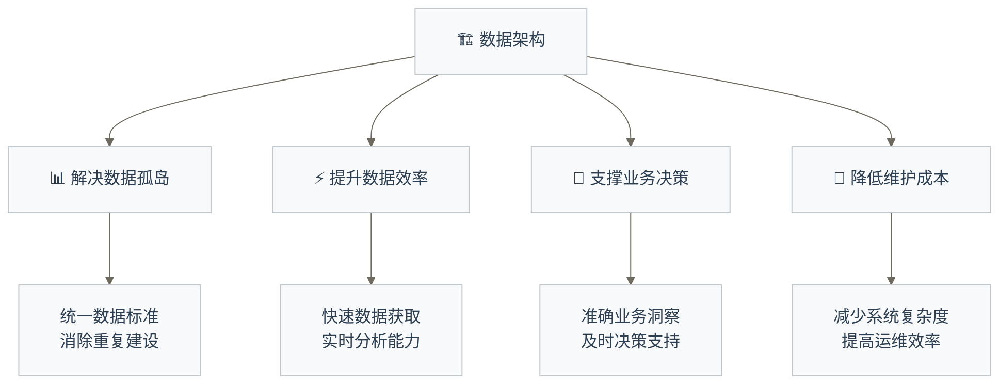
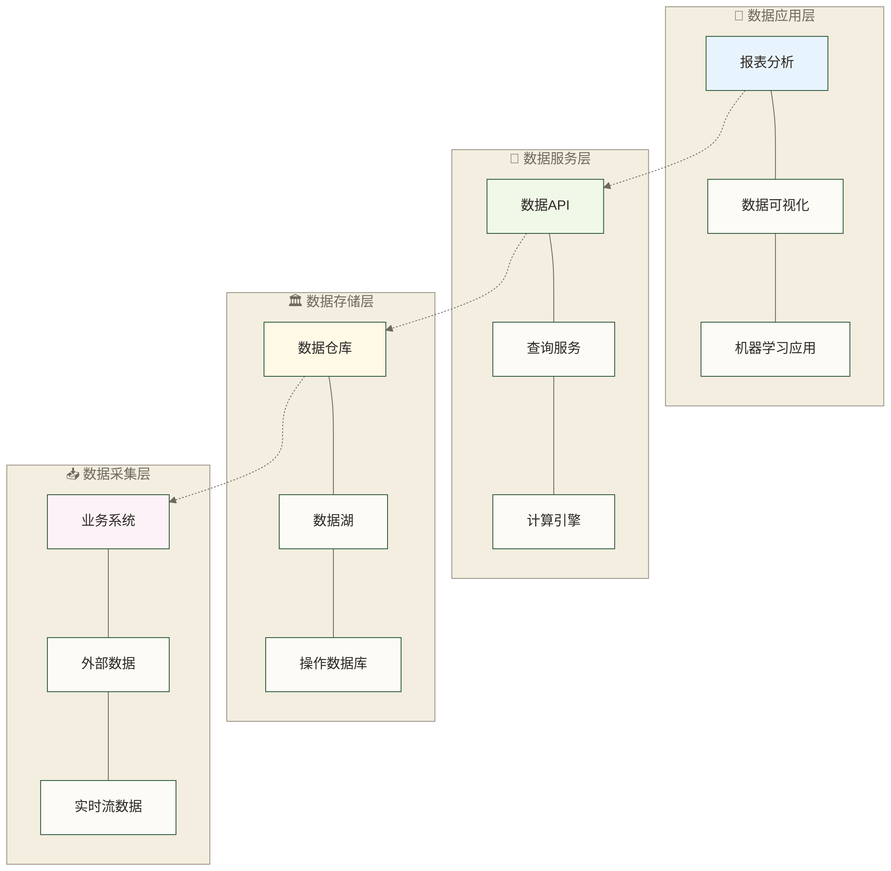
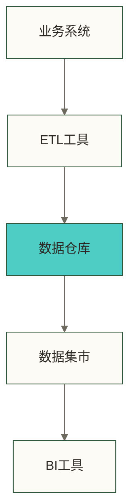
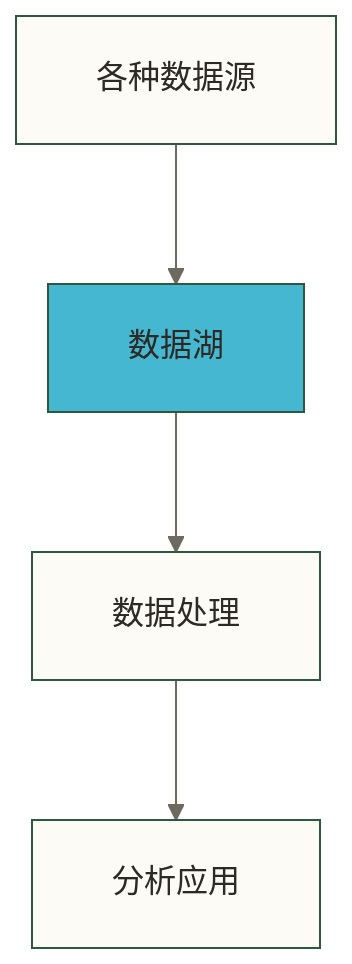
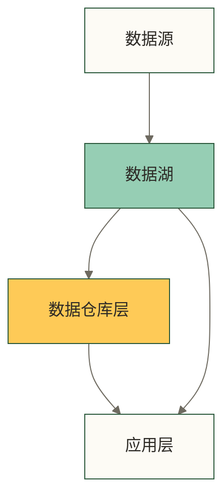
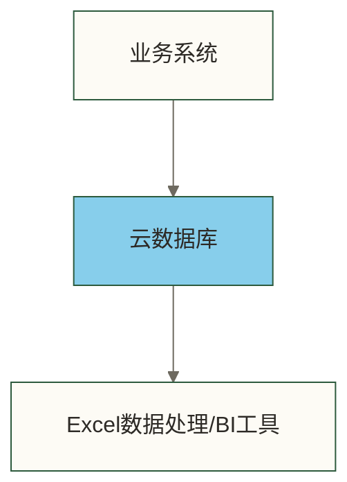
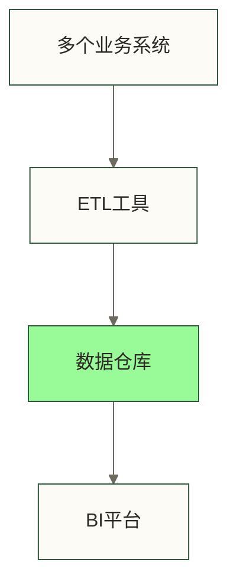
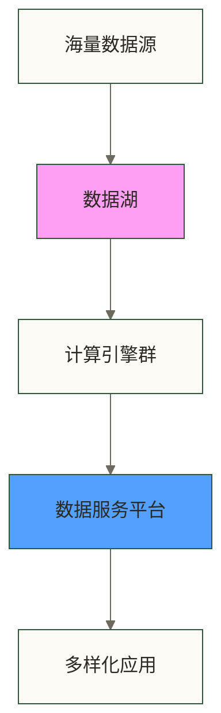

# 数据架构基本概念 - 让混乱的数据变成有序的城市

> [!abstract] 📋 本原子概览
> - 🎯 **学习目标**：理解数据架构的价值，掌握数据架构的基本组成和设计思路
> - 📚 **前置知识**：[[【数据治理与数据管理】/01-快速学习/01-基础概念/什么是数据.md|什么是数据]]（建议先了解）
> - ⏱️ **预计用时**：20分钟
> - 🏷️ **适合人群**：对数据架构概念模糊的学习者，希望了解技术与业务关系的人员

## 🏗️ 数据管理的"基础设施蓝图"

数据架构是**构建可扩展数据管理体系的核心架构**，为企业数据资产的有效利用奠定坚实基础。

**数据架构的架构价值**：

良好的数据架构设计能够为企业带来显著的价值回报。在效率提升方面，标准化的数据管理流程能够显著提升团队协作效率，减少重复建设和资源浪费，让数据工作更加规范有序。在成本优化层面，合理的架构规划有助于避免数据孤岛和系统割裂问题，通过统一规划降低整体数据管理成本，实现投资效益最大化。在质量保障方面，系统化的架构设计能够从源头确保数据的准确性和一致性，为高质量的数据分析奠定基础。最后在敏捷响应能力上，灵活的架构设计能够很好地支持快速变化的业务需求和持续演进的技术环境，增强企业的市场适应能力。

从混乱的数据现状到井然有序的管理体系，数据架构是数字化转型的重要基石。以假设情境说明：若架构优化后数据管理成本降低40%，可用这一假设讨论降本价值；40%并非本文已证实的通用效果。
## 💡 核心概念

> [!tip] 🎯 简单来说
> **数据架构是对企业数据资产的整体规划和设计，包括数据如何采集、存储、处理、流转和使用的总体蓝图**。就像城市总体规划一样，指导数据相关系统的建设和运行。

### 数据架构的核心价值

### 数据架构的基本组成

#### 🏗️ **四层架构模型**

#### 📥 **数据采集层** - 数据的源头活水
- **业务系统数据**：ERP、CRM、电商平台等核心业务系统
- **外部数据**：第三方API、公开数据集、合作伙伴数据
- **实时流数据**：用户行为、设备监控、传感器数据
- **文档数据**：邮件、合同、报告等非结构化数据

#### 🏛️ **数据存储层** - 数据的安全港湾
- **[[【数据分析与数据运营】/98-专业术语词典/04-数据工程类/数据仓库.md|数据仓库]]**：结构化、已清洗的数据，支持复杂分析
- **数据湖**：原始数据存储，支持多种数据格式
- **操作数据库**：支持业务系统日常运行的数据
- **缓存系统**：高频访问数据的快速存储

#### 🔧 **数据服务层** - 数据的加工厂
- **ETL/ELT工具**：数据抽取、转换、加载
- **计算引擎**：大数据处理、实时计算
- **数据API**：标准化的数据访问接口
- **数据目录**：数据资产的"地图"和"说明书"

#### 📱 **数据应用层** - 数据的价值体现
- **报表分析**：定期业务报告、KPI监控
- **自助分析**：业务人员自主的数据探索
- **数据可视化**：图表、看板、大屏展示
- **智能应用**：推荐系统、预测模型、AI应用

## 🔍 不同架构模式对比

### 🏗️ 常见的数据架构模式

#### 🏠 **传统数据仓库架构**

**特点**：
- ✅ 数据质量高，结构清晰
- ✅ 查询性能好，适合固定分析
- ❌ 建设周期长，成本较高
- ❌ 灵活性有限，难以处理非结构化数据

**适用场景**：传统企业、财务分析、合规报告

#### 🌊 **数据湖架构**

**特点**：
- ✅ 存储成本低，支持多种数据格式
- ✅ 扩展性强，适合大数据场景
- ❌ 数据质量难控制，可能变成"数据沼泽"
- ❌ 需要专业技能，学习成本较高

**适用场景**：互联网公司、研发团队、大数据分析

#### 🏙️ **湖仓一体架构**

**特点**：
- ✅ 结合两者优势，灵活性与可靠性并存
- ✅ 支持批处理和实时处理
- ❌ 技术复杂度较高
- ❌ 需要统一的数据治理体系

**适用场景**：现代企业、数字化转型、多场景应用

## 🔍 实际应用场景

### 不同规模企业的架构选择

#### 🏢 **小微企业（50人以下）**

**架构特点**：简单实用，低成本

**推荐方案**：
- 📊 使用云数据库（如阿里云RDS、腾讯云等）
- 📈 结合Excel或简单BI工具进行分析
- 💰 示例预算目标：每月几千元以内；这是规划假设，需按数据库规格、存储、流量、工具许可和运维范围另行估算

**假设案例**：某咖啡店连锁（5家店），用于说明小规模架构，不代表已核实的企业实践
- 用简单的进销存系统记录数据
- 每周用Excel分析销售趋势
- 月度用PowerBI制作经营报表

#### 🏬 **中型企业（500人左右）**

**架构特点**：标准化，支持多业务

**推荐方案**：
- 🏗️ 建设企业数据仓库
- 🔧 使用专业ETL工具
- 📊 部署企业级BI平台
- 👥 配备专职数据团队

**假设案例**：某制造企业，用于说明多系统整合，不代表已核实的企业实践
- 整合ERP、CRM、财务等系统数据
- 建设数据仓库支持多部门分析需求
- 实现从生产到销售的全链路数据分析

#### 🏭 **大型企业（5000人以上）**

**架构特点**：平台化，支持创新

**推荐方案**：
- 🌊 构建企业数据湖
- ⚡ 部署分布式计算集群
- 🏗️ 建设数据中台
- 🤖 发展AI/ML应用

**假设案例**：某大型零售集团，下述PB级规模和人员数量均为场景假设，不代表已核实的企业实践
- 数据湖存储PB级数据
- 支持上千个分析师和数据科学家
- 实现个性化推荐、智能定价等AI应用

## 💡 关键洞察

> [!tip] 💭 重要认知转变
> 
> **从"有什么数据"到"需要什么数据"**
> 
> 很多企业的数据架构是"摸着石头过河"，系统建一个是一个。好的数据架构应该：
> - 🎯 **业务驱动**：基于业务需求设计架构
> - 🔮 **前瞻规划**：考虑未来3-5年的发展需要
> - 🔄 **迭代演进**：支持渐进式的能力提升
> 
> **数据架构不是技术问题，是业务问题**
> 
> 最好的数据架构不是技术最先进的，而是最适合业务需要的：
> - 💰 **成本可控**：投入产出比合理
> - 👥 **团队匹配**：符合团队技能水平
> - ⏱️ **时间合适**：建设节奏符合业务发展

> [!example] 📝 数据架构ROI案例
> 
> **某零售企业数据架构升级（假设案例）**：以下投入、业务指标和改造成果均为教学假设，不代表真实企业业绩或效果保证。
> 
> **改造前状况**：
> - 20多个系统各自为政，数据孤岛严重
> - 做一个销售分析需要1周时间
> - 库存数据不准确，缺货率15%
> 
> **架构投入**：2年投入1500万
> - 数据仓库建设：800万
> - 系统集成：400万
> - 团队建设：300万
> 
> **改造成果**：
> - 实时销售分析，决策效率提升90%
> - 精准库存管理，缺货率降至3%
> - 个性化推荐，销售额提升25%
> 
> **回报口径说明**：假设第一年节省成本2000万，相对于两年总投入1500万，节省额与总投入之比约为133%，该比例不是第一年ROI。若仅将2000万节省额与1500万投入视为同一评估期的全部收益和成本，则净ROI约为33.3%；原案例未给出分期现金流，不能据此计算实际第一年ROI。

> [!warning] ⚠️ 常见架构误区
> 
> **误区1**："技术越先进越好"
> - **真相**：适合的才是最好的，过度先进可能带来无法承受的复杂度
> 
> **误区2**："一步到位建设完美架构"
> - **真相**：架构需要迭代演进，一次性投入过大风险很高
> 
> **误区3**："数据架构是IT部门的事"
> - **真相**：业务部门的深度参与是成功的关键

## ✅ 掌握检查

- [ ] 我理解数据架构的价值和作用
- [ ] 我了解数据架构的四层基本组成
- [ ] 我知道不同架构模式的特点和适用场景
- [ ] 我认识到数据架构需要与业务需求和企业规模匹配

## 🔗 学习连接

### 🔙 前置知识
**如果你还不了解**：[[【数据治理与数据管理】/01-快速学习/01-基础概念/什么是数据.md|什么是数据]] - 理解数据的基本概念

### 🔄 相关概念  
**你可能还想了解**：
- 数据仓库与数据湖 - 深入了解两种主要架构模式
- [[【数据治理与数据管理】/01-快速学习/01-基础概念/数据生命周期概念.md|数据生命周期概念]] - 理解数据在架构中的流转过程
- [[【数据治理与数据管理】/01-快速学习/01-基础概念/数据治理简介.md|数据治理简介]] - 了解架构与治理的关系

### 🔜 后续学习
**下一步可以学习**：
- 数据中台概念 - 学习现代企业数据架构
- [[【数据开发与数据架构】/04-数据架构设计/02-数据架构设计原则.md|数据开发 数据架构设计原则]] - 掌握架构设计方法
- 云原生数据架构 - 了解最新发展趋势

### 🛠️ 实践应用
**如何在实际中应用**：
- [[【数据治理与数据管理】/02-深度研究/03-技术架构/数据架构/01-数据架构基础/数据架构评估.md|数据架构评估]] - 评估现有架构状况
- 数据架构升级计划 - 制定架构升级计划
- 中小企业数据架构方案 - 适合中小企业的实用方案

---

> [!quote] 💭 学习鼓励
> 
> 🎉 **恭喜你建立了数据架构的整体认知！**
> 
> 数据架构是一个既有技术深度又有业务广度的领域。不要被技术名词吓到，记住数据架构的本质就是"让数据更好地服务业务"。
> 
> 就像城市规划师需要理解城市的方方面面一样，优秀的数据架构师需要既懂技术又懂业务。今天学习的基础概念，将为你理解更复杂的数据系统打下坚实基础。
> 
> **记住：好的数据架构不是建出来的，是规划出来的。先有蓝图，再有建筑！** 🏗️