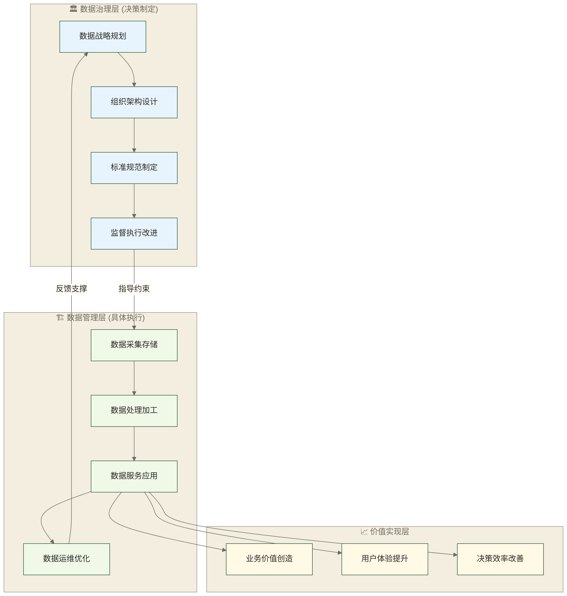

# 数据治理VS数据管理 - 不再混淆的清晰界限

> [!abstract] 📋 本原子概览
> - 🎯 **学习目标**：清晰区分数据治理和数据管理，理解两者的关系
> - 📚 **前置知识**：[[【数据治理与数据管理】/01-快速学习/01-基础概念/数据治理简介.md|数据治理简介]] 和 [[【数据治理与数据管理】/01-快速学习/01-基础概念/什么是治理.md|什么是治理]]（建议先了解）
> - ⏱️ **预计用时**：15分钟  
> - 🏷️ **适合人群**：容易混淆这两个概念的学习者

## 📊 概念辨析的"清晰界定书"

准确区分数据治理与数据管理是**确保数据工作职责清晰和协作高效的认知基础**，避免角色混淆和职责重叠带来的管理低效。

**概念清晰的协作价值**：

清晰区分数据治理与数据管理概念，对企业数据工作的高效开展具有重要价值。首先在职责明确方面，准确界定治理和管理的边界能够避免工作重叠和责任推诿现象，让每个人都明确自己的工作范围和职责要求。其次在协作效率上，准确的角色定位有助于提升跨部门数据协作的效率和决策速度，减少因概念混淆导致的沟通成本。同时，明确的概念边界有助于企业制定更加精准的数据投资策略和发展规划，避免资源配置的偏差。最后，基于清晰的职责分工，企业能够进行更合理的团队建设和人才培养，提升整体数据管理能力。

在企业数据组织建设中，治理与管理概念混淆可能增加沟通和协作成本。若以项目执行效率提升45%说明概念清晰的潜在价值，该数字只能作为假设示例，不代表已证实的平均效果。
## 💡 核心区别

### 🎯 一张表看懂根本差异

以下采用“治理侧重决策与监督、管理侧重落地执行”的简化视角，便于入门理解，并非互斥的领域或人员划分。广义数据管理也包含战略、组织与治理活动；实际职责和参与人员需结合企业组织安排确定。

| 维度 | 数据治理 (Data Governance) | 数据管理 (Data Management) |
|---|---|---|
| **核心职责** | 制定规则和标准 | 执行具体操作 |
| **关注层面** | 战略层、政策层 | 操作层、技术层 |
| **时间视角** | 长期规划和持续监督 | 日常执行和问题解决 |
| **参与人员** | 业务负责人、管理者 | 技术人员、操作人员 |
| **主要产出** | 规范、标准、流程 | 数据产品、服务、系统 |
| **成功标准** | 规则有效性、合规性 | 效率、质量、稳定性 |

### 🔍 具体职责对比

#### 🏛️ **数据治理的职责**

数据治理主要承担战略制定和规则建立的职责。在制定标准方面，负责建立数据定义规范、数据分类体系、命名标准等基础规范，为数据管理提供统一的标准依据。在建立规则层面，制定数据使用权限策略、安全管理要求、合规管理规定等制度框架。在组织协调方面，促进跨部门沟通协作，协调不同利益相关方的需求和冲突，确保治理目标的统一性。在监督检查职能上，评估治理效果、识别存在问题并推动纠正改进。最后在战略规划方面，制定数据发展方向和投资优先级，指导整体数据能力建设。

#### 🏗️ **数据管理的职责**

数据管理主要承担具体执行和技术实现的职责。在技术实现方面，负责数据库设计、ETL流程开发、系统运维等技术性工作，将治理要求转化为技术解决方案。在质量控制层面，执行具体的数据清洗、验证、监控等操作，确保数据质量符合标准要求。在安全实施方面，部署访问控制系统、实施数据加密、建立备份机制等安全措施，落实安全治理要求。在服务提供职能上，为业务用户提供数据查询、报表生成、分析服务等应用支持。最后在流程执行方面，严格按照既定的标准流程处理各类数据操作，确保管理活动的规范性。

## 🔍 实际场景对比

### 📱 场景1：用户数据统一管理

#### 🏛️ **数据治理的视角**
**问题**：各部门对"活跃用户"定义不一致

**治理方案**：
1. 召集业务部门讨论，制定统一的"活跃用户"定义
2. 建立数据标准委员会，负责定义审核和更新
3. 制定数据标准管理流程，确保新定义有序引入
4. 设立数据标准合规检查，监督执行情况

#### 🏗️ **数据管理的视角**
**问题**：按照新的活跃用户定义，如何技术实现

**管理方案**：
1. 分析各系统的用户行为数据表结构
2. 设计用户活跃度计算逻辑和ETL流程
3. 开发用户活跃度监控看板
4. 建立数据质量检查和异常告警机制

### 🏪 场景2：数据安全保护

#### 🏛️ **数据治理的视角**
**问题**：需要保护客户隐私，满足法规要求

**治理方案**：
1. 制定数据分类分级标准（公开、内部、敏感、机密）
2. 建立数据访问权限管理制度
3. 制定数据脱敏和使用规范
4. 建立数据安全审计和责任追溯机制

#### 🏗️ **数据管理的视角**  
**问题**：如何技术实现数据安全保护

**管理方案**：
1. 部署数据访问控制系统，实现细粒度权限管理
2. 开发数据脱敏工具，对敏感字段自动处理
3. 建设数据使用审计系统，记录所有访问行为
4. 实施数据库加密和网络安全防护

## 💡 什么是治理应用

> [!tip] 💭 重要认知转变
> 
> **治理是"做正确的事"，管理是"正确地做事"**
> 
> - 🎯 **数据治理**回答：我们应该做什么？为什么这样做？
> - 🛠️ **数据管理**回答：怎么做？如何做得更好？
> 
> **治理失败，管理再好也没用；管理不行，治理理念无法落地**
> 
> 两者是相辅相成的关系，不能偏废任何一方。

### 🔄 两者的关系模型

**关系说明**：
- 🏛️ **治理指导管理**：制定规则和标准，指导具体实施
- 🏗️ **管理支撑治理**：提供反馈和数据，支撑决策优化
- 📈 **共同创造价值**：两者协同实现业务目标

## 🔍 职业发展角度

### 🎯 不同角色的关注重点

#### 👔 **数据治理角色**
**典型岗位**：数据治理经理、数据管理员、首席数据官

**核心技能**：
- 🤝 **沟通协调**：跨部门协作、利益冲突调解
- 📋 **制度设计**：流程梳理、规范制定
- 📊 **业务理解**：深刻理解业务需求和痛点
- ⚖️ **合规意识**：了解相关法规和行业标准

**发展路径示例（非固定晋升顺序）**：业务分析师 → 数据管理员 → 数据治理经理 → 首席数据官

#### 💻 **数据管理角色**
**典型岗位**：数据工程师、数据架构师、数据运维工程师

**核心技能**：
- 🔧 **技术实现**：数据库、编程、系统架构
- 📊 **工具使用**：ETL工具、监控工具、可视化工具
- 🛡️ **运维保障**：系统稳定性、性能优化
- 🔍 **问题解决**：故障排查、性能调优

**发展路径示例（非固定晋升顺序）**：数据开发工程师 → 数据工程师 → 数据架构师 → 技术总监

> [!example] 📝 职业发展建议
> 
> **如果你偏向管理和业务**：
> - 重点学习数据治理，培养跨部门协调能力
> - 关注业务理解和制度设计
> - 发展方向：数据治理专家、首席数据官
> 
> **如果你偏向技术和实现**：
> - 重点学习数据管理，掌握技术工具和方法
> - 关注系统架构和工程实现
> - 发展方向：数据架构师、技术专家
> 
> **最佳策略**：两者都要懂，但有所侧重
> - 理解治理思维，能够设计合理的技术方案
> - 掌握管理技能，能够将治理理念落地实现

## ✅ 掌握检查

- [ ] 我能清晰区分数据治理和数据管理的核心职责
- [ ] 我理解两者在时间视角、参与人员、产出成果上的差异
- [ ] 我认识到两者相辅相成的关系
- [ ] 我了解不同角色的职业发展路径

## 🔗 学习连接

### 🔙 前置知识
**如果你还不了解**：
- [[【数据治理与数据管理】/01-快速学习/01-基础概念/数据治理简介.md|数据治理简介]] - 理解数据治理的基本概念
- [[【数据治理与数据管理】/01-快速学习/01-基础概念/什么是治理.md|什么是治理]] - 理解治理的本质含义

### 🔄 相关概念  
**你可能还想了解**：
- 数据管理简介 - 深入了解数据管理的具体内容
- [[【数据治理与数据管理】/01-快速学习/01-基础概念/DAMA框架简介.md|DAMA框架简介]] - 学习权威的数据管理框架
- 数据治理组织关系 - 了解治理和管理的组织关系

### 🔜 后续学习
**下一步可以学习**：
- [[【数据治理与数据管理】/01-快速学习/01-基础概念/数据质量基本概念.md|数据质量基本概念]] - 了解具体的管理领域
- [[【数据治理与数据管理】/01-快速学习/01-基础概念/数据架构基本概念.md|数据架构基本概念]] - 学习架构设计思维
- [[【数据治理与数据管理】/02-深度研究/04-行业实践/实践案例库/数据治理成熟度评估实践案例.md|数据治理成熟度评估实践案例]] - 评估当前治理和管理水平

### 🛠️ 实践应用
**如何在实际中应用**：
- 数据治理组织建设 - 学习如何建立治理和管理组织
- 数据管理流程设计 - 掌握管理流程设计方法
- 数据治理实施方法 - 学习两者如何有效配合

---

> [!quote] 💭 学习鼓励
> 
> 🎉 **恭喜你理清了两个重要概念！**
> 
> 治理和管理的界限容易被混淆。本篇的学习目标是帮助你区分两者的侧重点，并练习从职责与协作关系理解数据工作。
> 
> 这个区分不只是概念问题，更是思维方式的差异。掌握这个区分，有助于你分析数据问题涉及的治理与管理职责；具体判断和方案选择仍需结合业务背景，许多问题需要两者协同解决。
> 
> **记住：好的数据治理需要好的数据管理来支撑，好的数据管理需要好的数据治理来指导。两者结合，才能真正发挥数据的价值！** 🚀