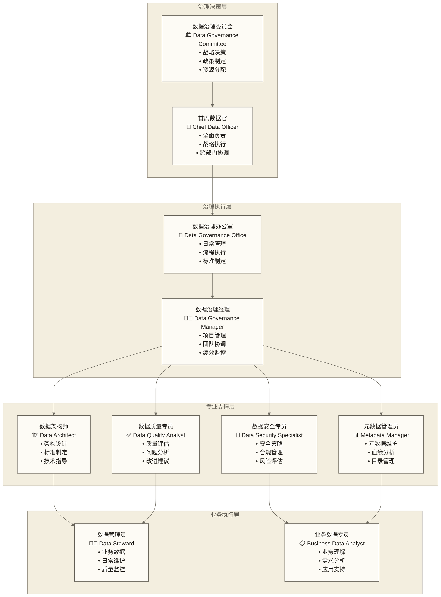
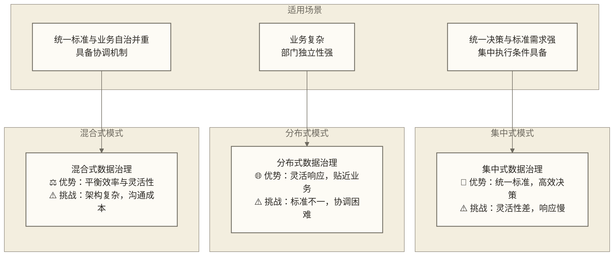

# 数据治理组织架构 - 构建高效的数据治理组织

> [!abstract] 📋 本节概览
> - 🎯 学习目标：掌握数据治理组织架构的设计原则和角色职责
> - 📚 前置知识：[[【数据治理与数据管理】/02-深度研究/01-理论基础/数据治理基础/数据治理概述.md|数据治理]], [[【数据治理与数据管理】/02-深度研究/01-理论基础/数据治理基础/数据治理框架.md|数据治理]]
> - ⏱️ 预计用时：18分钟

## 🔄 组织架构的"治理成功基石"

数据治理组织架构是**支持治理战略实施的重要基础**，通过科学的组织设计和明确的角色职责分工，为数据治理提供组织保障和执行体系；治理目标能否有效实现，仍取决于资源投入、权责落实及实际执行等条件。

**数据治理组织架构的基石价值**：
- 🎯 **执行效率大幅提升**：科学的架构设计旨在提升治理执行效率，支持目标达成；具体增幅需结合实际测量
- 🏗️ **责任边界清晰明确**：明确的角色定义有助于减少责任推诿、强化执行力，具体效果取决于权责落实情况
- 📊 **协调成本显著降低**：合理的协作机制有助于降低跨部门协调成本、提升协作效果，具体降幅需实际评估
- 💼 **治理价值持续放大**：专业的能力建设有助于提升治理价值创造，投资回报需结合投入、收益口径和实施周期评估
## 💡 数据治理组织架构设计

### 📊 典型数据治理组织架构图

### 🔄 组织架构模式对比

**组织设计原则**：
- 🎯 **职责清晰**：每个角色都有明确的责任边界和考核标准
- 🔄 **分层治理**：决策层、执行层、操作层职责分工明确
- 🤝 **协作机制**：建立跨部门协作和沟通机制
- 📈 **能力建设**：持续提升团队专业能力和治理水平

### 组织架构原则

| 原则 | 描述 | 重要性 |
|---|---|---|
| **业务导向** | 组织设计以业务需求为导向 | 支持治理价值实现 |
| **权责明确** | 明确各角色的职责和权限 | 避免推诿和冲突 |
| **分层管理** | 建立分层分级的治理体系 | 提高管理效率 |
| **专业分工** | 根据专业能力进行分工 | 提升治理质量 |
| **协作高效** | 促进跨部门协作 | 支持治理效果改善 |

### 典型组织架构模式

#### 1. 集中式组织架构

**架构特点**：数据治理委员会统一领导，数据管理办公室集中执行
- 治理委员会（最高决策层）
- 数据管理办公室（统筹协调）
- 专业治理团队（数据标准组、质量组、安全组、架构组）
- 各部门数据管理员（分散执行）

**适用场景**：大型企业、数据治理成熟度较高的组织
**优势**：统一管理、标准一致、效率高
**挑战**：灵活性不足、业务响应慢

#### 2. 分布式组织架构

**架构特点**：数据治理委员会战略决策，各部门独立实施
- 治理委员会（战略决策）
- 数据治理中心（专业支持）
- 业务部门治理团队（销售、财务、运营等）
- IT部门治理团队（技术支撑）

**适用场景**：业务复杂、部门独立性强的组织
**优势**：贴近业务、响应快速、专业性强
**挑战**：协调困难、标准不统一

#### 3. 混合式组织架构

**架构特点**：结合集中和分散的优势
- 治理委员会（战略决策）
- 数据管理办公室（统筹协调）
- 专业治理团队（集中管理）：标准管理、质量管理、安全管理
- 业务部门数据管理员（分散执行）

**适用场景**：需要兼顾统一标准与业务自治，且具备跨部门协调机制的组织
**优势**：平衡集中与分散、兼顾效率与灵活性
**挑战**：需要良好的协调机制

## 🔍 核心角色与职责

### 1. 数据治理委员会（Data Governance Council）

**角色定位**：数据治理的最高决策机构

**主要职责**：
- 制定数据治理战略和政策
- 审批数据治理重大决策
- 协调跨部门数据治理事项
- 监督数据治理实施效果

**人员构成**：公司高层领导（主席）、各业务部门负责人、技术部门负责人、法务合规负责人

### 2. 数据管理办公室（Data Management Office, DMO）

**角色定位**：数据治理的统筹协调机构

**主要职责**：
- 制定数据治理制度和标准
- 协调跨部门数据治理活动
- 监督数据治理政策执行
- 评估数据治理效果

**核心能力**：数据治理专业知识、项目管理能力、沟通协调能力、业务理解能力

### 3. 数据所有者（Data Owner）

**角色定位**：数据资产的业务负责人

**主要职责**：
- 确定数据的业务含义和用途
- 制定数据质量标准
- 审批数据访问权限
- 承担数据质量责任

**典型角色**：客户数据所有者、财务数据所有者、产品数据所有者

### 4. 数据管理员（Data Steward）

**角色定位**：数据治理的具体执行者

**主要职责**：
- 执行数据治理政策和标准
- 监控数据质量状况
- 处理数据质量问题
- 维护数据字典和元数据

**技能要求**：数据管理专业知识、业务领域知识、技术工具使用能力、问题解决能力

### 5. 数据架构师（Data Architect）

**角色定位**：数据架构的设计者

**主要职责**：
- 设计数据架构和模型
- 制定数据技术标准
- 指导数据平台建设
- 优化数据流程

**专业要求**：数据建模技能、数据库设计能力、系统架构知识、业务分析能力

## 📊 组织能力建设

### 能力模型

| 能力类别 | 具体能力 | 发展重点 |
|---|---|---|
| **战略规划** | 数据战略制定、治理规划、变革管理 | 高层视野、战略思维 |
| **专业执行** | 数据标准、质量、安全、元数据管理 | 专业技能、实操经验 |
| **技术支撑** | 数据架构设计、工具使用、技术实施 | 技术能力、创新思维 |
| **协作沟通** | 跨部门协调、培训推广、文化建设 | 软技能、影响力 |

### 人才培养路径

**初级数据管理员**
- 知识要求：数据管理基础知识、业务领域知识
- 技能要求：数据质量检查、标准执行、工具使用
- 发展路径：数据管理员 → 高级数据管理员 → 数据治理专家

**中级数据治理专家**
- 知识要求：数据治理理论、行业最佳实践
- 技能要求：治理方案设计、项目管理、团队协作
- 发展路径：数据治理专家 → 数据治理经理 → 数据治理总监

**高级数据治理领导者**
- 知识要求：战略管理、变革管理、组织设计
- 技能要求：战略规划、组织建设、文化培育
- 发展路径：数据治理总监 → 首席数据官（CDO）

## 🎯 组织实施策略

### 实施阶段

**第一阶段：组织建立（0-3个月）**
- 成立数据治理委员会
- 设立数据管理办公室
- 任命关键角色人员
- 制定基础管理制度

**第二阶段：能力建设（3-12个月）**
- 建立专业团队
- 开展技能培训
- 完善治理流程
- 建设技术平台

**第三阶段：深化应用（12-24个月）**
- 扩大治理范围
- 优化组织架构
- 提升治理效果
- 建立持续改进机制

### 成功要素

1. **高层支持**：获得领导层的充分支持和资源投入
2. **角色明确**：明确各角色的职责和权限
3. **能力匹配**：确保人员能力与岗位要求匹配
4. **激励机制**：建立有效的考核和激励机制
5. **持续改进**：建立组织能力持续提升机制

### 常见挑战及应对

| 挑战 | 具体表现 | 解决方案 |
|---|---|---|
| **角色冲突** | 业务角色与数据治理角色存在冲突 | 明确职责边界，建立协调机制 |
| **能力不足** | 缺乏专业的数据治理人才 | 加强培训，外部引进，内部培养 |
| **组织阻力** | 业务部门对数据治理存在抵触 | 加强沟通，展示价值，渐进实施 |

## ✅ 掌握检查

- [ ] 理解数据治理组织架构的设计原则
- [ ] 掌握三种典型组织架构模式的特点
- [ ] 了解核心角色的职责和要求
- [ ] 熟悉组织能力建设的路径
- [ ] 能够设计适合组织的数据治理架构

## 🔗 学习连接

**前置知识**: [[【数据治理与数据管理】/02-深度研究/01-理论基础/数据治理基础/数据治理概述.md|数据治理]], [[【数据治理与数据管理】/02-深度研究/01-理论基础/数据治理基础/数据治理框架.md|数据治理]]
**下一步**: [[【数据治理与数据管理】/02-深度研究/01-理论基础/数据治理基础/数据治理成熟度模型.md|数据治理成熟度]]
**相关概念**: [[【数据治理与数据管理】/02-深度研究/01-理论基础/数据管理基础/数据管理角色与职责.md|数据管理角色与职责]] 