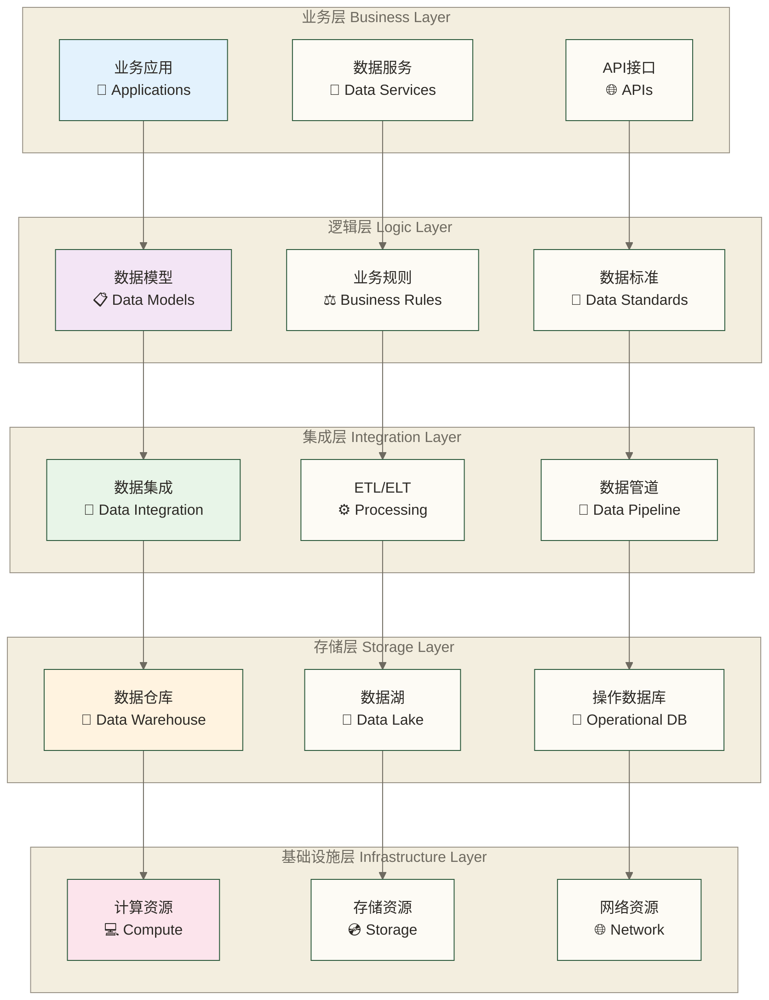
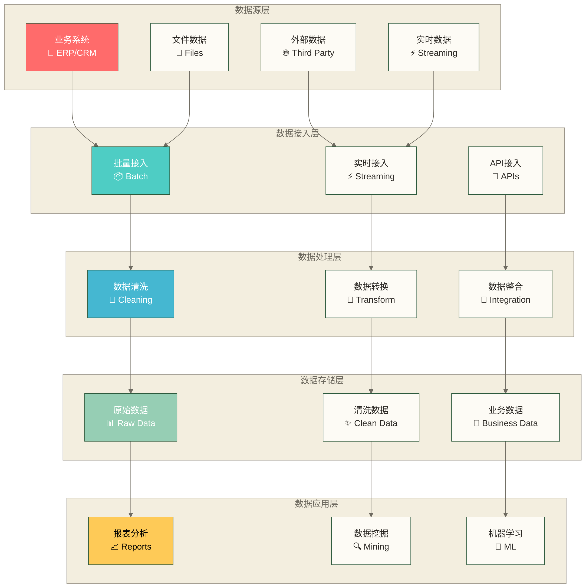

# 数据架构概述 - 构建企业数据的基础框架

> [!abstract] 📋 本节概览
> - 🎯 学习目标：理解数据架构的核心概念和设计原则
> - 📚 前置知识：[[【数据治理与数据管理】/02-深度研究/01-理论基础/数据治理基础/数据治理概述.md|数据治理]], [[【数据治理与数据管理】/02-深度研究/01-理论基础/数据治理基础/数据治理框架.md|数据治理]]
> - ⏱️ 预计用时：20分钟

## 🏗️ 数据架构的"企业数字蓝图"

数据架构概述是**绘制企业数字化转型蓝图的核心框架指南**，通过系统化的架构设计思想和科学的组织方法，为企业构建稳定、可扩展、高效的数据基础设施提供全面的认知基础和实践指导。

**数据架构概述的蓝图指导价值**：
- 🎯 **架构认知清晰**：系统化概述旨在帮助理解架构，减少设计偏差
- 🏗️ **设计决策科学**：完整框架认知有助于评估架构决策，识别重构风险
- 📊 **技术选型精准**：全面的架构视角有助于评估技术选型匹配度，识别技术债务
- 💼 **投入产出优化**：正确的架构认知有助于评估基础设施投入产出，支持投资决策
### 没有数据架构的常见问题

**问题一：数据孤岛**
- 各部门数据无法共享
- 相同数据重复存储
- 数据一致性难以保证

**问题二：数据混乱**
- 数据定义不统一
- 数据格式不一致
- 数据关系不清晰

**问题三：性能问题**
- 数据查询效率低下
- 系统响应缓慢
- 资源浪费严重

## 💡 什么是数据架构？

> [!abstract] 🎯 数据架构的定义
> 数据架构是组织数据资产的蓝图，定义了数据的组织方式、存储结构、处理流程和访问模式，确保数据能够支持业务需求并实现价值最大化。

### 📊 企业数据架构全景图

### 🔄 数据流动架构图

**架构设计要点**：
- 🏗️ **分层设计**：清晰的层次结构，每层职责明确
- 🔄 **松耦合**：各层之间通过标准接口交互，降低依赖
- 📈 **可扩展**：支持业务增长和技术演进
- 🛡️ **安全性**：全链路数据安全和访问控制

### 数据架构的核心要素

| 要素                                      | 描述         | 生活化类比     |           |
| --------------------------------------- | ---------- | --------- | --------- |
| **数据模型**                                | 定义数据的结构和关系 | 就像建筑的设计图纸 |           |
| **数据存储**   | 确定数据的存储方式 | 就像仓库的布局设计 |
| **数据流程**                                | 描述数据的流动路径  | 就像城市的交通规划 |           |
| **数据标准**                                | 统一数据的定义和格式 | 就像城市的建设标准 |           |
| **数据安全**                                | 保障数据的安全和隐私 | 就像城市的安保系统 |           |

## 🏗️ 数据架构设计原则

### 1. 业务导向原则
- **以业务需求为中心**：架构设计必须满足业务需求
- **支持业务变化**：架构要能够适应业务的发展变化
- **创造业务价值**：架构要为业务创造实际价值

### 2. 标准化原则
- **统一数据定义**：建立统一的数据标准和规范
- **一致的数据格式**：确保数据格式的一致性
- **标准化的接口**：提供标准化的数据访问接口

### 3. 可扩展性原则
- **水平扩展能力**：通过增加节点扩展系统容量，支持数据量和负载增长
- **垂直扩展能力**：通过提升单节点的计算、内存或存储资源扩展系统容量
- **技术演进能力**：支持技术的更新换代

### 4. 安全性原则
- **数据保护**：确保数据的安全性和完整性
- **访问控制**：建立完善的访问控制机制
- **隐私保护**：保护个人隐私和敏感数据

### 5. 性能优化原则
- **查询效率**：优化数据查询性能
- **存储效率**：提高数据存储效率
- **处理效率**：提升数据处理效率

## 🔍 数据架构层次结构

### 企业级数据架构

| 层次 | 英文 | 核心内容 |
|------|------|---------|
| 战略层 | Strategic Layer | 数据战略、数据治理、数据投资 |
| 概念层 | Conceptual Layer | 业务概念模型、数据分类体系、数据关系模型 |
| 逻辑层 | Logical Layer | 逻辑数据模型、数据流程设计、数据接口设计 |
| 物理层 | Physical Layer | 物理数据模型、存储架构设计、技术实现方案 |

### 各层职责

**战略层**
- 制定数据战略和目标
- 建立数据治理体系
- 规划数据投资方向

**概念层**
- 定义业务概念和术语
- 建立数据分类体系
- 描述数据之间的关系

**逻辑层**
- 设计逻辑数据模型
- 规划数据流程
- 定义数据接口

**物理层**
- 实现物理数据模型
- 选择存储技术
- 部署技术方案

## 📊 数据架构模式

### 1. 传统数据架构

业务系统 → 数据仓库 → 数据集市 → 报表系统

**特点**：
- 集中式存储
- 批量处理
- 结构化数据为主

**适用场景**：
- 传统企业
- 结构化数据
- 批量分析需求

### 2. 数据湖架构

数据源 → 数据湖 → 数据处理 → 数据应用

**特点**：
- 原始数据存储
- 灵活的数据处理
- 支持多种数据类型

**适用场景**：
- 大数据场景
- 非结构化数据
- 探索性分析

### 3. 数据中台架构

数据源 → 数据中台 → 数据服务 → 业务应用

**特点**：
- 统一数据服务
- 数据资产化
- 业务导向

**适用场景**：
- 互联网企业
- 数据驱动业务
- 快速创新需求

### 4. 现代数据架构

- 实时数据流 → 流处理引擎 → 实时应用
- 批处理数据 → 批处理引擎 → 批处理应用

**特点**：
- 实时+批处理
- 混合架构
- 云原生

**适用场景**：
- 现代企业
- 实时+批处理需求
- 云化部署

## 🎯 数据架构设计方法

### 设计流程

#### 第一步：需求分析
- 收集业务需求
- 分析数据需求
- 确定技术约束
- 识别性能要求

#### 第二步：现状评估
- 评估现有架构
- 识别问题和机会
- 分析技术债务
- 确定改进重点

#### 第三步：架构设计
- 设计数据模型
- 规划数据流程
- 选择技术方案
- 制定实施计划

#### 第四步：架构验证
- 验证架构可行性
- 评估性能和成本
- 识别风险点
- 优化设计方案

#### 第五步：实施部署
- 分阶段实施
- 监控实施效果
- 调整优化方案
- 持续改进

### 设计工具

#### 1. 数据建模工具
- **ERwin**：企业级数据建模工具
- **PowerDesigner**：综合建模工具
- **Lucidchart**：在线图表工具

#### 2. 架构设计工具
- **ArchiMate**：企业架构建模语言
- **TOGAF**：企业架构框架
- **Zachman Framework**：企业架构框架

#### 3. 可视化工具
- **Visio**：流程图和架构图
- **Draw.io**：在线绘图工具
- **Miro**：协作白板工具

## 📈 数据架构演进

### 演进阶段

#### 第一阶段：基础建设
- 建立基本的数据模型
- 实现数据标准化
- 建设数据存储系统

#### 第二阶段：集成优化
- 实现数据集成
- 优化数据流程
- 提升数据质量

#### 第三阶段：智能化
- 引入AI和机器学习
- 实现数据自动化
- 提升数据价值

#### 第四阶段：生态化
- 构建数据生态
- 实现数据共享
- 创造数据价值

### 演进策略

**渐进式演进**
- 逐步改进现有架构
- 降低演进风险
- 保证业务连续性

**革命式演进**
- 全面重构架构
- 快速实现目标
- 承担较大风险

**混合式演进**
- 核心系统稳定演进
- 新系统采用新架构
- 平衡风险与收益

## ✅ 掌握检查

- [ ] 理解数据架构的核心概念和价值
- [ ] 掌握数据架构设计的基本原则
- [ ] 了解数据架构的层次结构
- [ ] 熟悉主流的数据架构模式
- [ ] 能够设计基本的数据架构方案

## 🔗 学习连接

**前置知识**: [[【数据治理与数据管理】/02-深度研究/01-理论基础/数据治理基础/数据治理概述.md|数据治理]], [[【数据治理与数据管理】/02-深度研究/01-理论基础/数据治理基础/数据治理框架.md|数据治理]] - 理解数据治理的基本概念
**下一步**: [[【数据开发与数据架构】/03-数据建模/00-数据建模导览.md|数据开发 数据建模导览]] - 学习数据建模的具体方法
**相关概念**: [[【数据开发与数据架构】/08-数据中台架构/08-数据中台建设路径.md|数据开发 数据中台建设路径]], [[【数据治理与数据管理】/02-深度研究/03-技术架构/数据架构/03-数据湖与数据仓库/数据仓库设计.md|数据仓库]] - 了解具体的架构模式
**实践案例**: [[【数据开发与数据架构】/04-数据架构设计/02-数据架构设计原则.md|数据开发 数据架构设计原则]] - 学习企业架构案例 