# 数据中台概述 - 构建企业数据服务的核心平台

> [!abstract] 📋 本节概览
> - 🎯 学习目标：理解数据中台的核心概念和价值
> - 📚 前置知识：[[【数据开发与数据架构】/09-实时数据架构/01-实时数据架构概述.md|数据开发 实时数据]]
> - ⏱️ 预计用时：25分钟

## 🏗️ 企业数据的"共享服务中心"

数据中台是**构建企业数据共享服务和资产化运营的核心平台**，通过统一的数据服务能力为业务创新提供敏捷的数据支撑。

**数据中台的平台化价值**：
- 🎯 **资源整合**：统一数据资产管理，避免重复建设，有助于降低数据基础设施成本；实际降幅需结合原有投入和中台建设维护成本评估
- ⚡ **敏捷响应**：标准化数据服务有助于缩短业务需求响应时间；改善程度取决于服务复用率、数据质量和交付流程
- 📊 **价值倍增**：数据资产复用和共享释放数据价值，支撑更多业务创新场景
- 💼 **能力复用**：构建企业级数据能力，避免各业务线重复投入技术资源

数据中台是企业数字化转型的一种架构选择，可为数据驱动业务提供共享服务基础；是否采用以及效率改善程度，需要结合业务复用需求、组织协同和建设维护成本评估。
### 传统数据架构的问题

**问题一：重复建设**
- 每个业务系统都有自己的数据处理逻辑
- 相同的数据被重复计算和存储
- 开发效率低下，维护成本高昂

**问题二：数据孤岛**
- 业务系统之间数据难以共享
- 数据标准不统一，质量参差不齐
- 跨业务分析困难

**问题三：响应缓慢**
- 新业务需求需要重新开发
- 数据服务响应时间长
- 无法快速支持业务创新

## 💡 什么是数据中台？

> [!abstract] 🎯 数据中台的定义
> 数据中台是企业级的数据服务平台，通过统一的数据采集、处理、存储和服务能力，为业务提供标准化、可复用的数据服务，实现数据资产的价值最大化。

### 数据中台的核心特征

| 特征 | 描述 | 价值体现 |
|---|---|---|
| **统一性** | 统一的数据标准和规范 | 消除数据孤岛，提高数据一致性 |
| **复用性** | 可复用的数据服务能力 | 提高开发效率，降低重复建设 |
| **实时性** | 实时数据处理和服务能力 | 支持实时业务决策 |
| **智能化** | 智能化的数据处理和服务 | 提升数据价值，支持业务创新 |
| **开放性** | 开放的数据服务接口 | 支持多业务场景，促进生态发展 |

## 🏗️ 数据中台架构

### 整体架构

```mermaid
%%{init: {"theme":"base","themeVariables":{"fontFamily":"PingFang SC, -apple-system, Source Han Serif SC, serif","fontSize":"16px","background":"#FDFBF5","primaryColor":"#FDFBF5","primaryTextColor":"#2D2A26","primaryBorderColor":"#6E6A60","secondaryColor":"#E8EFE8","secondaryBorderColor":"#8FA890","secondaryTextColor":"#2D2A26","tertiaryColor":"#FDFBF5","tertiaryBorderColor":"#9A9488","tertiaryTextColor":"#6E6A60","lineColor":"#6E6A60","textColor":"#2D2A26","mainBkg":"#FDFBF5","nodeBorder":"#2D5A3D","clusterBkg":"#F3EEDF","clusterBorder":"#9A9488","edgeLabelBackground":"#FDFBF5"},"flowchart":{"htmlLabels":true,"curve":"basis","padding":20,"nodeSpacing":60,"rankSpacing":70,"useMaxWidth":false},"themeCSS":".node rect, .node polygon, .node circle { stroke-width: 1.5px; } .edgePath .path { stroke-width: 1.5px; } .cluster-label .nodeLabel, .cluster-label foreignObject { color: #2D2A26 !important; } .edgeLabel, .edgeLabel foreignObject { color: #2D2A26 !important; background-color: #FDFBF5; } .edgeLabel rect { fill: #FDFBF5; }"}}%%
flowchart TD
    classDef default fill:#FDFBF5,stroke:#6E6A60,color:#2D2A26,stroke-width:1.5px
    classDef startend fill:#2D2A26,stroke:#2D2A26,color:#FDFBF5,font-weight:bold
    classDef decision fill:#F6EAD8,stroke:#C08A1A,color:#2D2A26,font-weight:bold
    classDef hub fill:#3B5A80,stroke:#3B5A80,color:#FDFBF5,font-weight:bold
    classDef io fill:#E5EAF0,stroke:#3B5A80,color:#2D2A26
    classDef accent fill:#A6432C,stroke:#A6432C,color:#FDFBF5,font-weight:bold
    classDef storage fill:#F3EEDF,stroke:#9A9488,color:#2D2A26
    A["数据中台架构"]
    A --> B["数据接入层<br/>Data Ingestion"]
    B --> B1["实时数据接入"]
    B --> B2["批量数据接入"]
    B --> B3["数据质量检测"]

    A --> C["数据存储层<br/>Data Storage"]
    C --> C1["数据湖"]
    C --> C2["数据仓库"]
    C --> C3["分布式存储"]

    A --> D["数据计算层<br/>Data Computing"]
    D --> D1["实时计算引擎"]
    D --> D2["离线计算引擎"]
    D --> D3["机器学习平台"]

    A --> E["数据服务层<br/>Data Service"]
    E --> E1["数据API服务"]
    E --> E2["数据应用服务"]
    E --> E3["数据可视化服务"]

    A --> F["数据治理层<br/>Data Governance"]
    F --> F1["数据标准管理"]
    F --> F2["数据质量管理"]
    F --> F3["数据安全管理"]
    class A,B,B1,B2,B3,C,C1,C2,C3,D,D1,D2,D3,E,E1,E2,E3,F,F1,F2,F3 default
```

### 核心组件

#### 1. 数据接入层
**功能**：统一的数据采集和接入能力

**核心组件**：
- **实时数据接入**：[[【技术与工具】/Kafka/00-Kafka学习路线图.md|Kafka消息队列学习路线]]、Flink等流处理技术
- **批量数据接入**：Sqoop、DataX等ETL工具
- **数据质量检测**：实时数据质量监控和告警

**应用场景**：
- 业务系统数据接入
- 第三方数据接入
- IoT设备数据接入

#### 2. 数据存储层
**功能**：统一的数据存储和管理能力

**核心组件**：
- **[[【数据开发与数据架构】/05-数据存储架构/05-数据湖架构.md|数据开发 数据湖]]**：存储原始数据，支持多种格式
- **[[【数据治理与数据管理】/02-深度研究/03-技术架构/数据架构/03-数据湖与数据仓库/数据仓库设计.md|数据仓库]]**：存储结构化数据，支持OLAP分析
- **分布式存储**：[[【技术与工具】/Hadoop/03-HDFS分布式文件系统.md|Hadoop HDFS分布式文件系统]]、对象存储等

**应用场景**：
- 海量数据存储
- 多格式数据存储
- 数据备份和归档

#### 3. 数据计算层
**功能**：统一的数据处理和计算能力

**核心组件**：
- **实时计算引擎**：[[【技术与工具】/Flink/00-Flink学习路线图.md|Flink Flink]] 和 [[【技术与工具】/Spark/00-Spark学习路线图.md|Spark分布式计算引擎学习路线]] Streaming
- **离线计算引擎**：[[【技术与工具】/Spark/00-Spark学习路线图.md|Spark分布式计算引擎学习路线]]、MapReduce
- **机器学习平台**：TensorFlow、PyTorch

**应用场景**：
- 实时数据处理
- 批量数据处理
- 机器学习模型训练

#### 4. 数据服务层
**功能**：统一的数据服务和应用能力

**核心组件**：
- **数据API服务**：RESTful API、GraphQL
- **数据应用服务**：报表、仪表板、应用
- **数据可视化服务**：图表、地图、大屏

**应用场景**：
- 业务系统数据服务
- 数据分析应用
- 数据可视化展示

#### 5. 数据治理层
**功能**：统一的数据治理和管理能力

**核心组件**：
- **数据标准管理**：数据字典、元数据管理
- **数据质量管理**：质量监控、质量评估
- **数据安全管理**：权限控制、数据脱敏

**应用场景**：
- 数据标准制定和执行
- 数据质量监控和改进
- 数据安全保护和合规

## 🔍 数据中台价值

### 1. 业务价值

**提升业务响应速度**
- 新业务需求快速响应
- 数据服务快速交付
- 业务创新快速验证

**降低业务开发成本**
- 减少重复开发工作
- 提高开发效率
- 降低维护成本

**增强业务决策能力**
- 提供全面的数据视图
- 支持实时业务决策
- 提升决策准确性

### 2. 技术价值

**提高技术效率**
- 统一技术栈和标准
- 减少技术债务
- 提升系统性能

**降低技术复杂度**
- 简化系统架构
- 减少系统集成复杂度
- 提高系统可维护性

**支持技术演进**
- 支持新技术快速引入
- 保持技术先进性
- 降低技术风险

### 3. 管理价值

**提升数据管理水平**
- 统一数据管理标准
- 提高数据质量
- 加强数据安全

**优化资源配置**
- 合理配置计算资源
- 优化存储资源使用
- 提高资源利用率

**支持组织变革**
- 支持业务模式创新
- 促进组织数字化转型
- 提升组织竞争力

## 📊 数据中台应用场景

### 1. 电商行业

**用户画像服务**
- 统一用户数据
- 构建用户标签体系
- 提供个性化推荐

**商品分析服务**
- 商品销售分析
- 库存优化建议
- 价格策略支持

**营销效果分析**
- 营销活动效果评估
- 用户行为分析
- ROI分析

### 2. 金融行业

**风险控制服务**
- 实时风险监控
- 信用评估模型
- 反欺诈检测

**客户服务**
- 客户画像构建
- 产品推荐服务
- 客户满意度分析

**运营分析**
- 业务运营分析
- 成本效益分析
- 市场趋势分析

### 3. 制造业

**生产优化服务**
- 生产计划优化
- 设备预测性维护
- 质量控制分析

**供应链管理**
- 供应链可视化
- 库存优化
- 供应商评估

**产品服务**
- 产品生命周期管理
- 客户需求分析
- 产品改进建议

## 🎯 数据中台实施

### 实施策略

#### 1. 渐进式实施
**特点**：分阶段、分模块实施
**优势**：风险可控、效果可见
**适用**：大型企业、复杂业务

#### 2. 快速实施
**特点**：快速构建核心能力
**优势**：在范围受控、已有基础能力可复用的条件下，有望较快交付核心能力；总成本仍需评估
**适用**：中小企业、简单业务

#### 3. 混合式实施
**特点**：核心能力快速构建，其他能力渐进完善
**优势**：平衡速度和质量
**适用**：大多数企业

### 实施步骤

以下三阶段及0-6个月、6-18个月、18-36个月的周期为示意规划，并非通用工期；实际阶段划分和进度需依据数据基础、业务范围、团队能力与预算确定。

#### 第一阶段：基础建设（0-6个月）
- 建立数据中台组织
- 制定数据中台标准
- 建设基础技术平台
- 接入核心数据源

#### 第二阶段：能力建设（6-18个月）
- 完善数据处理能力
- 建设数据服务能力
- 建立数据治理体系
- 开发核心数据应用

#### 第三阶段：深化应用（18-36个月）
- 扩大数据中台覆盖范围
- 优化数据中台性能
- 提升数据中台价值
- 建立持续改进机制

### 成功要素

1. **高层支持**：获得领导层的充分支持和资源投入
2. **业务导向**：以业务需求为导向，确保中台价值
3. **技术先进**：采用先进的技术架构和工具
4. **组织协同**：建立有效的组织协同机制
5. **持续改进**：建立持续改进和优化机制

### 常见挑战

**挑战一：组织阻力**
- 问题：业务部门对数据中台存在抵触
- 解决：加强沟通，展示价值，渐进实施

**挑战二：技术复杂度**
- 问题：数据中台技术复杂度高
- 解决：采用成熟技术，分阶段实施

**挑战三：[[【数据治理与数据管理】/01-快速学习/01-基础概念/数据质量基本概念.md|数据质量]]**
- 问题：数据质量参差不齐
- 解决：建立数据治理体系，提升数据质量

## ✅ 掌握检查

- [ ] 理解数据中台的核心概念和价值
- [ ] 理解数据中台的架构分层与各层职责
- [ ] 了解数据中台的应用场景
- [ ] 了解数据中台的示意实施步骤与适用条件
- [ ] 了解设计数据中台方案还需开展需求分析、架构权衡与成本评估

## 🔗 学习连接

**前置知识**: [[【数据开发与数据架构】/09-实时数据架构/01-实时数据架构概述.md|数据开发 实时数据]] - 理解数据架构的基本概念
**下一步**: [[【数据治理与数据管理】/02-深度研究/03-技术架构/数据架构/03-数据湖与数据仓库/数据仓库设计.md|数据仓库]] - 了解数据存储技术
**相关概念**: 实时数据服务, 数据API设计 - 了解数据服务技术
**延伸研究方向（非必要前置）**：阿里巴巴数据中台实践；本文未提供具体案例正文、出处或材料入口，需另行选择可核实资料。 