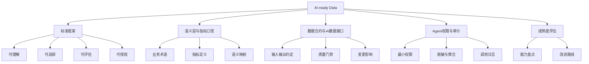

# AI-ready Data专题导览

> [!abstract] 本专题定位
> AI-ready Data 不是“把数据准备好给模型用”这么简单，而是让企业数据具备被 AI、Agent、RAG、Text-to-SQL、智能 BI 安全理解、正确调用、持续评估和可追溯治理的能力。

很多企业做 AI，前期热热闹闹，后期卡在很朴素的地方：数据在哪？口径是什么？谁能访问？文档有没有过期？模型回答错了能不能追溯？Agent 查到明细数据是否越权？

这些问题听起来不如大模型耀眼，却决定了 AI 能不能真正进入业务流程。AI-ready Data 的价值就在这里：它把传统数据治理升级为 AI 时代的数据可用性、可信性和可控性体系。

## 本专题学习地图

## 推荐阅读顺序

1. [[【数据治理与数据管理】/02-深度研究/05-AI数据治理/10-AI-ready Data/01-AI-ready Data标准框架.md|AI-ready Data标准框架]]：先建立整体标准。
2. [[【数据治理与数据管理】/02-深度研究/05-AI数据治理/10-AI-ready Data/02-语义层与指标口径治理.md|语义层与指标口径治理]]：解决 AI 能不能正确理解业务问题。
3. [[【数据治理与数据管理】/02-深度研究/05-AI数据治理/10-AI-ready Data/03-数据合约与AI数据接口.md|数据合约与AI数据接口]]：解决数据如何稳定供给 AI 应用。
4. [[【数据治理与数据管理】/02-深度研究/05-AI数据治理/10-AI-ready Data/04-Agent数据权限与审计.md|Agent数据权限与审计]]：解决 Agent 使用数据的安全边界。
5. [[【数据治理与数据管理】/02-深度研究/05-AI数据治理/10-AI-ready Data/05-AI-ready Data成熟度评估清单.md|AI-ready Data成熟度评估清单]]：用于企业现状评估和项目规划。

## 与现有 AI 数据治理内容的关系

本专题不是替代原有 AI 数据治理内容，而是把它们组织成一套面向企业落地的能力框架：

| 既有内容 | 在 AI-ready Data 中的作用 |
|---|---|
| [[【数据治理与数据管理】/02-深度研究/05-AI数据治理/非结构化数据治理.md\|非结构化数据治理]] | 让文档、图片、合同、客服记录等知识资产可治理 |
| [[【数据治理与数据管理】/02-深度研究/05-AI数据治理/03-大模型数据治理/03-RAG知识库治理.md\|RAG知识库治理]] | 保障检索增强生成中的知识质量和可追溯性 |
| [[【数据治理与数据管理】/02-深度研究/05-AI数据治理/05-AI数据质量管理/01-AI数据质量维度体系.md\|AI数据质量维度体系]] | 定义 AI 数据质量的评估维度 |
| [[【数据治理与数据管理】/02-深度研究/05-AI数据治理/AI-Lineage血缘2.0.md\|AI-Lineage血缘2.0]] | 追踪数据、特征、Prompt、检索片段、模型输出之间的链路 |
| [[【数据治理与数据管理】/02-深度研究/05-AI数据治理/AI-First治理模型.md\|AI-First治理模型]] | 提供面向 AI 的治理组织和运行机制 |

## 适合谁学习

- 数据治理工程师：需要从传统治理升级到 AI-ready Data。
- 数据架构师：需要设计语义层、指标层、数据服务和治理平台。
- 数据开发工程师：需要为 Agent、RAG、Text-to-SQL 提供稳定数据接口。
- 数据产品经理：需要把数据能力包装成可用、可信、可运营的产品。
- AI 应用负责人：需要判断企业数据是否足以支撑 AI 进入生产。

## 一句话判断

如果一个企业的数据只适合“人慢慢查”，但不适合“AI 安全地用”，它就还不是 AI-ready Data。

## 趋势参考

AI-ready Data 属于快速演进领域，建议每季度复查一次。当前判断参考：

- [Gartner - Lack of AI-Ready Data Puts AI Projects at Risk](https://www.gartner.com/en/newsroom/press-releases/2025-02-26-lack-of-ai-ready-data-puts-ai-projects-at-risk)
- [Gartner - Top Data and Analytics Predictions for 2026](https://www.gartner.com/en/newsroom/press-releases/2026-03-11-gartner-announces-top-predictions-for-data-and-analytics-in-2026)
- [NIST - AI Risk Management Framework](https://www.nist.gov/itl/ai-risk-management-framework)
- [ISO/IEC 42001:2023 - AI management systems](https://www.iso.org/standard/42001)

