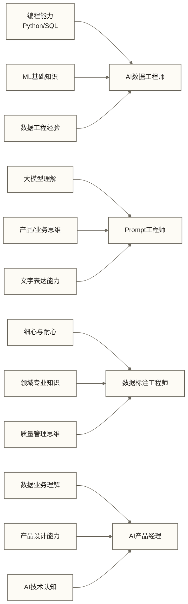

# AI数据岗位全景导览

## 为什么AI系统需要新的数据分工

生成式 AI 在 2022 年进入大众视野，但需要区分两个时间点：ChatGPT 于 2022 年 11 月公开发布，GPT-4 则由 OpenAI 于 **2023 年 3 月 14 日**发布。此前“2022 年底发布 GPT-4”的说法不准确。

岗位数量是否增长、增长多少，取决于招聘平台、地区、检索词和统计周期，不能用一次搜索概括为“翻倍”。更稳定、也更适合复用的判断方式，是从 AI 系统的工作链条识别新增的数据职责。

训练大模型高度依赖数据质量和数据工程。OpenAI 没有在 GPT-4 官方发布材料中披露训练 Token 总量，因此不应把外部估计写成事实；Meta 则公开说明 Llama 3.1 405B 使用了超过 15 万亿 Token 训练。无论具体规模如何，训练数据都需要经过采集、清洗、去重、质量过滤、格式标准化、安全审查和版本管理。

模型进入应用阶段后，同样需要持续的数据工作：

- **RAG系统**需要持续维护高质量的知识库向量数据
- **RLHF微调**需要大量人类偏好标注数据
- **模型监控**需要实时采集和分析模型行为数据
- **A/B测试**需要科学设计和严谨分析实验数据

因此，这份导览不预测“AI 会创造或替代多少岗位”，而是帮助你识别：传统数据能力在训练数据、检索数据、评估数据和模型运营中如何迁移。岗位名称会变，职责链条和可验证的交付物更值得关注。

> [!note] 来源边界
> ChatGPT、GPT-4 与 Llama 3.1 的历史事实来自文末官方来源；本文的岗位分类是便于求职分析的工作框架，不是国家职业分类，也不代表所有公司的组织方式。

---

## 主要AI数据岗位分类

```mermaid
%%{init: {"theme":"base","themeVariables":{"fontFamily":"PingFang SC, -apple-system, Source Han Serif SC, serif","fontSize":"16px","background":"#FDFBF5","primaryColor":"#FDFBF5","primaryTextColor":"#2D2A26","primaryBorderColor":"#6E6A60","secondaryColor":"#E8EFE8","secondaryBorderColor":"#8FA890","secondaryTextColor":"#2D2A26","tertiaryColor":"#FDFBF5","tertiaryBorderColor":"#9A9488","tertiaryTextColor":"#6E6A60","lineColor":"#6E6A60","textColor":"#2D2A26","mainBkg":"#FDFBF5","nodeBorder":"#2D5A3D","clusterBkg":"#F3EEDF","clusterBorder":"#9A9488","edgeLabelBackground":"#FDFBF5"},"flowchart":{"htmlLabels":true,"curve":"basis","padding":20,"nodeSpacing":60,"rankSpacing":70,"useMaxWidth":false},"themeCSS":".node rect, .node polygon, .node circle { stroke-width: 1.5px; } .edgePath .path { stroke-width: 1.5px; } .cluster-label .nodeLabel, .cluster-label foreignObject { color: #2D2A26 !important; } .edgeLabel, .edgeLabel foreignObject { color: #2D2A26 !important; background-color: #FDFBF5; } .edgeLabel rect { fill: #FDFBF5; }"}}%%
graph TD
    classDef default fill:#FDFBF5,stroke:#6E6A60,color:#2D2A26,stroke-width:1.5px
    classDef startend fill:#2D2A26,stroke:#2D2A26,color:#FDFBF5,font-weight:bold
    classDef decision fill:#F6EAD8,stroke:#C08A1A,color:#2D2A26,font-weight:bold
    classDef hub fill:#3B5A80,stroke:#3B5A80,color:#FDFBF5,font-weight:bold
    classDef io fill:#E5EAF0,stroke:#3B5A80,color:#2D2A26
    classDef accent fill:#A6432C,stroke:#A6432C,color:#FDFBF5,font-weight:bold
    classDef storage fill:#F3EEDF,stroke:#9A9488,color:#2D2A26
    A["AI数据相关岗位"] --> B["工程类"]
    A --> C["标注类"]
    A --> D["产品与策略类"]

    B --> B1["AI数据工程师"]
    B --> B2["ML平台数据工程师"]
    B --> B3["向量数据库工程师"]

    C --> C1["数据标注工程师"]
    C --> C2["RLHF标注专家"]
    C --> C3["标注质检与管理"]

    D --> D1["Prompt工程师"]
    D --> D2["AI产品经理-数据方向"]
    D --> D3["AI数据策略分析师"]
    class A,B,C,D,B1,B2,B3,C1,C2,C3,D1,D2,D3 default
```

### AI数据工程师

**一句话定位**：负责为AI/ML系统构建和维护数据基础设施。

这个岗位是传统数据工程师的进化版，但不只是加了"AI"的前缀。核心差异在于工作目标从"支持业务分析"变成了"支持模型训练和推理"。需要理解ML流水线，知道特征存储、数据版本化、训练集管理是怎么一回事。

**识别岗位边界**：如果 JD 同时涉及训练或评估数据管道、数据质量与版本、特征或向量数据、任务编排与可观测性，它更接近 AI 数据工程；如果主要交付仍是报表取数和传统数仓任务，则通常属于通用数据工程岗位。判断时以职责和交付物为准，不只看岗位名称。

### 数据标注工程师

**一句话定位**：负责生产AI训练所需的高质量标注数据。

这个岗位内部差异很大，至少要区分执行标注、领域标注、质量抽检、规则设计和项目管理。不同层级的计价方式也可能是按件、按小时、按月或按项目，不能把它们放在同一个薪资区间比较。

**识别岗位边界**：执行层强调按规则稳定产出；专业层需要领域知识和疑难样本判断；方案层需要定义标签体系、金标准集、一致性指标和返工机制。求职时应确认自己负责的是“生产标签”，还是“设计并治理标注系统”。

### Prompt工程师

**一句话定位**：负责设计、优化和管理AI系统中的提示词工程。

“Prompt 工程师”既可能是独立岗位，也可能只是 AI 产品经理、应用工程师或算法工程师的一项能力。不同公司使用同一名称时，职责可能完全不同。

**识别岗位边界**：如果工作只要求编写提示词，应进一步核验它的长期职责、协作对象和验收产物；如果同时要求上下文设计、工具调用、结构化输出、评估集、版本管理和线上监控，它更接近 AI 应用工程或 LLMOps。求职时应检查交付物，而不是根据标题推断职业路径。

### AI产品经理（数据方向）

**一句话定位**：负责数据/AI产品的规划和落地，需要深刻理解数据价值链。

这个岗位对背景要求较为复合：需要有数据行业经验（知道数据从哪来到哪去）、AI 产品理解（知道大模型的能力边界）和产品设计能力（知道怎么把技术转化为用户价值）。

**识别岗位边界**：重点查看 JD 是否要求定义数据闭环、评估指标、人工兜底、权限与反馈机制。如果只负责常规需求管理，未必属于“数据方向”的 AI 产品岗位。

### ML平台数据工程师

**一句话定位**：负责构建供算法团队使用的机器学习基础设施中的数据层。

这类职责较常见于拥有算法团队或机器学习平台的组织，但岗位名称可能写成 MLOps 工程师、机器学习平台工程师或数据平台工程师。需要理解特征工程、Feature Store、数据版本管理、训练编排和可观测性。不要依据未经分层抽样的百分比推断其薪资溢价。

---

## 从传统数据岗位转AI数据岗位的路径

> [!tip] 转型核心建议
> 不要试图"跨越"到AI领域，而是要"延伸"自己已有的数据能力。你在传统数据岗位积累的SQL优化、数据建模、质量管理经验，在AI数据场景中依然有价值，只需要补充AI特有的知识模块。

### 传统数据分析师 → AI数据策略分析师

**补充学习**：LLM应用评估方法、A/B测试在AI场景的特殊性、模型效果指标体系

**过渡项目**：用现有分析技能做一个模型效果分析报告，展示你能评估AI系统的表现

### 传统数据工程师 → AI数据工程师

**补充学习**：
- 向量检索系统的索引、过滤、召回、权限隔离和评估；具体产品只是实现选项
- 训练与评估数据的版本、血缘、可重复构建和回滚；工具选择服从团队现有平台
- RAG 数据的采集、切分、版本、索引、评测和更新链路；应用框架不是必备能力本身
- 特征存储的离在线一致性、特征复用、时点正确性和常见实现方式

> [!note] 工具名称不是能力标准
> 向量数据库、实验跟踪和应用框架更新很快。求职准备应以“能解释输入、状态、质量门禁和失败模式”为完成标准，再根据目标公司的技术栈选择 Pinecone、Weaviate、Milvus、MLflow、DVC、LangChain 或其他具体工具；不能把熟悉某个品牌直接等同于具备 AI 数据工程能力。

**过渡项目**：搭建一个完整的RAG知识库系统，从数据清洗到向量化入库到检索优化，全流程走通

**转岗完成标准**：不要用固定月数判断是否准备好。至少应能提交一个可运行项目，说明数据来源与授权、清洗和版本策略、检索或特征链路、质量指标、失败样本以及上线监控，并能解释自己在其中承担的决策。

### 传统BI工程师 → Prompt工程师/AI产品经理

**补充学习**：大模型工作原理（不需要很深，但要懂能力边界）、Prompt设计方法论、AI应用产品调研

**可复用能力**：如果已有需求澄清、指标口径设计和数据呈现的交付证据，可以把这些能力迁移到 AI 产品的需求定义与效果评估；仍需补齐模型能力边界、评测集设计和异常兜底。

### 数据产品经理 → AI产品经理（数据方向）

这一路径的能力重叠主要在需求分析、数据产品设计和跨团队交付。转型准备还应补充大模型能力边界、评测方法，以及幻觉处理、不确定性表达和人机协作等 AI 产品设计模式。

---

## 如何制作可比较的岗位与薪资快照

岗位名称、数量和薪资属于高波动信息。本指南不提供一张会迅速失效的“全国行情表”，而提供一套可以重复执行的采样口径。

### 最小采样卡

| 字段 | 必须记录的内容 |
|------|---------------|
| 快照日期 | 招聘信息采集的起止日期 |
| 地区 | 城市、是否远程，不混合不同市场 |
| 平台与检索词 | 使用的招聘平台、岗位关键词及同义词 |
| 样本范围 | 去重后的有效 JD 数量、公司规模和行业 |
| 岗位层级 | 应届、初级、中级、高级分别统计 |
| 薪资口径 | 月薪或年包、发薪月数、奖金和期权是否包含 |
| 统计结果 | 中位数与四分位数，不只报告最高值 |
| 排除规则 | 猎头引流、范围异常、职责不匹配和重复发布 |

### 使用步骤

1. 先按职责定义纳入标准，再检索岗位标题。
2. 人工阅读 JD，剔除“标题含 AI、职责不含 AI 数据工作”的样本。
3. 分城市、经验和公司类型统计，避免直接混算。
4. 把薪资统一到同一口径，并保留样本量。
5. 快照超过三个月时重新采样，不把历史区间当成当前报价。

> [!warning] 解读边界
> 招聘平台展示的是公开职位样本，不等于全部就业市场；JD 数量也不等于实际录用人数。样本量不足时，只报告观察到的范围和限制，不下“需求翻倍”“稳定增长”或“普遍溢价”等结论。

---

## 各岗位能力要求总览

---

## 本指南的结构与使用说明

本求职指南包含以下文档，建议按需阅读：

| 文档 | 适合人群 | 核心价值 |
|------|---------|---------|
| [[【求职就业专题】/07-AI数据岗位求职指南/01-AI数据工程师岗位解析.md\|AI数据工程师岗位解析]] | 有数据工程背景的求职者 | 了解岗位差异、准备面试 |
| [[【求职就业专题】/07-AI数据岗位求职指南/02-Prompt工程师岗位解析.md\|Prompt工程师岗位解析]] | 对AI应用感兴趣的求职者 | 判断转型可行性、规划路径 |
| [[【求职就业专题】/07-AI数据岗位求职指南/03-数据标注工程师的职业可能.md\|数据标注工程师的职业可能]] | 入门级求职者/职业转型者 | 区分岗位层级、规划成长路径 |
| [[【求职就业专题】/07-AI数据岗位求职指南/04-如何用AI工具加速求职.md\|如何用AI工具加速求职]] | 所有求职者 | 实用工具和方法，立即可用 |

### 阅读建议

**如果你是应届生**：先读本文了解全局，再根据自己的专业背景选择1-2个岗位方向深入阅读对应章节。不建议一开始就同时准备多个方向。

**如果你有3年以下数据经验**：重点阅读 [[【求职就业专题】/07-AI数据岗位求职指南/01-AI数据工程师岗位解析.md|AI数据工程师岗位解析]] 和 [[【求职就业专题】/07-AI数据岗位求职指南/04-如何用AI工具加速求职.md|如何用AI工具加速求职]]，明确自己相比 AI 岗位要求的差距，制定补强计划。

**如果你在考虑职业转型**：先读本文的转型路径部分，判断自己的现有技能与目标岗位的匹配度，然后重点阅读目标岗位的解析文档。

**如果你目前就在求职**：直接阅读 [[【求职就业专题】/07-AI数据岗位求职指南/04-如何用AI工具加速求职.md|如何用AI工具加速求职]]，使用其中的工具和模板。若你已经有项目经历，继续看 [[【求职就业专题】/08-AI时代求职与作品集/00-AI时代求职与作品集专题导览.md|AI时代求职与作品集专题导览]]，把项目整理成简历和作品集证据。

> [!note] 关于市场信息
> 本页不再保留缺少样本说明的薪资区间。需要判断当前行情时，请按“岗位与薪资快照”的口径重新采样，并在结论旁记录日期、地区、平台、样本量和统计方式。

---

## 延伸阅读

- [[【求职就业专题】/01-数据分析师求职全攻略/00-数据分析师求职导览.md|数据分析师求职全攻略]] - 传统数据分析师岗位的详细指南
- [[【求职就业专题】/03-数据工程师求职全攻略/00-数据工程师求职导览.md|数据工程师求职全攻略]] - 传统数据工程师转型的参考基础
- [[【求职就业专题】/04-数据产品经理求职全攻略/00-数据产品经理求职导览.md|数据产品经理求职全攻略]] - 数据产品方向的完整攻略
- [[【AI 与大数据】/04-AI工程化/02-LLMOps体系全景.md|LLMOps 体系全景]] - 理解模型应用进入生产后的工作链条
- [[【AI 与大数据】/02-大模型核心/04-RAG检索增强生成实战.md|RAG 检索增强生成实战]] - 补齐检索数据工程能力
- [[【数据治理与数据管理】/02-深度研究/05-AI数据治理/02-训练数据治理/03-训练数据版本控制.md|训练数据版本控制]] - 理解训练数据的可追溯交付物
- [[【技术与工具】/向量数据库/00-向量数据库选型指南.md|向量数据库选型指南]] - 建立工具选型的比较框架

## 官方来源

- [OpenAI：Introducing ChatGPT（2022-11-30）](https://openai.com/index/chatgpt/)
- [OpenAI：GPT-4（2023-03-14）](https://openai.com/index/gpt-4-research/)
- [Meta：Introducing Llama 3.1](https://ai.meta.com/blog/meta-llama-3-1/)

> [!info] 来源性质
> 上述来源只支持模型发布日期、公开训练信息等事实。岗位分类、转岗完成标准和市场采样方法属于本知识库的方法归纳；它们用于分析 JD，不代表官方职业分类或招聘平台统计结论。

#AI岗位 #求职指南 #职业发展 #数据工程 #大模型
