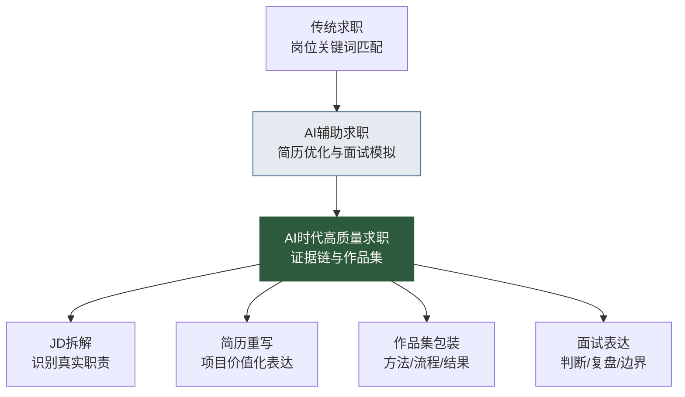

# AI时代求职与作品集专题导览

> [!abstract] 本专题定位
> 这个专题不是教你把简历丢给 AI 改得花团锦簇。那很容易，也很危险。
>
> 真正的 AI 时代求职，是把你的经历重新翻译成招聘方能理解的证据：你会不会用 AI 提效，能不能审查 AI 输出，是否理解数据口径和业务问题，能不能把一次项目沉淀成可复用的方法。

## 为什么要单独做这个专题

我们前面已经补了很多“能力升级”内容：

- [[【学习路线】/AI时代数据人/05-AI时代数据分析师升级路线.md|AI时代数据分析师升级路线]]
- [[【学习路线】/AI时代数据人/10-AI时代数据运营升级路线.md|AI时代数据运营升级路线]]
- [[【学习路线】/AI时代数据人/11-AI时代数据产品经理升级路线.md|AI时代数据产品经理升级路线]]
- [[【学习路线】/AI时代数据人/07-AI时代数据治理工程师升级路线.md|AI时代数据治理工程师升级路线]]

但求职不是把学习路线背下来。求职要回答招聘方三个问题：

1. 你是不是理解这个岗位真正要解决的问题？
2. 你有没有能证明能力的项目证据？
3. 你能不能在面试现场把这些证据讲清楚？

AI 时代更是如此。简历里写“熟练使用 ChatGPT / Copilot / 大模型工具”已经没有区分度。真正有区分度的是：你用 AI 参与了什么流程，识别了什么风险，提升了什么效率，产出了什么可复用资产。

## AI时代求职的核心变化

过去求职，很多人拼的是“我会什么工具”。现在工具会被 AI 快速拉平，招聘方更关心：你能不能把工具放进真实业务流程里，并对结果负责。

## 本专题阅读顺序

| 顺序 | 文档 | 解决的问题 | 推荐读者 |
|---|---|---|---|
| 1 | [[【求职就业专题】/08-AI时代求职与作品集/01-AI时代JD拆解与岗位匹配.md\|AI时代JD拆解与岗位匹配]] | 看懂岗位真正要什么 | 所有求职者 |
| 2 | [[【求职就业专题】/08-AI时代求职与作品集/02-AI时代数据人简历重写方法.md\|AI时代数据人简历重写方法]] | 把经历改写成岗位证据 | 准备投递的人 |
| 2.5 | [[【求职就业专题】/96-简历模板库/00-AI简历模板库导览.md\|AI简历模板库]] | 按岗位套用简历结构与Prompt | 需要快速出简历版本的人 |
| 3 | [[【求职就业专题】/08-AI时代求职与作品集/03-AI项目作品集包装模板.md\|AI项目作品集包装模板]] | 把项目做成可展示作品集 | 转型和跳槽人群 |
| 4 | [[【求职就业专题】/08-AI时代求职与作品集/04-AI时代面试表达与案例讲述.md\|AI时代面试表达与案例讲述]] | 面试时讲清楚项目和判断 | 面试准备阶段 |
| 5 | [[【求职就业专题】/08-AI时代求职与作品集/05-求职材料自检清单.md\|求职材料自检清单]] | 投递前做最终体检 | 所有人 |
| 6 | [[【求职就业专题】/08-AI时代求职与作品集/06-AI时代数据人作品集项目清单.md\|AI时代数据人作品集项目清单]] | 选择适合岗位的作品集项目 | 转型和跳槽人群 |
| 7 | [[【求职就业专题】/08-AI时代求职与作品集/07-如何把AI项目写进简历.md\|如何把AI项目写进简历]] | 把AI项目写成可信简历经历 | 准备投递的人 |

## 本专题和原有求职内容的关系

原有求职专题仍然是底盘：

- 岗位全局入口：[[【求职就业专题】/00-岗位导向求职指南.md|数据从业者岗位导向求职指南]]
- AI岗位入口：[[【求职就业专题】/07-AI数据岗位求职指南/00-AI数据岗位全景导览.md|AI数据岗位全景导览]]
- AI工具求职：[[【求职就业专题】/07-AI数据岗位求职指南/04-如何用AI工具加速求职.md|如何用AI工具加速求职]]
- 作品集路线：[[【学习路线】/AI时代数据人/04-AI时代数据人作品集路线.md|AI时代数据人作品集路线]]
- 简历模板库：[[【求职就业专题】/96-简历模板库/00-AI简历模板库导览.md|AI简历模板库]]

本专题补的是“AI时代版本的求职表达”：让你把前面学到的分析、运营、治理、产品路线，翻译成简历、作品集和面试里的证据。

## 2026新增：作品集项目库与简历表达

这一轮新增两篇内容，专门解决“我知道要做作品集，但不知道做什么、怎么写进简历”的问题：

- [[【求职就业专题】/08-AI时代求职与作品集/06-AI时代数据人作品集项目清单.md|AI时代数据人作品集项目清单]]：给出 AI 辅助业务分析、AI-BI、RAG 治理、Agent-to-Data、轻量分析栈、行业数据专题等项目方向。
- [[【求职就业专题】/08-AI时代求职与作品集/07-如何把AI项目写进简历.md|如何把AI项目写进简历]]：把“AI 项目”翻译成场景、数据、AI 协作、人工审查和业务结果。

## 一条基本原则

> [!warning] 不要用 AI 编造经历
> AI 可以帮你表达真实经历，不能帮你虚构能力。AI 改出来的每一句简历描述，你都必须能在面试中说清楚：背景是什么、你做了什么、方法是什么、结果怎么算、风险在哪里。

## 趋势参考

本专题具有时效性，建议每季度复查一次。当前判断参考了以下公开资料：

- [World Economic Forum - Future of Jobs Report 2025](https://www.weforum.org/press/2025/01/future-of-jobs-report-2025-78-million-new-job-opportunities-by-2030-but-urgent-upskilling-needed-to-prepare-workforces/)
- [U.S. Bureau of Labor Statistics - Data Scientists Outlook](https://www.bls.gov/ooh/math/data-scientists.htm)
- [Microsoft Work Trend Index 2025](https://www.microsoft.com/en-us/worklab/work-trend-index/2025-the-year-the-frontier-firm-is-born)
- [LinkedIn Skills on the Rise 2026](https://news.linkedin.com/2026/Skills-on-the-rise-2026)
