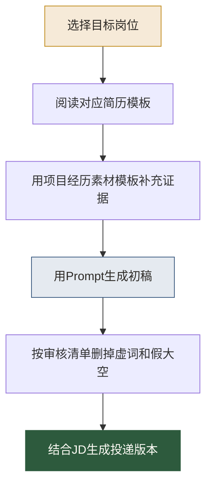

# AI简历模板库导览

> [!abstract] 本库定位
> 这不是一个“把简历包装得更像高手”的模板库。
>
> 它更像一套翻译器：把你的真实经历，翻译成 AI 时代招聘方能看懂的岗位证据。模板负责给你结构，AI 负责帮你打磨表达，但真实性、判断力和项目细节，仍然必须由你负责。

## 具体简历样例 PDF

下面这些不是方法论汇总，而是可以直接打开参考、复用结构的单份简历模板。每一份都包含姓名、联系方式、自我介绍、工作经历和项目经历，并在页眉或页脚标注「大数据领航员 · pro.ss-data.cc」。

- [[【求职就业专题】/96-简历模板库/PDF简历模板/01-AI时代数据分析师简历模板-林一诺.md|AI时代数据分析师简历模板-林一诺]]
- [[【求职就业专题】/96-简历模板库/PDF简历模板/02-AI时代数据运营简历模板-周知夏.md|AI时代数据运营简历模板-周知夏]]
- [[【求职就业专题】/96-简历模板库/PDF简历模板/03-AI时代数据工程师简历模板-陈砚舟.md|AI时代数据工程师简历模板-陈砚舟]]
- [[【求职就业专题】/96-简历模板库/PDF简历模板/04-AI时代数据治理工程师简历模板-许青禾.md|AI时代数据治理工程师简历模板-许青禾]]
- [[【求职就业专题】/96-简历模板库/PDF简历模板/05-AI时代数据产品经理简历模板-顾清言.md|AI时代数据产品经理简历模板-顾清言]]
- [[【求职就业专题】/96-简历模板库/PDF简历模板/06-AI-Data-Analyst简历模板-沈亦舟.md|AI Data Analyst简历模板-沈亦舟]]
- [[【求职就业专题】/96-简历模板库/PDF简历模板/07-Analytics-Engineer简历模板-梁知远.md|Analytics Engineer简历模板-梁知远]]
- [[【求职就业专题】/96-简历模板库/PDF简历模板/08-初级数据分析师AI简历模板-宋小满.md|初级数据分析师AI简历模板-宋小满]]

## 为什么要单独做 AI 简历模板库

传统简历模板通常解决三个问题：排版、关键词、经历描述。AI 时代还多了三个问题：

1. **你是否会把 AI 放进真实工作流**：不是“我用过 ChatGPT”，而是“我让 AI 参与了分析假设生成、SQL 初稿、报告草拟、运营文案变体、数据产品问答等具体环节”。
2. **你是否能审查 AI 的输出**：AI 会一本正经地胡说八道。数据人如果不写“校验、口径、权限、实验、复盘”，简历就容易像会摆弄工具的人，而不是能负责结果的人。
3. **你是否有可复用资产**：岗位不再只看一次项目结果，还看你能不能沉淀指标体系、Prompt 模板、Eval 清单、语义层、数据合约、作品集。

一句话：AI 简历不是把旧经历加上 AI 名词，而是把经历重写成“业务问题 + 数据方法 + AI 协作 + 人的判断 + 可验证结果”。

## 本库怎么使用



建议顺序：

1. 先读 [[【求职就业专题】/08-AI时代求职与作品集/02-AI时代数据人简历重写方法.md|AI时代数据人简历重写方法]]，理解底层方法。
2. 再按岗位选择下面的模板。
3. 如果项目经历太散，先用 [[【求职就业专题】/96-简历模板库/09-AI简历项目经历素材模板.md|AI简历项目经历素材模板]] 整理经历。
4. 最后用 [[【求职就业专题】/96-简历模板库/08-AI简历生成Prompt模板.md|AI简历生成Prompt模板]] 做初稿与版本迭代。

## 当前模板清单

- [[【求职就业专题】/96-简历模板库/01-AI时代数据分析师简历模板.md|AI时代数据分析师简历模板]]：适合数据分析、经营分析、用户分析、商业分析方向。
- [[【求职就业专题】/96-简历模板库/02-AI时代数据运营简历模板.md|AI时代数据运营简历模板]]：适合增长运营、用户运营、活动运营、策略运营方向。
- [[【求职就业专题】/96-简历模板库/03-AI时代数据工程师简历模板.md|AI时代数据工程师简历模板]]：适合数仓、数据开发、实时数仓、数据平台方向。
- [[【求职就业专题】/96-简历模板库/04-AI时代数据治理工程师简历模板.md|AI时代数据治理工程师简历模板]]：适合数据质量、元数据、权限、合规、AI-ready Data 方向。
- [[【求职就业专题】/96-简历模板库/05-AI时代数据产品经理简历模板.md|AI时代数据产品经理简历模板]]：适合 BI 产品、指标平台、数据中台、AI 数据产品方向。
- [[【求职就业专题】/96-简历模板库/06-AI-Data-Analyst简历模板.md|AI Data Analyst 简历模板]]：适合偏 AI 应用分析、Text-to-SQL、智能分析产品运营方向。
- [[【求职就业专题】/96-简历模板库/07-Analytics-Engineer简历模板.md|Analytics Engineer 简历模板]]：适合分析工程、语义层、dbt、指标工程方向。
- [[【求职就业专题】/96-简历模板库/08-AI简历生成Prompt模板.md|AI简历生成Prompt模板]]：用于 JD 拆解、经历重写、关键词对齐、版本生成。
- [[【求职就业专题】/96-简历模板库/09-AI简历项目经历素材模板.md|AI简历项目经历素材模板]]：用于把零散工作整理成可写进简历的项目资产。

## AI 简历的四条红线

> [!warning] 简历可以被 AI 打磨，但不能被 AI 编造
> 面试官不会因为一句漂亮的表达录用你，反而会因为你讲不清楚漂亮表达背后的细节而扣分。

### 1. 不写没有做过的事

没有做过 RAG，就不要写“搭建 RAG 系统”；只是用过 ChatGPT，就不要写“主导 AI Agent 落地”。可以写成：

```text
使用 AI 工具辅助生成分析假设与报告初稿，并对数据口径、样本偏差和因果表述进行人工校验。
```

### 2. 不把 AI 写成主角

简历的主角不是工具，而是你的判断。好的写法应该让招聘方看到：AI 帮了你什么，你又补上了 AI 做不到的哪一块。

### 3. 不堆技术名词

“LLM、RAG、Agent、Embedding、Copilot、Text-to-SQL”这些词本身没有含金量。含金量来自它们进入了哪个流程，解决了哪个问题，产生了什么结果。

### 4. 不隐藏风险控制

AI 时代的数据岗位，越来越重视质量、权限、口径和审计。简历里写出风险控制，反而更像成熟的数据人。

## 相关专题

- [[【求职就业专题】/08-AI时代求职与作品集/00-AI时代求职与作品集专题导览.md|AI时代求职与作品集专题导览]]
- [[【求职就业专题】/07-AI数据岗位求职指南/00-AI数据岗位全景导览.md|AI数据岗位全景导览]]
- [[【学习路线】/AI时代数据人/00-AI时代数据人成长路线.md|AI时代数据人成长路线]]
- [[【学习路线】/AI时代数据人/04-AI时代数据人作品集路线.md|AI时代数据人作品集路线]]

## 趋势参考

本库属于强时效内容，建议每季度复查一次。当前判断参考：

- [World Economic Forum - Future of Jobs Report 2025](https://www.weforum.org/press/2025/01/future-of-jobs-report-2025-78-million-new-job-opportunities-by-2030-but-urgent-upskilling-needed-to-prepare-workforces/)
- [Microsoft Work Trend Index 2025](https://www.microsoft.com/en-us/worklab/work-trend-index/2025-the-year-the-frontier-firm-is-born)
- [LinkedIn Skills on the Rise 2026](https://news.linkedin.com/2026/Skills-on-the-rise-2026)
