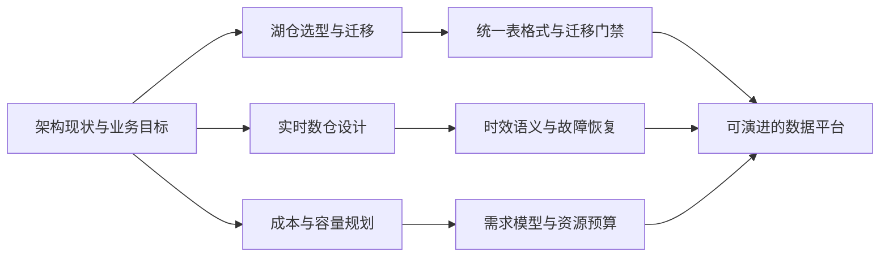

# 数据架构项目库导览

> [!abstract] 这个项目库解决什么问题
> 数据架构能力不是把组件画进一张图，而是在业务目标、数据正确性、性能、成本、组织能力和迁移风险之间作出可解释的决策。本项目库用三个可复刻项目，训练从现状盘点、约束量化、方案比较、验证试点到迁移验收的完整链路。

## 学习目标

完成本项目库后，你应该能够：

1. 把“系统太慢、成本太高、架构太旧”等模糊诉求翻译为可测量的架构质量属性；
2. 用业务适配、生态兼容、运维复杂度、迁移成本和退出成本比较候选方案，而不是只比较功能清单；
3. 为湖仓迁移、实时数仓和容量规划设计基线、试点、回滚与验收证据；
4. 形成架构决策记录、容量模型、数据流图、风险清单和上线门禁等真实交付物；
5. 把项目改写成自己能够演示、复盘并接受追问的作品集。

## 项目地图

| 项目 | 核心问题 | 关键交付物 | 推荐顺序 |
|---|---|---|---|
| [[【项目实战库】/04-数据架构项目库/01-湖仓架构选型与迁移项目.md\|湖仓架构选型与迁移项目]] | 如何选择开放表格式并安全迁移存量数据 | 选型评分卡、PoC 报告、迁移波次、对账与回滚方案 | 1 |
| [[【项目实战库】/04-数据架构项目库/02-实时数仓架构设计项目.md\|实时数仓架构设计项目]] | 如何统一事件时间、状态一致性与实时服务 | 数据流图、事件契约、SLA、故障演练记录 | 2 |
| [[【项目实战库】/04-数据架构项目库/03-数据平台成本与容量规划项目.md\|数据平台成本与容量规划项目]] | 如何让资源预算跟随业务负载并持续校准 | 成本账本、容量模型、压测报告、扩缩容策略 | 3 |

## 可复刻的统一结构

三个项目都沿用同一条交付主线。读者复刻时应替换业务边界和数据样本，但保留决策过程：

1. **项目背景**：写清提出方、受影响链路与为什么现在必须处理；
2. **需求翻译**：把口号变成吞吐、时延、可用性、恢复点、恢复时间、成本和治理约束；
3. **现状基线**：先测当前系统，再谈目标方案，避免没有参照物的“优化”；
4. **架构与选型**：列出候选方案、淘汰条件、权重和证据来源；
5. **实施步骤**：设计最小试点、迁移波次、双跑校验、灰度和回滚；
6. **故障与取舍**：说明一致性、延迟、成本和复杂度之间如何权衡；
7. **验收材料**：交付可重复运行的验证脚本、结果记录、运行手册和决策记录；
8. **面试表达**：只陈述亲自完成且能用证据说明的动作。

## 项目边界与反模式

> [!warning] 架构项目的边界
> 架构师负责明确质量属性、系统边界和决策原则，不应绕过数据所有者替业务定义指标，也不能把工具默认值当成企业标准。涉及安全、合规、跨境和财务口径时，必须由对应责任人确认。

以下情况应先暂停“换架构”：

- 根因只是少数 SQL、分区或任务配置错误，局部修复已经满足目标；
- 没有关键查询、写入与故障恢复样本，PoC 只能演示理想路径；
- 团队没有维护新组件的能力，也没有托管服务或培训计划；
- 数据所有权、指标口径和权限边界尚未明确，技术迁移无法解决管理问题；
- 旧系统没有可验证的退出方案，新旧系统将长期双份建设。

常见反模式包括“先定产品再补评分表”“用峰值资源常驻解决偶发流量”“只测吞吐不测恢复”“上线后才补数据对账”“把预计节省写成已实现收益”。本项目库要求把假设、目标和实测结果分开记录。

## 建议的复刻环境

个人练习不需要搭建企业规模集群。可以使用对象存储兼容服务、Apache Iceberg、Spark 或 Flink、Kafka、分析型数据库与监控工具组成最小环境；数据可由可重复生成的订单事件构成。重点不是组件数量，而是能展示以下证据：

- 同一批输入在迁移前后行数、主键集合与关键聚合一致；
- 延迟事件、重复事件和乱序事件有明确处理结果；
- 节点或作业失败后能够从检查点或重放位置恢复；
- 容量假设能通过压测数据校准，且保留安全余量；
- 任何切换都有停止条件和回滚入口。

复刻过程可结合 [[【项目实战库】/01-项目复刻与简历改写模板.md|项目复刻与简历改写模板]]，基础知识则依次阅读 [[【数据开发与数据架构】/13-技术选型与评估/01-数据技术选型框架.md|数据技术选型框架]]、[[【数据开发与数据架构】/04-数据架构设计/07-数据架构评审.md|数据架构评审]] 与 [[【数据开发与数据架构】/04-数据架构设计/06-数据架构文档化.md|数据架构文档化]]。

## 学习与验收方式

每个项目至少完成一次“设计评审 + 故障演练 + 结果复盘”。架构图只能说明组件关系，不能替代验证。最终作品集建议包含：一页项目摘要、一份架构决策记录、一张数据流或容量图、一份试验记录、一份上线与回滚清单，以及三分钟项目讲述。

### 综合练习

任选一个熟悉的业务域，完成以下任务：

1. 写出三条业务目标和六条可测量质量属性；
2. 画出当前数据流，标注系统边界、数据所有者和故障域；
3. 选择三个候选方案，设置权重并记录淘汰条件；
4. 设计一个一周内可完成的最小试点，包含正常、迟到、重复和故障场景；
5. 写出上线门禁、停止条件、回滚步骤和责任人；
6. 用“假设—证据—决策—结果”的结构完成复盘。

## 相关链接

- [[【数据开发与数据架构】/04-数据架构设计/02-数据架构设计原则.md|数据架构设计原则]]
- [[【数据开发与数据架构】/04-数据架构设计/05-数据架构演进策略.md|数据架构演进策略]]
- [[【数据开发与数据架构】/13-技术选型与评估/02-数据技术选型决策树与评估模型.md|数据技术选型决策树与评估模型]]
- [[【数据开发与数据架构】/13-技术选型与评估/04-技术债务管理方法论.md|技术债务管理方法论]]
- [[【数据开发与数据架构】/11-数据开发运维/06-数据基础设施即代码.md|数据基础设施即代码]]

## 参考资料

- [Apache Iceberg Documentation](https://iceberg.apache.org/docs/latest/)
- [Apache Flink Stable Documentation](https://nightlies.apache.org/flink/flink-docs-stable/)
- [AWS Well-Architected Cost Optimization Pillar](https://docs.aws.amazon.com/wellarchitected/latest/cost-optimization-pillar/welcome.html)
